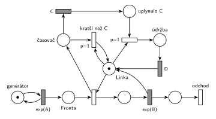

# 04–05 – Údržba po dlouhé obsluze

## Zadání

⚠️ Zadání je známé jen ze stručné vzpomínky studenta.

> M/M/1, kdyz obshuha trvala konstatni dobu C a dyl, tak se pousti udrzba s konstatni dobu D. + SIMLIB

Podle hlavičky souboru u tohoto termínu „Petriho siet a SIMLIB nemuseli byt izomorfne“.

Podobné úlohy:

- [03–11 – Přerušení příliš dlouhé obsluhy](<../03–11 - Přerušení příliš dlouhé obsluhy/03–11 - Přerušení příliš dlouhé obsluhy.md>): dlouhá obsluha se přeruší, tady se dokončí
- [04–04 – Údržba při prázdné frontě](<../04–04 - Údržba při prázdné frontě/04–04 - Údržba při prázdné frontě.md>): o údržbě se také rozhoduje po obsluze

## Interpretace

Zobrazit interpretaci (nápověda)

 

- **Délku obsluhy síť přímo nezná.** Hodnota vylosovaná pro `exp(B)` se nikde neukládá. Proto se s obsazením linky spustí souběžný **časovač**: obsazení dává značku i do místa *časovač* a časovaný přechod `C` ji po C jednotkách přesune do *uplynulo C*.
- **Konec obsluhy** vrací značku *Lince* jako obvykle. V tu chvíli je značka buď ještě v *časovači* (obsluha byla kratší než C), nebo už v *uplynulo C*:
  - *kratší než C* (`p=1`) je k *Lince* připojený testovacími hranami a jen odebere značku *časovače*. Tím odpočet `C` zanikne (slajd 139).
  - druhý přechod (`p=1`) si vezme *Linku* i značku z *uplynulo C* a linka jde na dobu D do *údržby*.
- **Proč `p=1`:** oba přechody se musí provést dřív než obsazení linky dalším zákazníkem (`p=0`). Jinak by údržbu předběhl čekající zákazník, nebo by v *časovači* zůstala stará značka a další obsluha by měla dva časovače.
- „C a déle“: obsluha přesně C má nulovou pravděpodobnost, na rovnosti nezáleží.
- Transakce po obsluze hned odchází, údržbu dělá linka sama. SIMLIB kód z fifinasova streamu nechává transakci čekat i během údržby (`Wait(D)` před `Release`). Na chování linky to nic nemění.
- C a D jsou konstanty, střední doby příchodů a obsluhy nejsou zadány, proto `exp(A)` a `exp(B)`. SIMLIB část otázky tu není řešená.

## Petriho síť

Zobrazit Petriho síť

 

| Požadavek | Prvek sítě |
|---|---|
| M/M/1 | *generátor* ⇄ `exp(A)` → *Fronta* → obsazení *Linky* → `exp(B)` (vrací *Linku*) → *odchod* |
| měření délky obsluhy | obsazení → *časovač* → `C` → *uplynulo C* |
| obsluha kratší než C: nic | *kratší než C* (`p=1`): *časovač* + test *Linky* |
| obsluha aspoň C: údržba D | `p=1`: *uplynulo C* + *Linka* → *údržba* → `D` → *Linka* |
| transakce opouští systém | *odchod* |

Kontrola simulací: *Linka* + obsluha + *údržba* = 1 a *časovač* + *uplynulo C* = obsluha (časovač běží právě během obsluhy). Obě větve se provádějí, fronta zůstává krátká.

## Časté chyby

Zobrazit časté chyby

 

- Pokus porovnat „výsledek `exp(B)`“ s C přímo v síti. Síť umí jen časovat, potřebuje souběžný časovač.
- Časovač, který se po krátké obsluze nezruší. Zůstane běžet a spustí údržbu po některé z dalších obsluh.
- Časovač `C` napojený přímo na místo obsluhy bez návratu značky: po C jednotkách obsluhu ukončí (to je jiná úloha, [03–11 – Přerušení příliš dlouhé obsluhy](<../03–11 - Přerušení příliš dlouhé obsluhy/03–11 - Přerušení příliš dlouhé obsluhy.md>)).
- Údržba bez priority vůči obsazení: čekající zákazník může linku dostat dřív než údržba.

## Původ a zdroje

Zobrazit původ a zdroje

 

**Původ:** zkouška 2021/22, 1. termín, skupina D, otázka 1 (body neuvedeny).

**Zdroje:**

- `Fitcheats/Zkoušky z minulých let/2021-22 - 1. termín.txt`, „D skupina“, otázka 1 (vzpomínka studenta)
- `Fitcheats/Příprava na zkoušku/fifinas - Tabule ze streamu.pdf`, str. 5 („D) M/M/1, pokud obsluha ≥ C, pak údržba D“: síť a SIMLIB kód z tabule)

**Existující řešení:**

- **fifinas, str. 5:** stejný nápad se souběžným časovačem („Timer C“). Obsazení dává značku do obsluhy i do časovače, `Exp(b)` vede do místa za obsluhou. Toto místo + uplynulý časovač → `D` → linka, zeleně toto místo + neuplynulý časovač → linka. Linka se tu nevrací z `Exp(b)`, ale až z rozhodovacích přechodů, které spojí značku transakce se značkou časovače do jedné značky linky. **Chybí výstupní přechod**, transakce v síti nikde neodchází. Priority nejsou potřeba, obě větve jsou vzájemně výlučné. SIMLIB kód na téže straně (po obsluze `if (wait >= C) Wait(D);`, až pak `Release`) odpovídá variantě, kdy transakce drží linku i během údržby.

