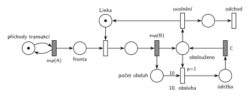

# 04–06 – Údržba po každé 10. obsluze

## Zadání

⚠️ Fotka zadání je hodně rozmazaná. Znění je přečtené z ní a ověřené ručním přepisem na str. 4 („M/M/1, kde transakce po každé 10 dokončené obsluze navíc zařadí blok údržby linky trvající C časových jednotek.“).

> 1. (15 bodů) Nakreslete Petriho síť pro systém M/M/1, kde transakce po každé desáté dokončené obsluze navíc zařadí blok údržby linky trvající přesně C časových jednotek. S využitím notace knihovny SIMLIB napište pseudokód všech nezbytných částí simulačního modelu. Dbejte na izomorfní vztah mezi oběma modely.

Podobné úlohy:

- [04–02 – Automat na kávu – údržba po 50 obsluhách](<../04–02 - Automat na kávu – údržba po 50 obsluhách/04–02 - Automat na kávu – údržba po 50 obsluhách.md>): údržbu dělá automat po uvolnění
- [03–07 – Každá 10. transakce vyvolá poruchu](<../03–07 - Každá 10. transakce vyvolá poruchu/03–07 - Každá 10. transakce vyvolá poruchu.md>)
- [04–07 – Údržbář na obchůzce](<../04–07 - Údržbář na obchůzce/04–07 - Údržbář na obchůzce.md>): stejný termín, skupina C
- [10–01 – Server s údržbou po 1000 požadavcích](<../10–01 - Server s údržbou po 1000 požadavcích/10–01 - Server s údržbou po 1000 požadavcích.md>)

## Interpretace

<details>
<summary>Zobrazit interpretaci (nápověda)</summary>
<br>

- **M/M/1:** *příchody transakcí* ⇄ `exp(A)` → *fronta* → obsazení *Linky* → `exp(B)` → *obslouženo* → *uvolnění* (vrací *Linku*) → *odchod*. Střední doby příchodů a obsluhy zadání neuvádí, proto `exp(A)` a `exp(B)`.
- **Údržbu „zařadí transakce“:** desátá transakce po své obsluze linku neuvolní, ale drží ji ještě C jednotek na údržbu a teprve pak ji uvolní a odchází. V SIMLIBu tedy transakce po obsluze započítá obsluhu a při desáté čeká C ještě před uvolněním linky. Izomorfní síť proto má uvolnění linky jako samostatný přechod *uvolnění* až po rozhodnutí o údržbě.
- **Čítač:** `exp(B)` dává značku do *počtu obsluh*. Přechod *10. obsluha* má z čítače hranu s váhou 10, takže se provede po každé desáté obsluze a čítač vynuluje. Transakci přesune z *obslouženo* do *údržby*.
- **Priorita `p=1`:** po obsluze je proveditelné i *uvolnění*. Priorita zajistí, že desátá transakce opravdu půjde do údržby.
- Po údržbě (`C`, pevná doba) se transakce vrátí do místa *obslouženo*. Čítač je už prázdný, takže proběhne *uvolnění* a transakce **opouští systém** přechodem *odchod*.
- Druhá přípustná varianta: `exp(B)` vrací *Linku* jako obvykle a údržbu jako samostatný přechod s `p=1` spustí čítač (jako v [04–02](<../04–02 - Automat na kávu – údržba po 50 obsluhách/04–02 - Automat na kávu – údržba po 50 obsluhách.md>)). Linka je pak stejně dlouho mimo provoz, jen desátá transakce odchází hned. Izomorfní SIMLIB je ale složitější (proces údržby, který linku obsadí dřív než čekající transakce).

</details>

## Petriho síť

<details>
<summary>Zobrazit Petriho síť</summary>
<br>



</details>

## Časté chyby

<details>
<summary>Zobrazit časté chyby</summary>
<br>

- Hrana z čítače bez váhy 10, nebo jen testovací hrana s váhou 10, která čítač nevynuluje.
- Údržba bez priority vůči uvolnění (nebo vůči obsazení ve variantě s vracením linky): údržba se může posunout k pozdější obsluze.
- Linka vrácená z `exp(B)` a zároveň držená během údržby: vzniknou dvě značky linky.
- SIMLIB, který neodpovídá síti (např. údržba až po uvolnění linky, kdy už ji drží další transakce, zatímco síť ji drží během údržby).

</details>

## SIMLIB

<details>
<summary>Zobrazit SIMLIB kód</summary>
<br>

Model je izomorfní k Petriho síti výše: každé místo, přechod a značka mají svůj protějšek v kódu.

```cpp
// 04–06 Údržba po každé 10. obsluze – model v SIMLIB/C++
#include "simlib.h"

const double A = 10;                   // střední interval příchodů (zadání ho neuvádí)
const double B = 6;                    // střední doba obsluhy (zadání ji neuvádí)
const double C = 20;                   // doba údržby

Facility Linka("Linka");               // místo „Linka“ (1 značka) + fronta
Histogram Doba("Doba transakce v systému [č. j.]", 0, 5, 20);
int pocet = 0;                         // místo „počet obsluh“ (čítač)
int obsluh = 0, udrzeb = 0;            // počet obsluh a údržeb

class Transakce : public Process {     // transakce = značka, která prochází sítí
  void Behavior() {
    double prichod = Time;
    Seize(Linka);                      // fronta + obsazení
    Wait(Exponential(B));              // časovaný přechod exp(B) → „obslouženo“
    obsluh++;
    if (++pocet == 10) {               // ... a značka do čítače; „10. obsluha“ (p=1,
      pocet = 0;                       //   hrana s váhou 10) čítač vynuluje
      udrzeb++;
      Wait(C);                         // místo „údržba“ + časovaný přechod C → „obslouženo“
    }
    Release(Linka);                    // přechod „uvolnění“ vrací značku linky
    Doba(Time - prichod);
  }                                    // konec Behavior = přechod „odchod“
};

class Generator : public Event {       // místo „příchody transakcí“ ve smyčce s exp(A)
  void Behavior() {
    (new Transakce)->Activate();       // nová značka v místě „fronta“
    Activate(Time + Exponential(A));   // další příchod
  }
};

int main() {
  Init(0, 100000);                     // modelový čas v časových jednotkách
  (new Generator)->Activate();
  Run();
  Linka.Output();                      // vytížení = obsluha + údržba
  Doba.Output();
  Print("Obsluh: %d, údržeb: %d\n", obsluh, udrzeb);
}
```

| Petriho síť | SIMLIB |
|---|---|
| *příchody transakcí* ⇄ `exp(A)` | událost `Generator`, která se znovu plánuje za `Exponential(A)` |
| značka (transakce) | proces `Transakce` |
| *fronta* + obsazení linky | `Seize(Linka)` (fronta je vnitřní fronta zařízení) |
| místo *Linka* (1 značka) | `Facility Linka` |
| `exp(B)` → *obslouženo* + *počet obsluh* | `Wait(Exponential(B));` a `++pocet` |
| *10. obsluha* (`p=1`, hrana s váhou 10) | `if (++pocet == 10) pocet = 0;` (rozhoduje se před uvolněním) |
| *údržba* → `C` → *obslouženo* | `Wait(C);` ještě před `Release` |
| *uvolnění* | `Release(Linka);` |
| přechod *odchod* | konec metody `Behavior()` |

**Kontrola simulací.** Petriho síť: *Linka* + obsluha + *obslouženo* + *údržba* = 1, v čítači je nejvýš 10 značek, údržba proběhla přesně po každé desáté obsluze (9 523 údržeb na 95 237 obsluh), fronta zůstává omezená (`make check`). SIMLIB model: v jednom běhu (100 000 č. j.) proběhlo 10 048 obsluh a 1 004 údržeb. Linka byla obsazená 81 % času; teoreticky 60 % obsluha (B/A = 6/10) + 20 % údržba (C = 20 jednotek na 10 × 10 = 100 jednotek provozu) = 80 % (`make simlib`).

</details>

## Původ a zdroje

<details>
<summary>Zobrazit původ a zdroje</summary>
<br>

**Původ:** zkouška 2022/23, 1. termín (11. 1. 2023), skupina D, otázka 1, 15 bodů.

**Původní znění:**

> 1. (15 bodů) Nakreslete Petriho síť pro systém M/M/1, kde transakce po každé desáté dokončené obsluze navíc zařadí blok údržby linky trvající C časových jednotek. S využitím notace knihovny SIMLIB napište pseudokód všech nezbytných částí simulačního modelu. Dbejte na izomorfní vztah mezi oběma modely.

**Zdroje:**

- `Fitcheats/Zkoušky z minulých let/2022-23 - 1. termín D.pdf`, str. 1 (malá rozmazaná fotka zadání) a str. 4 (ručně psaný přepis celé písemky)

**Existující řešení:**

- Ve zdrojích není žádné řešení této otázky.

</details>
