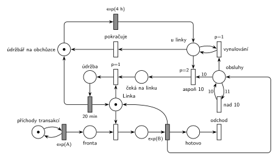

# 04–07 – Údržbář na obchůzce

## Zadání

> 1. (15 bodů) Modelujte zadaný systém Petriho sítí s vyznačením všech relevantních parametrů. Napište simulační model systému prostředky knihovny SIMLIB, který je izomorfní k modelu v Petriho síti.
>
> Uvažujme systém M/M/1. V systému pracuje jeden údržbář, který se v intervalech exp(4 hodiny) vrací k této obslužné lince. Pokud v okamžiku jeho příchodu bylo dokončeno alespoň 10 obsluh od jeho poslední návštěvy u linky, pak počká na dokončení případné právě prováděné obsluhy a zahájí na lince údržbu trvající 20 minut. Jinak pokračuje ve své obchůzce.

Podobné úlohy:

- [04–06 – Údržba po každé 10. obsluze](<../04–06 - Údržba po každé 10. obsluze/04–06 - Údržba po každé 10. obsluze.md>): stejný termín, skupina D
- [04–02 – Automat na kávu – údržba po 50 obsluhách](<../04–02 - Automat na kávu – údržba po 50 obsluhách/04–02 - Automat na kávu – údržba po 50 obsluhách.md>)

## Interpretace

Zobrazit interpretaci (nápověda)

 

- **Údržbář** je jedna značka, která obíhá: *na obchůzce* → `exp(4 h)` → *u linky* → (údržba, nebo nic) → zpět *na obchůzku*.
- **Čítač obsluh:** `exp(B)` dává značku do místa *obsluhy*. Víc než 10 si pamatovat netřeba („alespoň 10“), proto přechod *nad 10* (hrana s váhou 11 tam, 10 zpět) každou jedenáctou značku hned zahodí. V čítači je tak vždy 0 až 10 značek.
- **Rozhodnutí u linky** (tři okamžité přechody, vyšší priorita má přednost):
  - *aspoň 10* (`p=2`) odebere 10 značek, tedy celý čítač, a údržbář jde *čekat na linku*;
  - *vynulování* (`p=1`, testovací hrany na *u linky*) odebírá zbytek čítače po jedné, když je obsluh méně než 10;
  - *pokračuje* (`p=0`) vrátí údržbáře na obchůzku, až je čítač prázdný.
  
  Čítač se tedy nuluje při každé návštěvě, i když údržba neproběhne: „od jeho poslední návštěvy“ počítá i návštěvu bez údržby.
- **Počká na dokončení probíhající obsluhy:** údržbář si linku bere obyčejným obsazením, takže probíhající obsluhu nepřeruší. Obsazení údržbářem má `p=1`, proto po skončení obsluhy dostane linku on, ne další zákazník z fronty.
- Obsluhy dokončené v době, kdy údržbář čeká na linku, se počítají už do další návštěvy.
- Časy jsou v minutách: `exp(4 h)` = exp(240 min), údržba `20 min`. Střední doby příchodů a obsluhy zadání neuvádí, proto `exp(A)` a `exp(B)`. SIMLIB část otázky tu není řešená.

## Petriho síť

Zobrazit Petriho síť

 

| Požadavek | Prvek sítě |
|---|---|
| M/M/1 | *generátor* ⇄ `exp(A)` → *Fronta* → obsazení *Linky* → `exp(B)` (vrací *Linku*) → *odchod* |
| počet dokončených obsluh | `exp(B)` → *obsluhy* (nejvýš 10, přechod *nad 10*) |
| údržbář se vrací v intervalech exp(4 h) | *údržbář na obchůzce* → `exp(4 h)` → *u linky* |
| aspoň 10 obsluh → údržba | *aspoň 10* (`p=2`): *u linky* + 10 × *obsluhy* → *čeká na linku* |
| jinak pokračuje, čítač se nuluje | *vynulování* (`p=1`), *pokračuje* → *údržbář na obchůzce* |
| počká na konec obsluhy, údržba 20 min | `p=1`: *čeká na linku* + *Linka* → *údržba* → `20 min` → *Linka* + *údržbář na obchůzce* |
| transakce opouští systém | *odchod* |

Kontrola simulací: *Linka* + obsluha + *údržba* = 1, údržbář je vždy na právě jednom místě, v čítači je nejvýš 10 značek. Údržbář přichází v průměru po 4 h a asi při 70 % návštěv údržbu provede.

## Časté chyby

Zobrazit časté chyby

 

- Údržba, která probíhající obsluhu přeruší. Zadání chce počkat na její dokončení.
- Údržbář bez priority při obsazení linky: po skončení obsluhy dostane linku další zákazník a údržbář čeká na prázdnou frontu.
- Čítač, který se nuluje jen po údržbě. Návštěva bez údržby je také návštěva.
- Hrana s váhou 10 z čítače bez vynulování zbytku: obsluhy nad 10 by se přenesly do další návštěvy.
- Údržbář, který se po údržbě nevrátí na obchůzku.

## Původ a zdroje

Zobrazit původ a zdroje

 

**Původ:** zkouška 2022/23, 1. termín (11. 1. 2023, 16:00–17:30), skupina C, otázka 1, 15 bodů.

**Zdroje:**

- `Fitcheats/Zkoušky z minulých let/2022-23 - 1. termín C.pdf`, str. 1 (fotka zadání, pravá polovina)
- `Fitcheats/Příprava na zkoušku/cranycrane - Kódy (generátory, Monte Carlo, Euler, RK, Petri + SIMLIB)/petri/8.png` a `8.cpp` (studentská síť a SIMLIB kód)

**Existující řešení:**

- **cranycrane, 8.png:** `exp(B)` vede do čítače a do místa za obsluhou, odkud se linka vrací okamžitým přechodem. Údržbu spouští přechod `P=2`, který potřebuje údržbáře u linky, 10 značek z čítače **a značku z místa za obsluhou**. Chyby:
  - Značka v místě za obsluhou existuje jen na okamžik (hned ji převezme přechod zpět k lince), a údržbář u linky nečeká (hned ho odvede `P=1` a přechod bez priority). Údržba tak proběhne jen tehdy, když údržbář přijde přesně v okamžiku konce obsluhy, tedy prakticky nikdy. Nefunguje ani případ, kdy je linka při jeho příchodu volná.
  - Přechod `20` vrací jen linku, ne údržbáře. Po první údržbě by údržbář ze sítě zmizel.
  - Správně je vynulování čítače přechodem `P=1` s testovacími hranami na údržbáři.
- **cranycrane, 8.cpp:** podmínka `counter == 10` místo „alespoň 10“ (při více obsluhách se údržba neprovede), `Wait(Exponential(4))` a `Wait(20)` v nesouladu jednotek (hodiny a minuty). Nastavení `Priority = 100` před `Seize` je správný nápad: údržbář dostane linku před čekajícími zákazníky.

