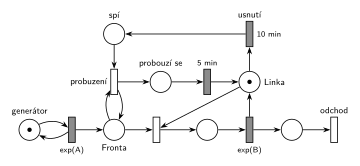

# 04–08 – Spánek po nečinnosti

**Původ:** zkouška 2022/23, 2. termín (v hlavičce přepisu „IMS 1.op. F: 2023“), skupina F, otázka 2, 10 bodů.

**Zdroje:**

- `Fitcheats/Zkoušky z minulých let/2022-23 - 2. termín F.pdf`, str. 1 a 2 (dva ručně psané přepisy zadání od různých studentů)

## Zadání

⚠️ Zadání je známé jen ze dvou vzpomínek studentů. Autor souboru píše: „Zadania máme dve. Neviem, ktoré je presnejšie, tak tu nechám obe.“

> ② Petriho sítě M/M/1, linka po 10m nečinnosti jde do spacího režimu, z režimu spaní ji probudí přích. požad. a trvá 5 min než se stane dostupnou.

Druhý přepis (str. 2): „M/M/1 – po 10min nečinnosti se uspí, probudí ji požadavek 5 min po svém příchodu.“

Podobné úlohy:

- [10–02 – Výpočetní služba se spánkem](<../10–02 - Výpočetní služba se spánkem/10–02 - Výpočetní služba se spánkem.md>): stejný mechanismus (200 s a 5 s)
- [04–03 – Automat na kávu – uspání](<../04–03 - Automat na kávu – uspání/04–03 - Automat na kávu – uspání.md>): probuzení prodlouží obsluhu
- [04–01 – Automat na kávu – údržba po nečinnosti](<../04–01 - Automat na kávu – údržba po nečinnosti/04–01 - Automat na kávu – údržba po nečinnosti.md>)
- [09–09 – Trafika](<../09–09 - Trafika/09–09 - Trafika.md>)

## Interpretace

Zobrazit interpretaci (nápověda)

- **Nečinnost** = linka nic neobsluhuje a nikdo nečeká, tedy značka je v místě *Linka*. Časovaný přechod `10 min` (*usnutí*) má jediný vstup, *Linku*. Obsazení si značku vezme a odpočet zanikne (slajd 139). Po každé obsluze začíná znovu od nuly.
- **Linka má čtyři stavy** a její značka je vždy v právě jednom: volná (*Linka*), obsluhuje, *spí*, *probouzí se*.
- **Probuzení příchozím požadavkem:** okamžitý přechod potřebuje značku *spí* a požadavek ve *Frontě*. K *Frontě* je připojený testovacími hranami (tam a zpět), takže požadavek ve frontě zůstane.
- **5 min, než je linka dostupná:** *probouzí se* → `5 min` → *Linka*, teprve pak požadavek linku obsadí. Linka je tedy dostupná 5 min po příchodu požadavku, který ji probudil (to říká i druhý přepis). Požadavky, které přijdou mezitím, čekají ve *Frontě*.
- Doby 10 a 5 min jsou pevné. Střední doby příchodů a obsluhy zadání neuvádí, proto `exp(A)` a `exp(B)`.

## Řešení

Zobrazit řešení

| Požadavek | Prvek sítě |
|---|---|
| M/M/1 | *generátor* ⇄ `exp(A)` → *Fronta* → obsazení *Linky* → `exp(B)` (vrací *Linku*) → *odchod* |
| po 10 min nečinnosti spánek | *Linka* → `10 min` (*usnutí*) → *spí* |
| probuzení příchozím požadavkem | *probuzení*: *spí* + test *Fronty* → *probouzí se* |
| 5 min, než je linka dostupná | *probouzí se* → `5 min` → *Linka* |
| transakce opouští systém | *odchod* |

Kontrola simulací: *Linka* + obsluha + *spí* + *probouzí se* = 1. Linka usíná a probouzí se, fronta zůstává krátká.

## Existující řešení

Zobrazit srovnání s existujícími řešeními

- Ve zdrojích není žádné řešení. Stejná síť (jen s jinými časy) je v řešení půlsemestrálky [10–02 – Výpočetní služba se spánkem](<../10–02 - Výpočetní služba se spánkem/10–02 - Výpočetní služba se spánkem.md>).

## Časté chyby

Zobrazit časté chyby

- Časovač nečinnosti na *Frontě* nebo na generátoru místo na volné lince.
- Probuzení obyčejnou hranou z *Fronty* bez návratu: požadavek, který linku probudil, zmizí a nikdy není obsloužen. (Pokud místo toho rovnou obsadí linku, jako v [04–03](<../04–03 - Automat na kávu – uspání/04–03 - Automat na kávu – uspání.md>), je to v pořádku.)
- Spící linka, kterou probudí sám čas, ne příchod požadavku.
- Probouzení, které nevrací značku do *Linky* (linka zůstane nedostupná).

