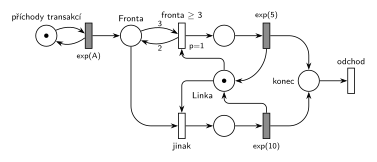

# Doba obsluhy podle délky fronty

## Zadání

⚠️ Původní zadání se nedochovalo, jen studentské přepisy:

> Petriho síť (M/M/1 kde trvání 5 časových jednotek pokud je fronta >=3 jinak 10 časových jednotek)

Řešené výpočetní příklady, str. 31: „Petriho síť (M/M/1 kde trvání dalsi obsluhy je 5 jednotek pokud jsou alespoň 3 transakce ve frontě, jinak 10 jednotek)“.

2019/20 (slovensky): „Nakreslit petriho siet M/M/1 kde linka obsluhuje 5jedotiek ak je vo fronte >= X procesov (presne takto to tam bolo formulovane) a inak obsluha trva 10jednotiek.“

Podobné úlohy: [Centrum MM1 s rychlým režimem](<../../09 - Obsluha zákazníků/04 - Centrum MM1 s rychlým režimem/04 - Centrum MM1 s rychlým režimem.md>) (rychlý režim podle délky fronty, Hrubého řešení), [Interval příchodů podle délky fronty](<../04 - Interval příchodů podle délky fronty/04 - Interval příchodů podle délky fronty.md>) (podle fronty se mění příchody), [MD3 – poslední volné zařízení](<../../06 - Doba obsluhy podle stavu/03 - MD3 – poslední volné zařízení/03 - MD3 – poslední volné zařízení.md>) (doba obsluhy podle stavu linek).

## Interpretace

<details>
<summary>Zobrazit interpretaci (nápověda)</summary>
<br>

- **M/M/1:** *příchody transakcí* ⇄ `exp(A)` → *fronta* → obsazení *Linky* → obsluha, která *Linku* vrací. Interval příchodů zadání neuvádí, proto `exp(A)`.
- **Kdy se rozhoduje:** při zahájení obsluhy („trvání další obsluhy“). Probíhající obsluhu pozdější změna fronty nemění. Proto jsou tu dvě obsazení *Linky*, každé s vlastní obsluhou.
- **Test fronty v obsazení:** *fronta ≥ 3* bere z *fronty* 3 značky a 2 vrací. Odebere tedy jednu transakci a zároveň ověří, že jich ve frontě byly aspoň 3. Priorita `p=1` zajistí, že při dlouhé frontě vyhraje rychlá obsluha `exp(5)`. *Jinak* (`p=0`, obsluha `exp(10)`) se provede jen tehdy, když rychlá větev proveditelná není.
- **Kdo se počítá do fronty:** tady i transakce, která právě linku obsazuje (v tu chvíli je ještě ve *frontě*). Tak to kreslí i obě studentská řešení. Kdo počítá jen ty, kdo po zahájení obsluhy dál čekají, dá váhy 4 a 3. Zadání to nerozlišuje, u zkoušky stačí zvolené čtení napsat.
- **exp(5), nebo 5?** Systém je M/M/1, obsluha je tedy exponenciální a 5 a 10 jsou střední hodnoty. Konstantní doba by znamenala M/D/1. Kdo čte zadání doslova, napíše `5` a `10`, struktura sítě zůstane stejná.
- **Linka** leží mezi oběma řadami: zespodu vede do *fronta ≥ 3*, shora do *jinak*. Obě obsluhy ji vracejí (uvolnění sloučené s časovaným přechodem).
- Obě větve se slévají v místě *konec* a transakce opouští systém přechodem *odchod*.

</details>

## Petriho síť

<details>
<summary>Zobrazit Petriho síť</summary>
<br>



</details>

## Časté chyby

<details>
<summary>Zobrazit časté chyby</summary>
<br>

- Test fronty jedinou hranou s váhou 3 bez zpětné hrany: obsazení by z fronty odebralo tři transakce.
- Obě obsazení bez priority: při dlouhé frontě by se náhodně vybírala i pomalá obsluha.
- Volba doby obsluhy už při příchodu (rozdělení před *frontou*): o době pak rozhoduje fronta v okamžiku příchodu, ne při zahájení obsluhy.
- Přepínání doby obsluhy během probíhající obsluhy (test fronty napojený na časovaný přechod).

</details>

## SIMLIB

<details>
<summary>Zobrazit SIMLIB kód</summary>
<br>

Model je izomorfní k Petriho síti výše: každé místo, přechod a značka mají svůj protějšek v kódu. Hodnota `A = 7` je doplněná, zadání ji nedává. O délce obsluhy se rozhoduje hned po `Seize`, jako v síti při obsazení. Transakce, která linku právě obsadila, už ve frontě zařízení není, proto se k `QueueLen()` přičítá 1.

```cpp
// Doba obsluhy podle délky fronty – model v SIMLIB/C++
#include "simlib.h"

const double A = 7;                    // střední interval příchodů exp(A), zadání ho nedává

Facility Linka("Linka");               // místo Linka s jednou značkou
int rychlych = 0, beznych = 0;         // počty provedení přechodů „fronta ≥ 3“ a „jinak“

class Transakce : public Process {     // transakce = značka, která prochází sítí
  void Behavior() {
    Seize(Linka);                      // Fronta + obsazení Linky (oba přechody berou její značku)
    if (Linka.QueueLen() + 1 >= 3) {   // fronta ≥ 3 (p=1): čekající + tato transakce
      rychlych++;
      Wait(Exponential(5));            // časovaný přechod exp(5) ...
    } else {                           // jinak (p=0)
      beznych++;
      Wait(Exponential(10));           // časovaný přechod exp(10) ...
    }
    Release(Linka);                    // ... který vrací značku Lince
  }                                    // konec Behavior = konec + odchod
};

class Generator : public Event {       // místo „příchody transakcí“ ve smyčce s exp(A)
  void Behavior() {
    (new Transakce)->Activate();       // nová značka ve Frontě
    Activate(Time + Exponential(A));   // další příchod
  }
};

int main() {
  Init(0, 1000000);                    // modelový čas v časových jednotkách
  (new Generator)->Activate();
  Run();
  Linka.Output();
  Print("Rychlých obsluh exp(5): %d, běžných exp(10): %d (rychlých %.1f %%)\n",
        rychlych, beznych, 100.0 * rychlych / (rychlych + beznych));
}
```

| Petriho síť | SIMLIB |
|---|---|
| *příchody transakcí* ⇄ `exp(A)` | událost `Generator`, která se znovu plánuje za `Exponential(A)` |
| značka (transakce) | proces `Transakce` |
| *fronta* + obsazení *Linky* (oba přechody) | `Seize(Linka)` (fronta je vnitřní fronta zařízení) |
| místo *Linka* (1 značka) | `Facility Linka` |
| *fronta ≥ 3* (`p=1`): z *fronty* 3, zpět 2 | `if (Linka.QueueLen() + 1 >= 3)` hned po `Seize` |
| *jinak* (`p=0`) | větev `else` |
| `exp(5)` / `exp(10)` se sloučeným uvolněním | `Wait(Exponential(5))` / `Wait(Exponential(10))` a pak `Release(Linka)` |
| *konec* → *odchod* | konec metody `Behavior()` |

**Kontrola simulací.** Petriho síť: *Linka* + obsluhovaná transakce = 1, všechny přechody se provádějí, fronta zůstává omezená (`make check`); při `A = 7` je asi 70 % obsluh rychlých a fronta má nejvýš kolem 26 čekajících. SIMLIB model: v jednom běhu (10⁶ časových jednotek) bylo rychlých 70,0 % obsluh, linka byla vytížena na 93,3 % a fronta měla nejvýš 30 čekajících. Vytížení odpovídá teorii: (1/7) · (0,7 · 5 + 0,3 · 10) = 92,9 % (`make simlib`).

</details>

## Původ a zdroje

<details>
<summary>Zobrazit původ a zdroje</summary>
<br>

**Původ:** zkouška 2020/21, 1. termín, skupina v 10:00, otázka 2 (body neuvedené). Stejná úloha (obecné X místo 3): zkouška 2019/20, 1. termín, neznámá skupina, otázka 4, 10 bodů.

**Původní znění:**

> Petriho síť (M/M/1 kde trvání 5 pokud je fronta >=3 jinak 10)

**Zdroje:**

- `Fitcheats/Zkoušky z minulých let/2020-21 - 1. termín.txt`, skupina 10:00, otázka 2 (studentský přepis zadání)
- `Fitcheats/Zkoušky z minulých let/2019-20 - 1. termín.txt`, „Skupina ?“, otázka 4 (studentský přepis zadání)
- `Fitcheats/Příprava na zkoušku/FIT - Řešené výpočetní příklady 2017-21.pdf`, str. 15 (varianta s X: studentské řešení s komentáři) a str. 31–32 („2021 - Řádný 10:00“: studentské řešení)

**Existující řešení:**

- **Řešené výpočetní příklady, str. 15 (varianta s X):** stejná síť. Přechod *P1* má hranu *x* z fronty a *x−1* zpět a obsazuje linku, druhé obsazení je bez priority. Obsluhy `exp(5)` a `exp(10)` vracejí linku, výstupní přechod je společný. Pod řešením je spor, zda nemá být jen `5` místo `exp(5)`. Odpověď „je to M/M/1 … aby tam bylo jen trvání 5 jednotek, muselo by to být M/D/1“ je správná.
- **Řešené výpočetní příklady, str. 32 (varianta s 3):** totéž s váhami 3 a 2 a `p=1`. Každá větev má vlastní výstupní místo a přechod, což je také správně.

</details>
