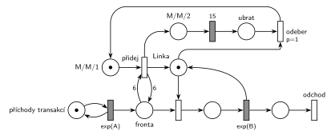

# Dočasně MM2 při dlouhé frontě

Úloha 05/02

## Zadání

> 1. M/M/1, pokud délka fronty přesáhne 5 – M/M/2 na 15 časových jednotek
> 2. simlib pro 1, byla zde napověda, že máme využít Store a měnit kapacitu v závislosti na délce fronty (byl jsem upozorněn, že lze řešit i bez vyřešení 1. otázky)

Bug, str. 11 (slovensky): „Petriho sieť bola typu M/M/1, ak dĺžka fronty presiahne 5, tak sa SHO prepne na M/M/2 na 15 jednotiek času. Taktiež zapísať v SIMLIBe. Nápoveda: Treba využiť Store a meniť kapacitu v závislosti na dĺžke fronty. Možno riešiť aj bez Petriho siete.“

Podobné úlohy: [Natrvalo MM3 při dlouhé frontě](<../03 - Natrvalo MM3 při dlouhé frontě/03 - Natrvalo MM3 při dlouhé frontě.md>) (změna natrvalo), [Pomocník přidá kapacitu](<../10 - Pomocník přidá kapacitu/10 - Pomocník přidá kapacitu.md>) (kapacita navíc v náhodných intervalech), [Cestovní kancelář](<../../09 - Obsluha zákazníků/08 - Cestovní kancelář/08 - Cestovní kancelář.md>) (fronta ≥ 5 → dvě přepážky navíc na 1 h).

## Nápověda

<details>
<summary>Zobrazit nápovědu</summary>
<br>

- **M/M/1:** *příchody transakcí* ⇄ `exp(A)` → *fronta* → obsazení *Linky* → `exp(B)`, který *Linku* vrací → *konec* → *odchod*. Příchody a obsluhu zadání neuvádí, proto `exp(A)` a `exp(B)`.
- **„Přesáhne 5“** = víc než 5, tedy aspoň 6 čekajících. Test fronty má proto váhu 6 (hrana do přechodu a zpět). „Dosáhne 5“ by byla váha 5.
- **M/M/2 = druhá jednotka kapacity:** přechod *přidej* vloží do *Linky* druhou značku. Obsluha se nemění, jen mohou běžet dvě najednou.
- **Režim** je jedna značka v *M/M/1*, *M/M/2* nebo *ubrat*. *Přidej* potřebuje značku *M/M/1*, takže dlouhá fronta během M/M/2 nespustí další rozšíření. Prioritu *přidej* nepotřebuje: fronta delší než 5 je jen při obsazené lince, takže o značky *fronty* s obsazením nesoupeří (`p=1` jako ve studentském řešení ale nevadí).
- **15 č. j.** je konstanta: zadání neříká, že jde o exponenciální rozložení. Značka *M/M/2* po `15` přejde do *ubrat*.
- **Konec M/M/2:** druhou jednotku nejde vzít, dokud na ní běží obsluha. Po 15 č. j. proto čeká značka v *ubrat* a *odeber* (`p=1`) vezme první uvolněnou jednotku dřív, než ji obsadí další transakce (obsazení má `p=0`), a vrátí režim do *M/M/1*. Rozpracovaná obsluha se normálně dokončí.
- Pokud je po návratu do M/M/1 fronta pořád delší než 5, *přidej* se hned provede znovu. Zadání nic jiného neříká.

</details>

## Petriho síť

<details>
<summary>Zobrazit Petriho síť</summary>
<br>



</details>

## Časté chyby

<details>
<summary>Zobrazit časté chyby</summary>
<br>

- Váha 5 místo 6 („přesáhne“ znamená víc než 5).
- Bez řídicí značky *M/M/1*: test fronty zůstává splněný a přechod přidává linky pořád dokola.
- Po 15 č. j. odebrání linky bez priority: uvolněnou jednotku může dřív obsadit další transakce a M/M/2 se protáhne.
- Odebrání jednotky, která právě obsluhuje (přerušení obsluhy), nebo „vrácení“ kapacity bez odebrání značky z *Linky*.
- V SIMLIBu `Linka.SetCapacity(1)` po 15 č. j.: pokud někdo čeká ve frontě, SIMLIB simulaci ukončí chybou „can't reduce store capacity“.

</details>

## SIMLIB

<details>
<summary>Zobrazit SIMLIB kód</summary>
<br>

Model je izomorfní k Petriho síti výše: každé místo, přechod a značka mají svůj protějšek v kódu. Hodnoty `A = 5` a `B = 6` jsou doplněné, zadání je nedává. Linka je `Store`, jak radí nápověda u zkoušky, ale kapacita se nemění přes `SetCapacity`: ta kapacitu nezmenší, dokud někdo čeká ve frontě (SIMLIB skončí chybou), a po zvětšení čekající sama nepustí (novou jednotku obsadí až při dalším `Leave`). Sklad má proto pevnou kapacitu 2 a druhou jednotku drží proces `Rezim`, dokud je systém M/M/1. To přesně odpovídá síti, kde je druhá jednotka „schovaná“ ve značce *M/M/1* (*Linka* + obsluhované + *M/M/1* = 2).

```cpp
// Dočasně M/M/2 při dlouhé frontě – model v SIMLIB/C++
#define I_REALLY_KNOW_HOW_TO_USE_WAITUNTIL  // zpřístupní makro WaitUntil (test podmínky)
#include "simlib.h"

const double A = 5;                    // střední interval příchodů exp(A), zadání ho nedává
const double B = 6;                    // střední doba obsluhy exp(B), zadání ji nedává

Store Linka("Linka", 2);               // místo Linka: 2 jednotky, jednu drží značka M/M/1
int rozsireni = 0;                     // počet provedení přechodu „přidej“

class Rezim : public Process {         // značka režimu: M/M/1 → M/M/2 → ubrat → M/M/1
  void Behavior() {
    Enter(Linka, 1);                   // v režimu M/M/1 je druhá jednotka mimo Linku
    for (;;) {
      WaitUntil(Linka.QueueLen() >= 6);  // přidej: test 6 na Frontě („přesáhne 5“)
      rozsireni++;
      Leave(Linka, 1);                 // druhá značka do Linky, čekající ji hned obsadí
      Wait(15);                        // M/M/2 → 15 → ubrat
      Enter(Linka, 1);                 // odeber (p=1): první uvolněná jednotka → M/M/1
    }
  }
 public:
  Rezim() : Process(1) {}              // priorita 1: ve frontě Linky předběhne transakce
};

class Transakce : public Process {     // transakce = značka, která prochází sítí
  void Behavior() {
    Enter(Linka, 1);                   // Fronta + obsazení (bere jednotku Linky)
    Wait(Exponential(B));              // časovaný přechod exp(B) ...
    Leave(Linka, 1);                   // ... který jednotku vrací
  }                                    // konec Behavior = konec + odchod
};

class Generator : public Event {       // místo „příchody transakcí“ ve smyčce s exp(A)
  void Behavior() {
    (new Transakce)->Activate();       // nová značka ve Frontě
    Activate(Time + Exponential(A));   // další příchod
  }
};

int main() {
  Init(0, 1000000);                     // modelový čas v časových jednotkách
  (new Rezim)->Activate();             // nejdřív režim, ať si vezme jednotku před první transakcí
  (new Generator)->Activate();
  Run();
  Linka.Output();                      // obsazenost včetně jednotky, kterou drží režim M/M/1
  Print("Přechod přidej: %d× (jednou za %.1f časových jednotek)\n", rozsireni, Time / rozsireni);
}
```

| Petriho síť | SIMLIB |
|---|---|
| *příchody transakcí* ⇄ `exp(A)` | událost `Generator`, která se znovu plánuje za `Exponential(A)` |
| značka (transakce) | proces `Transakce` |
| místo *Linka* (1 značka, v M/M/2 dvě) | `Store Linka` s kapacitou 2, jednu jednotku drží `Rezim`, dokud je režim M/M/1 |
| *fronta* + obsazení | `Enter(Linka, 1)` (fronta je vnitřní fronta skladu) |
| `exp(B)` se sloučeným uvolněním | `Wait(Exponential(B)); Leave(Linka, 1);` |
| značka režimu (*M/M/1*, *M/M/2*, *ubrat*) | proces `Rezim` (jen jeden, takže se M/M/2 nespustí dvakrát) |
| *přidej*: *M/M/1* + test 6 na *frontě* | `WaitUntil(Linka.QueueLen() >= 6)` |
| *přidej* → druhá značka do *Linky*, značka do *M/M/2* | `Leave(Linka, 1)` |
| *M/M/2* → `15` → *ubrat* | `Wait(15)` |
| *odeber* (`p=1`): *ubrat* + volná jednotka → *M/M/1* | `Enter(Linka, 1)` s prioritou procesu 1 (ve frontě skladu je první) |
| *konec* → *odchod* | konec metody `Behavior()` transakce |

**Kontrola simulací.** Petriho síť: *Linka* + obsluhované + *M/M/1* = 2 a režim je vždy právě v jednom místě, všechny přechody se provádějí (`make check`). Samotná M/M/1 by při `A = 5`, `B = 6` nestačila (obsluha je pomalejší než příchody), s dočasnou druhou linkou zůstává fronta omezená (nejvýš kolem 15). SIMLIB model: v jednom běhu (10⁶ časových jednotek) se *přidej* provedl 16 774krát (jednou za 60 časových jednotek), fronta měla nejvýš 25 a průměrně 2,8 čekajících. Sklad byl průměrně obsazený 1,90 jednotky: 1,2 = B/A připadá na obsluhy, zbylých 0,70 je jednotka v držení režimu, takže systém byl asi 70 % času M/M/1 (`make simlib`).

</details>

## Původ a zdroje

<details>
<summary>Zobrazit původ a zdroje</summary>
<br>

**Původ:** zkouška 2018/19, 3. termín (2. opravný), otázka 1 (body neuvedené). Otázka 2 chtěla k tomuto modelu program v SIMLIBu.

**Původní znění** (studentské přepisy, originál se nedochoval):

> 1. M/M/1, pokud délka fronty přesáhne 5 – M/M/2 na 15j času
> 2. simlib pro 1, byla zde napověda, že máme využít Store a měnit kapacitu v závislosti na délce fronty (byl jsem upozorněn, že lze řešit i bez vyřešení 1. otázky)

**Zdroje:**

- `Fitcheats/Zkoušky z minulých let/2018-19 - 3. termín.txt`, otázky 1 a 2 (studentský přepis zadání)
- `Fitcheats/Příprava na zkoušku/FIT - Řešené výpočetní příklady 2017-21.pdf`, str. 19 („2019 - 2. opravný“: studentská síť)
- `Fitcheats/Příprava na zkoušku/Bug - Řešené otázky.pdf`, str. 11 (stejná síť a kód v SIMLIBu)
- `Fitcheats/Příprava na zkoušku/cranycrane - Kódy (generátory, Monte Carlo, Euler, RK, Petri + SIMLIB)/petri/1.png` a `1.cpp`

**Existující řešení:**

- **Řešené výpočetní příklady, str. 19 = Bug, str. 11 (stejný obrázek):** stejná struktura jako tady: přepínač `p=1` s *M/M/1*, přidání značky lince, místo *M/M/2*, konstanta `15` a červený přechod `p=1`, který vezme linku a vrátí režim. **Chyba:** test fronty má váhu 5, tedy „dosáhne 5“, ne „přesáhne 5“. Stejně kód v Bugovi testuje `QueueLen() >= 5`.
- **cranycrane, 1.png:** test s váhou 6 je správně. **Chyba:** doba `exp(15)` místo konstanty 15. Mezi přepínač a přidání linky vkládá navíc jedno místo a přechod (neškodí). Odebraná jednotka linky končí ve výstupním přechodu, jako by opouštěla systém transakce, což je matoucí. V `1.cpp` chybí pojistka proti opakovanému rozšíření: každý příchod při frontě delší než 5 spustí nový proces `Nova_linka` a první z nich, který skončí, vrátí kapacitu na 1, i když jiné rozšíření ještě běží. Navíc `SetCapacity(1)` při neprázdné frontě SIMLIB ukončí chybou a po `SetCapacity(2)` čekající transakce druhou jednotku obsadí až při dalším `Leave`.

</details>

## Reference

- [Jak síť funguje](<../../../basics/Jak síť funguje.md>)
- [Notace a vzory](<../../../basics/Notace a vzory.md>)

<!-- -->

- [Studijní plán](<../../Studijní plán.md>)
- [Seznam úloh](<../../Seznam úloh.md>)
