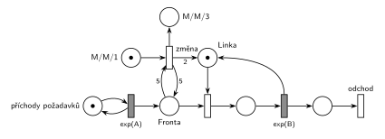

# Natrvalo MM3 při dlouhé frontě

## Zadání

⚠️ Původní zadání se nedochovalo, jen studentský přepis (slovensky):

> Petriho siet M/M/1. Ked bude vo fronte 5 poziadaviek, zmeni sa to na M/M/3 natrvalo

Podobné úlohy: [Dočasně MM2 při dlouhé frontě](<../02 - Dočasně MM2 při dlouhé frontě/02 - Dočasně MM2 při dlouhé frontě.md>) (změna jen na 15 č. j.), [Cestovní kancelář](<../../09 - Obsluha zákazníků/08 - Cestovní kancelář/08 - Cestovní kancelář.md>) (fronta ≥ 5 → dvě přepážky navíc na 1 h).

## Nápověda

<details>
<summary>Zobrazit nápovědu</summary>
<br>

- **M/M/1:** *příchody požadavků* ⇄ `exp(A)` → *fronta* → obsazení *Linky* → `exp(B)`, který *Linku* vrací → *konec* → *odchod*. Příchody a obsluhu zadání neuvádí, proto `exp(A)` a `exp(B)`.
- **„Keď bude vo fronte 5“** = fronta dosáhne 5, test má váhu 5 (hrana do přechodu a zpět, z fronty se nic neodebere).
- **M/M/3** = tři jednotky kapacity linky. *Změna* přidá do *Linky* dvě značky (hrana s váhou 2), obsluha se nemění.
- **Natrvalo:** *změna* bere jedinou značku z *M/M/1* a ta už se nevrátí. Bez ní by se přechod provedl při každé další frontě 5 a linek by přibývalo. Místo *M/M/3* jen ukazuje stav, dá se vynechat.
- Priorita není potřeba: fronta 5 vznikne jen při obsazené lince, takže *změna* nesoupeří s obsazením o značky *fronty*.

</details>

## Petriho síť

<details>
<summary>Zobrazit Petriho síť</summary>
<br>



</details>

## Časté chyby

<details>
<summary>Zobrazit časté chyby</summary>
<br>

- Hrana s váhou 3 do *Linky*: k původní značce přibudou tři a vznikne M/M/4.
- Přepínač bez jednorázové značky: při každé frontě 5 přibudou další linky.
- Test fronty jen hranou dovnitř: přechod by z fronty odebral pět požadavků.
- Váha 6 („přesáhne“) místo 5.

</details>

## SIMLIB

<details>
<summary>Zobrazit SIMLIB kód</summary>
<br>

Model je izomorfní k Petriho síti výše: každé místo, přechod a značka mají svůj protějšek v kódu. Hodnoty `A = 4` a `B = 6` jsou doplněné, zadání je nedává. Linka je `Store` s kapacitou 3, ze které dvě jednotky drží proces `Zmena`, dokud je systém M/M/1 (v síti je drží značka *M/M/1*: *Linka* + obsluhované + 2 · *M/M/1* = 3). Samotné `Linka.SetCapacity(3)` by kapacitu zvětšilo také, ale čekající požadavky by nové jednotky obsadily až při dalším `Leave`, ne hned jako v síti.

```cpp
// Natrvalo M/M/3 při dlouhé frontě – model v SIMLIB/C++
#define I_REALLY_KNOW_HOW_TO_USE_WAITUNTIL  // zpřístupní makro WaitUntil (test podmínky)
#include "simlib.h"

const double A = 4;                    // střední interval příchodů exp(A), zadání ho nedává
const double B = 6;                    // střední doba obsluhy exp(B), zadání ji nedává

Store Linka("Linka", 3);               // místo Linka: 3 jednotky, dvě drží značka M/M/1
double zmena = -1;                     // čas provedení přechodu „změna“

class Zmena : public Process {         // značka M/M/1, přechod změna, místo M/M/3
  void Behavior() {
    Enter(Linka, 2);                   // v M/M/1 jsou dvě jednotky mimo Linku
    WaitUntil(Linka.QueueLen() >= 5);  // změna: test 5 na Frontě
    zmena = Time;
    Leave(Linka, 2);                   // 2 značky do Linky natrvalo, čekající je hned obsadí
  }                                    // konec procesu = značka v M/M/3, M/M/1 je prázdné
};

class Pozadavek : public Process {     // transakce = značka, která prochází sítí
  void Behavior() {
    Enter(Linka, 1);                   // Fronta + obsazení (bere jednotku Linky)
    Wait(Exponential(B));              // časovaný přechod exp(B) ...
    Leave(Linka, 1);                   // ... který jednotku vrací
  }                                    // konec Behavior = konec + odchod
};

class Generator : public Event {       // místo „příchody požadavků“ ve smyčce s exp(A)
  void Behavior() {
    (new Pozadavek)->Activate();       // nová značka ve Frontě
    Activate(Time + Exponential(A));   // další příchod
  }
};

int main() {
  Init(0, 1000000);                    // modelový čas v časových jednotkách
  (new Zmena)->Activate();             // nejdřív změna, ať si vezme dvě jednotky
  (new Generator)->Activate();
  Run();
  Linka.Output();
  Print("Změna na M/M/3 v čase %.1f\n", zmena);
}
```

| Petriho síť | SIMLIB |
|---|---|
| *příchody požadavků* ⇄ `exp(A)` | událost `Generator`, která se znovu plánuje za `Exponential(A)` |
| značka (požadavek) | proces `Pozadavek` |
| místo *Linka* (1 značka, po změně 3) | `Store Linka` s kapacitou 3, dvě jednotky drží `Zmena`, dokud je režim M/M/1 |
| *fronta* + obsazení | `Enter(Linka, 1)` (fronta je vnitřní fronta skladu) |
| `exp(B)` se sloučeným uvolněním | `Wait(Exponential(B)); Leave(Linka, 1);` |
| značka *M/M/1* | proces `Zmena` (jen jeden, takže se změna provede jednou) |
| test 5 na *frontě* | `WaitUntil(Linka.QueueLen() >= 5)` |
| *změna* → 2 značky do *Linky*, značka do *M/M/3* | `Leave(Linka, 2)` a konec procesu |
| *konec* → *odchod* | konec metody `Behavior()` požadavku |

**Kontrola simulací.** Petriho síť: *Linka* + obsluhované + 2 · *M/M/1* = 3, *změna* se v každém běhu provede právě jednou, všechny přechody se provádějí (`make check`). Potom je systém M/M/3 a fronta zůstává omezená, i když by ji samotná M/M/1 při `A = 4`, `B = 6` neudržela. SIMLIB model: v jednom běhu (10⁶ časových jednotek) proběhla změna v čase 69 a sklad byl průměrně obsazený 1,50 jednotky, přesně podle teorie B/A = 6/4 = 1,5 obsazené linky (`make simlib`).

</details>

## Původ a zdroje

<details>
<summary>Zobrazit původ a zdroje</summary>
<br>

**Původ:** zkouška 2020/21, 1. termín, skupina ve 14:00, otázka 3 (body neuvedené).

**Zdroje:**

- `Fitcheats/Zkoušky z minulých let/2020-21 - 1. termín.txt`, skupina 14:00, otázka 3 (studentský přepis zadání)
- `Fitcheats/Příprava na zkoušku/FIT - Řešené výpočetní příklady 2017-21.pdf`, str. 33 („2021 - Řádný 14:00“: síť na tabuli)
- `Fitcheats/Příprava na zkoušku/cranycrane - Kódy (generátory, Monte Carlo, Euler, RK, Petri + SIMLIB)/petri/5.png` a `5.cpp`

**Existující řešení:**

- **Řešené výpočetní příklady, str. 33:** stejná síť: přechod `P=1` s testem 5/5 na frontě, jednorázové místo s jednou značkou a hrana s váhou 2 do linky. Generátor je jen přechod `exp(x)` bez místa, výstupní přechod je. Správně.
- **cranycrane, 5.png:** totéž (test 5/5, jednorázová značka, váha 2). Kód `5.cpp` hlídá délku fronty jen při příchodu a nastaví `SetCapacity(3)`. Hlídání při příchodu tu stačí, protože fronta roste jen příchody. Po `SetCapacity(3)` ale čekající požadavky nové jednotky neobsadí hned, SIMLIB je pustí až při dalším `Leave`.

</details>
