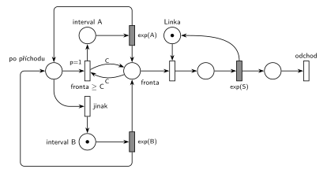

# Interval příchodů podle délky fronty

## Zadání

> Nakreslete Petriho síť pro systém M/M/1, kde se po každé nově příchozí transakci přehodnotí interval mezi příchody transakcí do systému podle následujícího předpisu: 1) pokud je aktuální délka fronty (včetně nově příchozího) větší nebo rovna počtu C, pak je střední doba mezi příchody nastavena na A časových jednotek, 2) jinak B časových jednotek. S využitím notace knihovny SIMLIB napište pseudokód všech nezbytných částí simulačního modelu. Dbejte na izomorfní vztah mezi oběma modely.

⚠️ 2021/22, skupina C, jen ze vzpomínky (slovensky): „M/M/1. Ak je vo fronte aspon C transakcii, tak generuje transakcie s exp(A), inak s exp(B). + SIMLIB.“

Podobné úlohy: [Přerušení příchodů při plné frontě](<../05 - Přerušení příchodů při plné frontě/05 - Přerušení příchodů při plné frontě.md>) (příchody se při dlouhé frontě zastaví), [Doba obsluhy podle délky fronty](<../01 - Doba obsluhy podle délky fronty/01 - Doba obsluhy podle délky fronty.md>) (podle fronty se mění obsluha).

## Interpretace

<details>
<summary>Zobrazit interpretaci (nápověda)</summary>
<br>

- **Kdy se rozhoduje:** jen při příchodu („po každé nově příchozí transakci“). Zvolený interval platí až do dalšího příchodu, i když se fronta mezitím zkrátí. Značka generátoru proto po příchodu přejde do místa *po příchodu* a odtud jedním ze dvou přechodů do *intervalu A*, nebo do *intervalu B*. Každý z nich má svůj časovaný přechod `exp(A)`, resp. `exp(B)` (jeden přechod = jeden čas), a ten po příchodu vrací značku do *po příchodu*.
- **„Fronta ≥ C“** testuje dvojice hran s váhou C (do přechodu a zpět). *Jinak* (`p=0`) žádný test nepotřebuje, provede se, jen když *fronta ≥ C* (`p=1`) proveditelná není. Inhibiční hrana tu tedy není potřeba.
- **„Včetně nově příchozího“:** časovaný příchod dá značku do *Fronty* a do *po příchodu* zároveň, takže se nově příchozí do fronty počítá. Priorita `p=1` navíc zajistí, že test proběhne dřív než obsazení linky (`p=0`).
- **M/M/1:** *Fronta* → obsazení *Linky* → `exp(S)`, který *Linku* vrací → *konec* → *odchod*. Doba obsluhy v zadání není, proto `exp(S)`.
- Na začátku je fronta prázdná, proto je značka generátoru v *intervalu B*.
- Přepis z roku 2021/22 by šel číst i tak, že se rychlost generátoru přepíná průběžně podle aktuální fronty. Oficiální znění z roku 2022/23 to vyjasňuje: rozhoduje se jen při příchodu.

</details>

## Petriho síť

<details>
<summary>Zobrazit Petriho síť</summary>
<br>



</details>

## Časté chyby

<details>
<summary>Zobrazit časté chyby</summary>
<br>

- Jeden časovaný přechod se dvěma časy (`exp(A)` / `exp(B)`). Časovaný přechod má jen jeden čas, proto jsou tu dva.
- Přepínání režimu generátoru průběžně, testem fronty kdykoli (i mezi příchody). Rozhodnutí patří jen k okamžiku příchodu.
- Test fronty jen hranou dovnitř: rozhodnutí by z fronty odebralo C transakcí.
- Větev *jinak* bez nižší priority: při dlouhé frontě by se náhodně volil i interval B.

</details>

## SIMLIB

<details>
<summary>Zobrazit SIMLIB kód</summary>
<br>

Model je izomorfní k Petriho síti výše: každé místo, přechod a značka mají svůj protějšek v kódu. Hodnoty `A = 20`, `B = 5`, `C = 5` a `S = 8` jsou doplněné, zadání je nedává. Značku generátoru představuje událost `Generator`: o dalším intervalu rozhoduje hned po vytvoření transakce, tedy jen při příchodu. Nově aktivovaná transakce se do fronty linky zařadí až po skončení události, proto se k `QueueLen()` přičítá 1 („včetně nově příchozího“).

```cpp
// Interval příchodů podle délky fronty – model v SIMLIB/C++
#include "simlib.h"

const double A = 20;                   // střední interval při dlouhé frontě exp(A)
const double B = 5;                    // jinak exp(B)
const unsigned C = 5;                  // hranice délky fronty
const double S = 8;                    // střední doba obsluhy exp(S), zadání ji nedává

Facility Linka("Linka");               // místo Linka s jednou značkou
int intervalA = 0, intervalB = 0;      // počty provedení přechodů „fronta ≥ C“ a „jinak“

class Transakce : public Process {     // transakce = značka, která prochází sítí
  void Behavior() {
    Seize(Linka);                      // Fronta + obsazení (bere značku Linky)
    Wait(Exponential(S));              // časovaný přechod exp(S) ...
    Release(Linka);                    // ... který vrací značku Lince
  }                                    // konec Behavior = konec + odchod
};

class Generator : public Event {       // značka generátoru: interval A / B → po příchodu
  void Behavior() {
    (new Transakce)->Activate();       // příchod: nová značka ve Frontě
    if (Linka.QueueLen() + 1 >= C) {   // fronta ≥ C (p=1), včetně nově příchozího
      intervalA++;
      Activate(Time + Exponential(A)); // → interval A ⇄ exp(A)
    } else {                           // jinak (p=0)
      intervalB++;
      Activate(Time + Exponential(B)); // → interval B ⇄ exp(B)
    }
  }
};

int main() {
  Init(0, 1000000);                    // modelový čas v časových jednotkách
  (new Generator)->Activate(Exponential(B));  // na začátku je značka v „interval B“
  Run();
  Linka.Output();
  Print("Interval A zvolen %d×, interval B %d× (A u %.1f %% příchodů)\n",
        intervalA, intervalB, 100.0 * intervalA / (intervalA + intervalB));
}
```

| Petriho síť | SIMLIB |
|---|---|
| značka generátoru v *interval A* / *interval B* | událost `Generator` naplánovaná za `Exponential(A)` / `Exponential(B)` |
| na začátku značka v *interval B* | `(new Generator)->Activate(Exponential(B))` |
| `exp(A)` / `exp(B)`: transakce do *Fronty*, značka do *po příchodu* | `(new Transakce)->Activate()` na začátku `Behavior()` generátoru |
| *fronta ≥ C* (`p=1`, test C na *Frontě*) | `if (Linka.QueueLen() + 1 >= C)` |
| *jinak* (`p=0`) | větev `else` |
| značka (transakce) | proces `Transakce` |
| *Fronta* + obsazení *Linky* | `Seize(Linka)` (fronta je vnitřní fronta zařízení) |
| místo *Linka* (1 značka) | `Facility Linka` |
| `exp(S)` se sloučeným uvolněním | `Wait(Exponential(S)); Release(Linka);` |
| *konec* → *odchod* | konec metody `Behavior()` transakce |

**Kontrola simulací.** Petriho síť: *Linka* + obsluhovaná transakce = 1, značka generátoru je vždy právě v jednom ze tří míst, všechny přechody se provádějí (`make check`). Pomalejší příchody `exp(A)` se volí asi u čtvrtiny příchodů. Fronta zůstává omezená, i když by ji samotné příchody `exp(B)` při obsluze `exp(8)` neudržely. SIMLIB model: v jednom běhu (10⁶ časových jednotek) se interval A zvolil u 26,5 % příchodů, fronta měla nejvýš 14 čekajících a linka byla vytížena na 89,4 %. To odpovídá 111 492 příchodům × 8 / 10⁶ = 89,2 % (`make simlib`).

</details>

## Původ a zdroje

<details>
<summary>Zobrazit původ a zdroje</summary>
<br>

**Původ:** zkouška 2022/23, 1. termín, skupina A, otázka 1, 15 bodů. Stejná úloha (jen ze vzpomínky): zkouška 2021/22, 1. termín, skupina C, otázka 1.

**Zdroje:**

- `Fitcheats/Zkoušky z minulých let/2022-23 - 1. termín A.pdf`, str. 1 (fotky zadání)
- `Fitcheats/Zkoušky z minulých let/2021-22 - 1. termín.txt`, skupina C, otázka 1 (studentský přepis zadání)
- `Fitcheats/Příprava na zkoušku/fifinas - Tabule ze streamu.pdf`, str. 4 (síť a kód v SIMLIBu na tabuli)

**Existující řešení:**

- **fifinas, str. 4:** dva generátory (černé místo se značkou a `Exp(b)`, zelené místo s `Exp(a)`), mezi nimiž se značka přesouvá. K tomu červené a modré přechody s prioritami `p=2` a `p=1` a hranami s váhou C na frontě. Tabule je silně přemalovaná a přesné napojení hran se nedá spolehlivě přečíst. Kód v SIMLIBu volí interval v chování generátoru: aktivuje novou transakci, otestuje délku fronty linky `>= C` a podle toho se naplánuje za `Exp(A)`, nebo `Exp(B)`. Rozhoduje tedy jen při příchodu, jako tady. Nově aktivovaná transakce se ale do fronty zařadí až po skončení chování generátoru, takže se do délky fronty nezapočítá. Podmínka „včetně nově příchozího“ by vyžadovala test `>= C - 1`.

</details>
