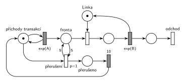

# 05-05 Přerušení příchodů při plné frontě

## Zadání

> Uvažujme systém M/M/1. Proces příchodu nových transakcí se na 10 časových jednotek přeruší, pokud délka fronty dosáhne pěti transakcí.

Podobné úlohy: [Klientské centrum](<../../09 - Obsluha zákazníků/06 - Klientské centrum/06 - Klientské centrum.md>) (stejný mechanismus: fronta 10 → stop stav na 4 h), [MM3 – zastavení příchodů](<../06 - MM3 – zastavení příchodů/06 - MM3 – zastavení příchodů.md>) (zastavení podle obsazení linek), [Interval příchodů podle délky fronty](<../04 - Interval příchodů podle délky fronty/04 - Interval příchodů podle délky fronty.md>).

## Nápověda

<details>
<summary>Zobrazit nápovědu</summary>
<br>

- **M/M/1:** *příchody transakcí* ⇄ `exp(A)` → *fronta* → obsazení *Linky* → `exp(B)`, který *Linku* vrací → *konec* → *odchod*. Příchody a obsluhu zadání neuvádí, proto `exp(A)` a `exp(B)`.
- **„Dosáhne pěti“** = ve *frontě* je aspoň 5 čekajících: test s váhou 5 (hrana do přechodu a zpět, z fronty se nic neodebere). Obsluhovaná transakce je v jiném místě a nepočítá se.
- **Přerušení příchodů:** *přerušení* odebere značku místu *příchody transakcí* a přesune ji do *přerušeno*. Probíhající odpočet `exp(A)` tím zanikne a nikdo nepřichází. Po `10` se značka vrátí do *příchodů transakcí* a příchody pokračují s novým odpočtem (u exponenciálního rozložení na tom nezáleží).
- **Značka příchodů je zároveň pojistka:** během přerušení chybí, takže se přerušení nemůže vyhlásit znovu, i když je ve frontě pořád 5 transakcí.
- **Po 10 č. j.:** pokud je fronta pořád aspoň 5, přerušení se hned zopakuje. Za 10 č. j. se obslouží jen pár transakcí, takže se to může stát. Kdo zadání čte jako „jen v okamžiku, kdy fronta pětky dosáhne“, musel by test navázat na příchod (např. testovat frontu z místa za příchodem). Jednodušší čtení výše u zkoušky stačí.
- **Priorita `p=1`** je pojistka, aby se test vyhodnotil dřív než ostatní okamžité přechody. Ke střetu s obsazením linky prakticky nedojde, protože fronta roste jen při obsazené lince.

</details>

## Petriho síť

<details>
<summary>Zobrazit Petriho síť</summary>
<br>



</details>

## Časté chyby

<details>
<summary>Zobrazit časté chyby</summary>
<br>

- Test fronty jen hranou dovnitř: přerušení by z fronty odebralo pět transakcí.
- Zastavení příchodů odebráním transakcí z *fronty* místo odebrání značky *příchodů transakcí*.
- Zapomenutý návrat značky po 10 č. j.: příchody by se zastavily natrvalo.
- Přerušení, které nebere značku příchodů ani jinou řídicí značku: test zůstává splněný a přechod se provádí pořád dokola.
- Váha 6 („přesáhne“) místo 5 („dosáhne“).

</details>

## SIMLIB

<details>
<summary>Zobrazit SIMLIB kód</summary>
<br>

Model je izomorfní k Petriho síti výše: každé místo, přechod a značka mají svůj protějšek v kódu. Hodnoty `A = 5` a `B = 6` jsou doplněné, zadání je nedává. Kde je značka příchodů, říká příznak `preruseno`, který kontroluje generátor: během přerušení transakci nevytvoří. Generátor se přitom plánuje dál, takže po návratu značky doběhne rozpracovaný interval místo nového odpočtu. U exponenciálních intervalů to vyjde nastejno (rozložení nemá paměť).

```cpp
// Přerušení příchodů při plné frontě – model v SIMLIB/C++
#define I_REALLY_KNOW_HOW_TO_USE_WAITUNTIL  // zpřístupní makro WaitUntil (test podmínky)
#include "simlib.h"

const double A = 5;                    // střední interval příchodů exp(A), zadání ho nedává
const double B = 6;                    // střední doba obsluhy exp(B), zadání ji nedává

Facility Linka("Linka");               // místo Linka s jednou značkou
bool preruseno = false;                // značka v místě „přerušeno“ místo „příchody transakcí“
int preruseni = 0;                     // počet provedení přechodu „přerušení“

class Transakce : public Process {     // transakce = značka, která prochází sítí
  void Behavior() {
    Seize(Linka);                      // Fronta + obsazení (bere značku Linky)
    Wait(Exponential(B));              // časovaný přechod exp(B) ...
    Release(Linka);                    // ... který vrací značku Lince
  }                                    // konec Behavior = konec + odchod
};

class Generator : public Event {       // místo „příchody transakcí“ ve smyčce s exp(A)
  void Behavior() {
    if (!preruseno)                    // bez značky příchodů nikdo nepřichází
      (new Transakce)->Activate();     // nová značka ve Frontě
    Activate(Time + Exponential(A));   // další příchod
  }
};

class Preruseni : public Process {     // přechody přerušení a 10, místo přerušeno
  void Behavior() {
    for (;;) {
      WaitUntil(Linka.QueueLen() >= 5);  // přerušení (p=1): test 5 na Frontě
      preruseno = true;                // vezme značku příchodů
      preruseni++;
      Wait(10);                        // přerušeno → 10
      preruseno = false;               // značka zpět do příchodů
    }
  }
};

int main() {
  Init(0, 1000000);                     // modelový čas v časových jednotkách
  (new Generator)->Activate();
  (new Preruseni)->Activate();
  Run();
  Linka.Output();
  Print("Přerušení příchodů: %d× (přerušeno %.1f %% času)\n", preruseni,
        100.0 * preruseni * 10 / Time);
}
```

| Petriho síť | SIMLIB |
|---|---|
| *příchody transakcí* ⇄ `exp(A)` | událost `Generator`, která se znovu plánuje za `Exponential(A)` |
| značka v *příchodech transakcí*, nebo v *přerušeno* | `bool preruseno` (generátor bez značky nikoho nevytvoří) |
| značka (transakce) | proces `Transakce` |
| *fronta* + obsazení *Linky* | `Seize(Linka)` (fronta je vnitřní fronta zařízení) |
| místo *Linka* (1 značka) | `Facility Linka` |
| `exp(B)` se sloučeným uvolněním | `Wait(Exponential(B)); Release(Linka);` |
| *přerušení* (`p=1`): test 5 na *frontě* + značka příchodů | `WaitUntil(Linka.QueueLen() >= 5); preruseno = true;` |
| *přerušeno* → `10` → *příchody transakcí* | `Wait(10); preruseno = false;` |
| *konec* → *odchod* | konec metody `Behavior()` transakce |

**Kontrola simulací.** Petriho síť: *Linka* + obsluhovaná transakce = 1, *příchody transakcí* + *přerušeno* = 1 a ve *frontě* nikdy není víc než 5 transakcí; všechny přechody se provádějí (`make check`). SIMLIB model: v jednom běhu (10⁶ časových jednotek) se příchody přerušily 24 523krát, tedy zhruba na 24,5 % času, a fronta měla nejvýš 5 čekajících. Příchody tak běží asi 75,5 % času, do systému vstoupí 0,2 · 0,755 · 10⁶ ≈ 151 000 transakcí (naměřeno 150 405) a linka je vytížena na 0,151 · 6 ≈ 90 % (naměřeno 89,8 %) (`make simlib`).

</details>

## Původ a zdroje

<details>
<summary>Zobrazit původ a zdroje</summary>
<br>

**Původ:** zkouška 2024/25, 1. termín, skupina B, otázka 3 (body neuvedené; ve skupinách A a C téhož termínu byla otázka 3 za 10 bodů).

**Původní znění** (studentský přepis):

> Uvažujme systém M/M/1. Proces přichodu nových transakcí se na 10 časových jednotek přeruší, pokud délka fronty dosáhne pěti transakcí. Nakreslete model systému s použitím petriho sítí

**Zdroje:**

- `Fitcheats/Zkoušky z minulých let/2024-25 - 1. termín B.txt`, otázka 3 (studentský přepis zadání)

**Existující řešení:**

- K této úloze v materiálech žádné řešení není. Stejný mechanismus je v úloze [Klientské centrum](<../../09 - Obsluha zákazníků/06 - Klientské centrum/06 - Klientské centrum.md>).

</details>

## Reference

- [Jak síť funguje](<../../../basics/Jak síť funguje.md>)
- [Notace a vzory](<../../../basics/Notace a vzory.md>)

<!-- -->

- [Studijní plán](<../../Studijní plán.md>)
- [Seznam úloh](<../../Seznam úloh.md>)
