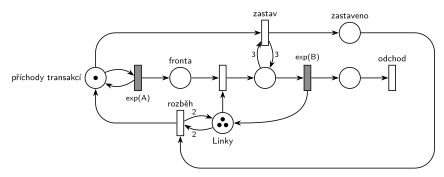

# MM3 – zastavení příchodů (05/06)

## Zadání

> Uvažujme systém typu M/M/3. Proces příchodu nových transakcí se přeruší v okamžiku, kdy jsou všechny linky obsazené. Znovu se rozběhne, až jsou alespoň dvě linky volné. Nakreslete model systému s použitím Petriho sítí.

Podobné úlohy: [Přerušení příchodů při plné frontě](<../05 - Přerušení příchodů při plné frontě/05 - Přerušení příchodů při plné frontě.md>) (přerušení podle délky fronty, téhož termínu), [MD3 – poslední volné zařízení](<../../06 - Doba obsluhy podle stavu/03 - MD3 – poslední volné zařízení/03 - MD3 – poslední volné zařízení.md>) (obsazení poslední volné linky), [MM3 bez fronty s opakováním](<../../02 - Netrpělivost a omezená fronta/05 - MM3 bez fronty s opakováním/05 - MM3 bez fronty s opakováním.md>).

## Nápověda

<details>
<summary>Zobrazit nápovědu</summary>
<br>

- **M/M/3:** *příchody transakcí* ⇄ `exp(A)` → *fronta* → obsazení *Linek* → obsluha `exp(B)`, která linku vrací → *konec* → *odchod*. Místo *Linky* má tři značky, obsazení i obsluha jsou jen jedny. Počet obsazených linek je počet značek v místě obsluhy. Příchody a obsluhu zadání neuvádí, proto `exp(A)` a `exp(B)`.
- **Přerušení příchodů:** *zastav* přesune značku z *příchodů transakcí* do *zastaveno*, takže odpočet `exp(A)` zanikne. Podmínka „všechny linky obsazené“ je test s váhou 3 na místě obsluhy. Prázdné *Linky* testovat nejde (byla by potřeba inhibiční hrana, která se v kurzu nepoužívá).
- **Rozběh:** *rozběh* vrátí značku ze *zastaveno* do *příchodů transakcí*, když jsou v *Linkách* aspoň 2 značky (test s váhou 2). Mezi tím, tedy při jedné volné lince, se nic nemění: zastavené příchody stojí, běžící běží. Tím vzniká hystereze ze zadání.
- Značka v *příchodech transakcí*, nebo v *zastaveno* zároveň hlídá, aby se *zastav* ani *rozběh* neprovedly dvakrát po sobě.
- **fronta** v tomto systému čekající transakce nikdy nemá: příchody běží jen při volné lince a příchozí ji hned obsadí. Místo je tu, aby byl model čitelný jako M/M/3.
- **Pozor na test na místě obsluhy:** dvojice hran s váhou 3 značky formálně vezme a hned vrátí. Podle slajdu 139 by tím odpočty obsluh mohly začít znovu. U exponenciální obsluhy na tom nezáleží (rozložení nemá paměť). Kdo se tomu chce vyhnout, naváže zastavení na obsazení poslední volné linky: druhé obsazení s `p=0`, které navíc bere značku *příchodů transakcí*, a běžné obsazení s `p=1` jen při aspoň 2 volných linkách (hrana 2 z *Linek*, 1 zpět). Kreslí se to ale hůř.

</details>

## Petriho síť

<details>
<summary>Zobrazit Petriho síť</summary>
<br>



</details>

## Časté chyby

<details>
<summary>Zobrazit časté chyby</summary>
<br>

- Rozběh při jedné volné lince (test s váhou 1, nebo rovnou návrat značky po skončení obsluhy). Zadání chce aspoň dvě volné.
- Zastavení i rozběh bez řídicí značky: testy zůstávají splněné a přechody se provádějí pořád dokola.
- Zastavení odebráním transakcí z *fronty* nebo blokováním obsazení místo odebrání značky *příchodů transakcí*.
- Inhibiční hrana z *Linek* na zastavení. Funguje, ale Hrubý ji nechce, test na místě obsluhy dělá totéž.

</details>

## SIMLIB

<details>
<summary>Zobrazit SIMLIB kód</summary>
<br>

Model je izomorfní k Petriho síti výše: každé místo, přechod a značka mají svůj protějšek v kódu. Hodnoty `A = 3` a `B = 8` jsou doplněné, zadání je nedává. Linky jsou `Store` s kapacitou 3. Test 3 na místě obsluhy je `Linky.Full()` (obsazené jsou všechny tři), test 2 na *Linkách* je `Linky.Free() >= 2`. Kde je značka příchodů, říká příznak `zastaveno`, který kontroluje generátor: bez značky transakci nevytvoří. Generátor se plánuje dál, takže po rozběhu doběhne rozpracovaný interval místo nového odpočtu, u exponenciálních intervalů to vyjde nastejno.

```cpp
// M/M/3 – zastavení příchodů – model v SIMLIB/C++
#define I_REALLY_KNOW_HOW_TO_USE_WAITUNTIL  // zpřístupní makro WaitUntil (test podmínky)
#include "simlib.h"

const double A = 3;                    // střední interval příchodů exp(A), zadání ho nedává
const double B = 8;                    // střední doba obsluhy exp(B), zadání ji nedává

Store Linky("Linky", 3);               // místo Linky se třemi značkami
bool zastaveno = false;                // značka v místě „zastaveno“ místo „příchody transakcí“
int zastaveni = 0, prichodu = 0;       // počty provedení přechodů „zastav“ a příchodu

class Transakce : public Process {     // transakce = značka, která prochází sítí
  void Behavior() {
    Enter(Linky, 1);                   // Fronta + obsazení (bere jednu linku)
    Wait(Exponential(B));              // časovaný přechod exp(B) ...
    Leave(Linky, 1);                   // ... který linku vrací
  }                                    // konec Behavior = konec + odchod
};

class Generator : public Event {       // místo „příchody transakcí“ ve smyčce s exp(A)
  void Behavior() {
    if (!zastaveno) {                  // bez značky příchodů nikdo nepřichází
      prichodu++;
      (new Transakce)->Activate();     // nová značka ve Frontě
    }
    Activate(Time + Exponential(A));   // další příchod
  }
};

class Rizeni : public Process {        // přechody zastav a rozběh, místo zastaveno
  void Behavior() {
    for (;;) {
      WaitUntil(Linky.Full());         // zastav: všechny 3 linky obsazené (test 3)
      zastaveno = true;                // vezme značku příchodů
      zastaveni++;
      WaitUntil(Linky.Free() >= 2);    // rozběh: aspoň 2 volné linky (test 2)
      zastaveno = false;               // značka zpět do příchodů
    }
  }
};

int main() {
  Init(0, 1000000);                     // modelový čas v časových jednotkách
  (new Generator)->Activate();
  (new Rizeni)->Activate();
  Run();
  Linky.Output();
  Print("Příchodů: %d, zastavení: %d× (na %.2f příchodu)\n", prichodu, zastaveni,
        (double)prichodu / zastaveni);
}
```

| Petriho síť | SIMLIB |
|---|---|
| *příchody transakcí* ⇄ `exp(A)` | událost `Generator`, která se znovu plánuje za `Exponential(A)` |
| značka v *příchodech transakcí*, nebo v *zastaveno* | `bool zastaveno` (generátor bez značky nikoho nevytvoří) |
| značka (transakce) | proces `Transakce` |
| místo *Linky* (3 značky) | `Store Linky("Linky", 3)` |
| *fronta* + obsazení | `Enter(Linky, 1)` (fronta je vnitřní fronta skladu) |
| `exp(B)` se sloučeným uvolněním | `Wait(Exponential(B)); Leave(Linky, 1);` |
| *zastav*: test 3 na místě obsluhy + značka příchodů | `WaitUntil(Linky.Full()); zastaveno = true;` |
| *rozběh*: test 2 na *Linkách* + značka v *zastaveno* | `WaitUntil(Linky.Free() >= 2); zastaveno = false;` |
| *konec* → *odchod* | konec metody `Behavior()` transakce |

**Kontrola simulací.** Petriho síť: *Linky* + obsluhované = 3, *příchody transakcí* + *zastaveno* = 1 a ve *frontě* nikdy nikdo nečeká; všechny přechody se provádějí (`make check`). Příchody se zastaví asi u třetiny transakcí. SIMLIB model: v jednom běhu (10⁶ časových jednotek) přišlo 201 651 transakcí a příchody se zastavily 59 203krát (jednou na 3,4 příchodu). Fronta skladu zůstala prázdná a průměrně byly obsazené 1,61 linky, což odpovídá 201 651 × 8 / 10⁶ = 1,61 (`make simlib`).

</details>

## Původ a zdroje

<details>
<summary>Zobrazit původ a zdroje</summary>
<br>

**Původ:** zkouška 2024/25, 1. termín (8. 1. 2025), skupina C, otázka 3, 10 bodů.

**Zdroje:**

- `Fitcheats/Zkoušky z minulých let/2024-25 - 1. termín A+C.pdf`, str. 3–4 (fotky zadání skupiny C: hlavička na str. 3, otázka 3 na str. 4, bez řešení)

**Existující řešení:**

- K této úloze v materiálech žádné řešení není.

</details>

## Reference

- [Jak síť funguje](<../../../basics/Jak síť funguje.md>)
- [Notace a vzory](<../../../basics/Notace a vzory.md>)

<!-- -->

- [Studijní plán](<../../Studijní plán.md>)
- [Seznam úloh](<../../Seznam úloh.md>)
