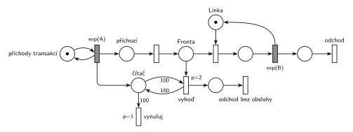

# Každá 100. transakce vyprázdní frontu

## Zadání

⚠️ Původní zadání se nedochovalo, jen studentský přepis (slovensky):

> Petriho síť M/M/1 kde kazda 100 transakcia vyprazdni frontu s transakciami cakajucimi na obsluhu

Podobné úlohy: [Každá 10. transakce vyvolá poruchu](<../../03 - Poruchy/07 - Každá 10. transakce vyvolá poruchu/07 - Každá 10. transakce vyvolá poruchu.md>) (čítač transakcí), [Údržba po každé 10. obsluze](<../../04 - Údržba a spánek/06 - Údržba po každé 10. obsluze/06 - Údržba po každé 10. obsluze.md>), [Psí salon](<../../09 - Obsluha zákazníků/03 - Psí salon/03 - Psí salon.md>) (všichni čekající opustí systém, Hrubého řešení).

## Interpretace

<details>
<summary>Zobrazit interpretaci (nápověda)</summary>
<br>

- **M/M/1:** *příchody transakcí* ⇄ `exp(A)` → *příchozí* → *Fronta* → obsazení *Linky* → `exp(B)`, který *Linku* vrací → *konec* → *odchod*. Příchody a obsluhu zadání neuvádí, proto `exp(A)` a `exp(B)`.
- **„Každá 100. transakce“** se počítá při příchodu: příchod přidá značku do *čítače*. 100. příchozí najde v *čítači* 100 značek.
- **Vyprázdnění fronty** bez inhibiční hrany: *vyhoď* (`p=2`) bere z *Fronty* po jedné transakci, dokud je v *čítači* 100 značek (test s váhou 100, hrana do přechodu a zpět). Okamžité přechody se provádějí ve stejném okamžiku za sebou, takže se fronta vyprázdní celá najednou. Když je prázdná, *vyhoď* proveditelný není a na řadu přijde *vynuluj* (`p=1`), který z *čítače* odebere 100 značek.
- **Sama 100. transakce** čeká v místě *příchozí*. Do *Fronty* ji pustí přechod s `p=0` až po vyprázdnění a vynulování, takže ji *vyhoď* nevyhodí a normálně se obslouží. Kdyby šel příchod rovnou do *Fronty*, vyhodila by se i ona.
- **Transakce v obsluze** se netýká („čakajúcimi na obsluhu“): *vyhoď* bere jen z *Fronty*. Priorita `p=2` zároveň zajistí, že při vyprazdňování nikdo z fronty neobsadí linku (obsazení má `p=0`).
- Vyhozené transakce opouštějí systém vlastním výstupním přechodem *odchod bez obsluhy*.
- Přepis nepoví, zda 100. transakce frontu opouští s ostatními, ani zda se počítají příchody, nebo obsloužené transakce. Tady se počítají příchody a 100. transakce zůstává.

</details>

## Petriho síť

<details>
<summary>Zobrazit Petriho síť</summary>
<br>



</details>

## Časté chyby

<details>
<summary>Zobrazit časté chyby</summary>
<br>

- Hrana s váhou 100 z čítače rovnou do přechodu, který vezme z fronty jednu transakci: vyhodí se jen jedna a čítač se vynuluje.
- *Vynuluj* se stejnou prioritou jako *vyhoď*: čítač se může vynulovat dřív, než se fronta vyprázdní.
- Vyprázdnění testem „fronta je prázdná“ přes inhibiční hranu. Hrubý ji nechce, stačí priorita.
- 100. transakce, která jde rovnou do *Fronty* a sama se vyhodí.
- Vyhazování i transakce, která je právě v obsluze.

</details>

## SIMLIB

<details>
<summary>Zobrazit SIMLIB kód</summary>
<br>

Model je izomorfní k Petriho síti výše: každé místo, přechod a značka mají svůj protějšek v kódu. Hodnoty `A = 5` a `B = 4,5` jsou doplněné, zadání je nedává. Fronta linky je vlastní objekt `Queue Fronta`, aby ji šlo vyprázdnit (vnitřní fronta zařízení zvenku přístupná není). Celé vyprázdnění proběhne v jednom okamžiku na začátku chování 100. transakce, ještě než se sama postaví do fronty, stejně jako v síti přechody `p=2` a `p=1` před přechodem `p=0`.

```cpp
// Každá 100. transakce vyprázdní frontu – model v SIMLIB/C++
#include "simlib.h"

const double A = 5;                    // střední interval příchodů exp(A), zadání ho nedává
const double B = 4.5;                  // střední doba obsluhy exp(B), zadání ji nedává

Queue Fronta("Fronta");                // místo Fronta (vlastní fronta, aby šla vyprázdnit)
Facility Linka("Linka", &Fronta);      // místo Linka s jednou značkou
int citac = 0;                         // místo čítač
int obslouzeno = 0, vyhozeno = 0;      // počty provedení přechodů odchod a odchod bez obsluhy

class Transakce : public Process {     // transakce = značka, která prochází sítí
  void Behavior() {
    if (++citac == 100) {              // příchod přidá značku do čítače; 100. příchozí:
      while (!Fronta.Empty()) {        // vyhoď (p=2), dokud ve Frontě někdo čeká
        Fronta.GetFirst()->Cancel();   // → odchod bez obsluhy
        vyhozeno++;
      }
      citac = 0;                       // vynuluj (p=1)
    }
    Seize(Linka);                      // příchozí → Fronta (p=0) + obsazení Linky
    Wait(Exponential(B));              // časovaný přechod exp(B) ...
    Release(Linka);                    // ... který vrací značku Lince
    obslouzeno++;
  }                                    // konec Behavior = konec + odchod
};

class Generator : public Event {       // místo „příchody transakcí“ ve smyčce s exp(A)
  void Behavior() {
    (new Transakce)->Activate();       // nová značka v místě „příchozí“
    Activate(Time + Exponential(A));   // další příchod
  }
};

int main() {
  Init(0, 1000000);                    // modelový čas v časových jednotkách
  (new Generator)->Activate();
  Run();
  Linka.Output();
  Print("Obslouženo: %d, vyhozeno z fronty: %d (%.1f %%)\n", obslouzeno, vyhozeno,
        100.0 * vyhozeno / (obslouzeno + vyhozeno));
}
```

| Petriho síť | SIMLIB |
|---|---|
| *příchody transakcí* ⇄ `exp(A)` | událost `Generator`, která se znovu plánuje za `Exponential(A)` |
| značka (transakce) v *příchozí* | proces `Transakce` na začátku `Behavior()` |
| `exp(A)` přidá značku do *čítače* | `++citac` |
| *vyhoď* (`p=2`): test 100 na *čítači* + transakce z *Fronty* | `while (!Fronta.Empty())` uvnitř `if (++citac == 100)` |
| *vyhozená* → *odchod bez obsluhy* | `Fronta.GetFirst()->Cancel()` (vyjme proces z fronty a ukončí ho) |
| *vynuluj* (`p=1`): 100 značek z *čítače* | `citac = 0` |
| *příchozí* → *Fronta* (`p=0`) + obsazení *Linky* | `Seize(Linka)` |
| místa *Fronta* a *Linka* (1 značka) | `Queue Fronta`, `Facility Linka("Linka", &Fronta)` |
| `exp(B)` se sloučeným uvolněním | `Wait(Exponential(B)); Release(Linka);` |
| *konec* → *odchod* | konec metody `Behavior()` |

**Kontrola simulací.** Petriho síť: *Linka* + obsluhovaná transakce = 1 a v *čítači* nikdy nezůstane víc než 99 značek; všechny přechody se provádějí (`make check`). Čítač se vynuluje jednou na 100 příchodů a pokaždé předtím odejdou všichni čekající (celkem asi 5 % transakcí). SIMLIB model: v jednom běhu (10⁶ časových jednotek) odešlo bez obsluhy 5,8 % transakcí a linka byla vytížena na 84,9 %, což odpovídá 0,2 · 0,942 · 4,5 = 84,8 % (`make simlib`).

</details>

## Původ a zdroje

<details>
<summary>Zobrazit původ a zdroje</summary>
<br>

**Původ:** zkouška 2022/23, 2. termín, skupina E, otázka 1 (body neuvedené).

**Zdroje:**

- `Fitcheats/Zkoušky z minulých let/2022-23 - 2. termín E.txt`, otázka 1 (studentský přepis zadání)

**Existující řešení:**

- K této úloze v materiálech žádné řešení není.

</details>
