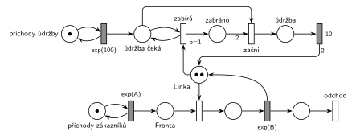

# 05-09 Údržba zabere celou kapacitu

## Zadání

> Mějme systém M/M/2. V intervalech exponenciálně se středem 100 časových jednotek přichází údržbový proces, který chce zabrat celou kapacitu linky. Po zabrání celé kapacity linky provádí její údržbu po dobu 10 časových jednotek. Údržbový proces nesmí ve frontě k lince zestárnout.

Podobné úlohy: [Pomocník přidá kapacitu](<../10 - Pomocník přidá kapacitu/10 - Pomocník přidá kapacitu.md>) (sesterská skupina F téhož termínu), [MM3 – prioritní zabírají 2 linky](<../../07 - Priority/06 - MM3 – prioritní zabírají 2 linky/06 - MM3 – prioritní zabírají 2 linky.md>) (transakce zabírá dvě linky najednou), [Údržbář na obchůzce](<../../04 - Údržba a spánek/07 - Údržbář na obchůzce/07 - Údržbář na obchůzce.md>).

## Nápověda

<details>
<summary>Zobrazit nápovědu</summary>
<br>

- **M/M/2:** *příchody zákazníků* ⇄ `exp(A)` → *fronta* → obsazení *Linky* → `exp(B)`, který jednotku vrací → *konec* → *odchod*. *Linka* má dvě značky (dvě jednotky kapacity). Příchody a obsluhu zákazníků zadání neuvádí, proto `exp(A)` a `exp(B)`.
- **Údržbový proces** vzniká v místě *příchody údržby* (smyčka s `exp(100)`) a čeká v místě *údržba čeká*. Probíhající obsluhy nepřerušuje, čeká na uvolnění jednotek.
- **„Nesmí ve frontě zestárnout“** = údržba má přednost před zákazníky. Jakmile čeká, dostane každou uvolněnou jednotku ona, ne další zákazník.
- **Proto zabírá po jedné jednotce:** *zabírá* (`p=1`) testuje *údržba čeká* a přesune jednu volnou jednotku do *zabráno*. Kdyby údržba brala obě jednotky najednou (hrana s váhou 2), čekala by, až budou volné obě současně. Mezitím by každou jednotlivě uvolněnou jednotku obsadil zákazník a údržba by mohla čekat neomezeně dlouho, tedy „zestárnout“.
- **Začni** vezme čekající údržbu a dvě zabrané jednotky. Po `10` se obě jednotky vrátí do *Linky* a údržbový proces skončí (nejde o transakci systému, proto bez výstupního přechodu).
- **Zabrané jednotky jsou společné:** když čekají dvě údržby, jednotky se sbírají do *zabráno* a první údržba začne, jakmile jsou tam dvě. Kdyby si každá údržba držela svou jednotku, mohly by dvě údržby mít po jedné a čekat na sebe navzájem (uváznutí).

</details>

## Petriho síť

<details>
<summary>Zobrazit Petriho síť</summary>
<br>



</details>

## Časté chyby

<details>
<summary>Zobrazit časté chyby</summary>
<br>

- Údržba bere obě jednotky jedním přechodem s váhou 2: při trvalém provozu může čekat neomezeně dlouho (přesně to zadání zakazuje).
- Údržba bez priority před zákazníky: uvolněná jednotka se náhodně dostane zákazníkovi.
- Přerušení rozpracovaných obsluh. Zadání chce jen přednost ve frontě, ne vyhazování z linky.
- Každá údržba si drží „svou“ první jednotku: dvě čekající údržby se mohou zablokovat.
- Po údržbě vrácená jen jedna jednotka (hrana bez váhy 2): z M/M/2 se stane M/M/1.

</details>

## SIMLIB

<details>
<summary>Zobrazit SIMLIB kód</summary>
<br>

Model je izomorfní k Petriho síti výše: každé místo, přechod a značka mají svůj protějšek v kódu. Hodnoty `A = 6` a `B = 9` jsou doplněné, zadání je nedává. Linka je `Store` s kapacitou 2. Čekající údržby jsou jen značky v místě *údržba čeká*, tedy počítadlo `ceka`; přechody *zabírá*, *začni* a `10` obstarává jeden proces `Udrzba` s prioritou 1, takže zabrané jednotky jsou společné jako místo *zabráno* a dvě údržby nemohou uváznout s jednou jednotkou každá. Jedno `Enter(Linka, 2)` by nefungovalo: když se dvě jednotky nevejdou, `Leave` čekající údržbu přeskočí a pustí zákazníky za ní, takže by údržba „zestárla“ přesně tak, jak to zadání zakazuje.

```cpp
// Údržba zabere celou kapacitu – model v SIMLIB/C++
#define I_REALLY_KNOW_HOW_TO_USE_WAITUNTIL  // zpřístupní makro WaitUntil (test podmínky)
#include "simlib.h"

const double A = 6;                    // střední interval příchodů exp(A), zadání ho nedává
const double B = 9;                    // střední doba obsluhy exp(B), zadání ji nedává

Store Linka("Linka", 2);               // místo Linka se dvěma značkami
int ceka = 0;                          // místo „údržba čeká“ (počet značek)
int udrzeb = 0, nejvicCeka = 0;        // počet provedení přechodu začni, nejvíc čekajících

class Udrzba : public Process {        // přechody zabírá, začni a 10, místa zabráno a údržba
  void Behavior() {
    for (;;) {
      WaitUntil(ceka > 0);             // zabírá testuje „údržba čeká“
      Enter(Linka, 1);                 // zabírá (p=1): jedna uvolněná jednotka do „zabráno“
      Enter(Linka, 1);                 // zabírá: druhá jednotka
      while (ceka > 0) {               // začni: údržba čeká + 2 zabráno → údržba
        ceka--;
        udrzeb++;
        Wait(10);                      // údržba → 10
      }                                // další čekající údržba by vrácené jednotky hned
      Leave(Linka, 2);                 // zase zabrala (p=1), proto je drží rovnou; 10: 2 do Linky
    }
  }
 public:
  Udrzba() : Process(1) {}             // priorita 1: ve frontě Linky předběhne zákazníky
};

class GenUdrzby : public Event {       // místo „příchody údržby“ ve smyčce s exp(100)
  void Behavior() {
    ceka++;                            // značka do „údržba čeká“
    if (ceka > nejvicCeka) nejvicCeka = ceka;
    Activate(Time + Exponential(100));
  }
};

class Zakaznik : public Process {      // transakce = značka, která prochází sítí
  void Behavior() {
    Enter(Linka, 1);                   // Fronta + obsazení (bere jednotku Linky)
    Wait(Exponential(B));              // časovaný přechod exp(B) ...
    Leave(Linka, 1);                   // ... který jednotku vrací
  }                                    // konec Behavior = konec + odchod
};

class Generator : public Event {       // místo „příchody zákazníků“ ve smyčce s exp(A)
  void Behavior() {
    (new Zakaznik)->Activate();        // nová značka ve Frontě
    Activate(Time + Exponential(A));   // další příchod
  }
};

int main() {
  Init(0, 1000000);                     // modelový čas v časových jednotkách
  (new Udrzba)->Activate();
  (new GenUdrzby)->Activate(Exponential(100));
  (new Generator)->Activate();
  Run();
  Linka.Output();                      // obsazenost včetně jednotek zabraných údržbou
  Print("Údržeb: %d (jednou za %.1f), nejvíc čekajících najednou: %d\n", udrzeb,
        Time / udrzeb, nejvicCeka);
}
```

| Petriho síť | SIMLIB |
|---|---|
| *příchody zákazníků* ⇄ `exp(A)` | událost `Generator`, která se znovu plánuje za `Exponential(A)` |
| značka (zákazník) | proces `Zakaznik` |
| místo *Linka* (2 značky) | `Store Linka("Linka", 2)` |
| *fronta* + obsazení | `Enter(Linka, 1)` (fronta je vnitřní fronta skladu) |
| `exp(B)` se sloučeným uvolněním | `Wait(Exponential(B)); Leave(Linka, 1);` |
| *příchody údržby* ⇄ `exp(100)` → *údržba čeká* | událost `GenUdrzby`: `ceka++` a další příchod za `Exponential(100)` |
| *zabírá* (`p=1`): test *údržba čeká* + jednotka → *zabráno* | `WaitUntil(ceka > 0)` a dvakrát `Enter(Linka, 1)` s prioritou procesu 1 |
| *začni*: *údržba čeká* + 2 ze *zabráno* → *údržba* | `ceka--` |
| *údržba* → `10` → 2 značky do *Linky* | `Wait(10)` a `Leave(Linka, 2)`; čeká-li další údržba, jednotky si nechá (*zabírá* by je hned vzal zpět) |
| *konec* → *odchod* | konec metody `Behavior()` zákazníka |

**Kontrola simulací.** Petriho síť: *Linka* + obsluhovaní + *zabráno* + 2 · *údržba* = 2, všechny přechody se provádějí (`make check`). Údržba proběhne v průměru jednou za 100 č. j.; občas čekají dvě nebo tři údržby najednou a síť přesto neuvázne. SIMLIB model: v jednom běhu (10⁶ časových jednotek) proběhlo 10 138 údržeb (jednou za 98,6), nejvíc čekaly čtyři najednou a fronta zákazníků měla nejvýš 91, průměrně 7,5 čekajících. Linka byla průměrně obsazená 1,77 jednotky: 1,5 = B/A připadá na zákazníky, 0,2 na samotné údržby (2 jednotky × 10 / 100) a zbytek na jednotky zabrané, zatímco údržba čeká na druhou (`make simlib`).

</details>

## Původ a zdroje

<details>
<summary>Zobrazit původ a zdroje</summary>
<br>

**Původ:** zkouška 2025/26, 2. termín (27. 1. 2026), skupina E, otázka 1, 10 bodů.

**Původní znění:**

> Mějme systém M/M/2. V intervalech exp(100 č.j.) přichází údržbový proces, který chce zabrat celou kapacitu linky. Po zabrání celé kapacity linky provádí její údržbu po dobu 10 č.j. Údržbový proces nesmí ve frontě k lince zestárnout. Zadaný systém modelujte prostředky Petriho sítě.

**Zdroje:**

- `Fitcheats/Zkoušky z minulých let/2025-26 - 2. termín E.pdf`, str. 1 (fotka zadání, studentská odpověď je zabělená)

**Existující řešení:**

- Na fotce zadání je studentská odpověď, ale celá zabělená, takže se nedá přečíst. Jiné řešení v materiálech není.

</details>

## Reference

- [Jak síť funguje](<../../../basics/Jak síť funguje.md>)
- [Notace a vzory](<../../../basics/Notace a vzory.md>)

<!-- -->

- [Studijní plán](<../../Studijní plán.md>)
- [Seznam úloh](<../../Seznam úloh.md>)
