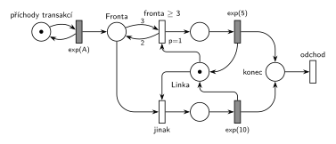

# 05–01 – Doba obsluhy podle délky fronty

**Původ:** zkouška 2020/21, 1. termín, skupina v 10:00, otázka 2 (body neuvedené). Stejná úloha (obecné X místo 3): zkouška 2019/20, 1. termín, neznámá skupina, otázka 4, 10 bodů.

**Zdroje:**

- `Fitcheats/Zkoušky z minulých let/2020-21 - 1. termín.txt`, skupina 10:00, otázka 2 (studentský přepis zadání)
- `Fitcheats/Zkoušky z minulých let/2019-20 - 1. termín.txt`, „Skupina ?“, otázka 4 (studentský přepis zadání)
- `Fitcheats/Příprava na zkoušku/FIT - Řešené výpočetní příklady 2017-21.pdf`, str. 15 (varianta s X: studentské řešení s komentáři) a str. 31–32 („2021 - Řádný 10:00“: studentské řešení)

## Zadání

⚠️ Původní zadání se nedochovalo, jen studentské přepisy:

> Petriho síť (M/M/1 kde trvání 5 pokud je fronta >=3 jinak 10)

Řešené výpočetní příklady, str. 31: „Petriho síť (M/M/1 kde trvání dalsi obsluhy je 5 jednotek pokud jsou alespoň 3 transakce ve frontě, jinak 10 jednotek)“.

2019/20 (slovensky): „Nakreslit petriho siet M/M/1 kde linka obsluhuje 5jedotiek ak je vo fronte >= X procesov (presne takto to tam bolo formulovane) a inak obsluha trva 10jednotiek.“

Podobné úlohy: [09–04 – Centrum MM1 s rychlým režimem](<../09–04 - Centrum MM1 s rychlým režimem/09–04 - Centrum MM1 s rychlým režimem.md>) (rychlý režim podle délky fronty, Hrubého řešení), [05–04 – Interval příchodů podle délky fronty](<../05–04 - Interval příchodů podle délky fronty/05–04 - Interval příchodů podle délky fronty.md>) (podle fronty se mění příchody), [06–03 – MD3 – poslední volné zařízení](<../06–03 - MD3 – poslední volné zařízení/06–03 - MD3 – poslední volné zařízení.md>) (doba obsluhy podle stavu linek).

## Interpretace

Zobrazit interpretaci (nápověda)

- **Kdy se rozhoduje:** při zahájení obsluhy („trvání další obsluhy“). Probíhající obsluhu pozdější změna fronty nemění. Proto jsou tu dvě obsazení *Linky*, každé s vlastní obsluhou.
- **Test fronty v obsazení:** *fronta ≥ 3* bere z *Fronty* 3 značky a 2 vrací. Odebere tedy jednu transakci a zároveň ověří, že jich ve frontě byly aspoň 3. Priorita `p=1` zajistí, že při dlouhé frontě vyhraje rychlá obsluha. *Jinak* (`p=0`) se provede jen tehdy, když rychlá větev proveditelná není.
- **Kdo se počítá do fronty:** tady i transakce, která právě linku obsazuje (v tu chvíli je ještě ve *Frontě*). Tak to kreslí i obě studentská řešení. Kdo počítá jen ty, kdo po zahájení obsluhy dál čekají, dá váhy 4 a 3. Zadání to nerozlišuje, u zkoušky stačí zvolené čtení napsat.
- **exp(5), nebo 5?** Systém je M/M/1, obsluha je tedy exponenciální a 5 a 10 jsou střední hodnoty. Konstantní doba by znamenala M/D/1. Kdo čte zadání doslova, napíše `5` a `10`, struktura sítě zůstane stejná.
- **Linka** leží mezi oběma obsazeními, aby k ní vedly krátké hrany. Obě obsluhy ji vracejí (uvolnění sloučené s časovaným přechodem).
- Interval příchodů zadání neuvádí, proto `exp(A)`.

## Řešení

Zobrazit řešení

| Požadavek | Prvek sítě |
|---|---|
| M/M/1 | *generátor* ⇄ `exp(A)` → *Fronta* → obsazení *Linky* → obsluha (vrací *Linku*) |
| ve frontě aspoň 3 → obsluha 5 | *fronta ≥ 3* (`p=1`): z *Fronty* 3, zpět 2, + *Linka* → `exp(5)` |
| jinak obsluha 10 | *jinak* (`p=0`): *Fronta* + *Linka* → `exp(10)` |
| transakce opouští systém | *odchod* |

Kontrola simulací (A = 7): *Linka* + obsluhovaná transakce = 1. Asi 70 % obsluh je rychlých a fronta zůstává omezená (nejvýš kolem 26).

## Existující řešení

Zobrazit srovnání s existujícími řešeními

- **Řešené výpočetní příklady, str. 15 (varianta s X):** stejná síť. Přechod *P1* má hranu *x* z fronty a *x−1* zpět a obsazuje linku, druhé obsazení je bez priority. Obsluhy `exp(5)` a `exp(10)` vracejí linku, výstupní přechod je společný. Pod řešením je spor, zda nemá být jen `5` místo `exp(5)`. Odpověď „je to M/M/1 … aby tam bylo jen trvání 5 jednotek, muselo by to být M/D/1“ je správná.
- **Řešené výpočetní příklady, str. 32 (varianta s 3):** totéž s váhami 3 a 2 a `p=1`. Každá větev má vlastní výstupní místo a přechod, což je také správně.

## Časté chyby

Zobrazit časté chyby

- Test fronty jedinou hranou s váhou 3 bez zpětné hrany: obsazení by z fronty odebralo tři transakce.
- Obě obsazení bez priority: při dlouhé frontě by se náhodně vybírala i pomalá obsluha.
- Volba doby obsluhy už při příchodu (rozdělení před *Frontou*): o době pak rozhoduje fronta v okamžiku příchodu, ne při zahájení obsluhy.
- Přepínání doby obsluhy během probíhající obsluhy (test fronty napojený na časovaný přechod).

