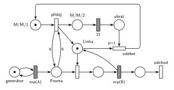

# 05–02 – Dočasně MM2 při dlouhé frontě

**Původ:** zkouška 2018/19, 3. termín (2. opravný), otázka 1 (body neuvedené). Otázka 2 chtěla k tomuto modelu program v SIMLIBu.

**Zdroje:**

- `Fitcheats/Zkoušky z minulých let/2018-19 - 3. termín.txt`, otázky 1 a 2 (studentský přepis zadání)
- `Fitcheats/Příprava na zkoušku/FIT - Řešené výpočetní příklady 2017-21.pdf`, str. 19 („2019 - 2. opravný“: studentská síť)
- `Fitcheats/Příprava na zkoušku/Bug - Řešené otázky.pdf`, str. 11 (stejná síť a kód v SIMLIBu)
- `Fitcheats/Příprava na zkoušku/cranycrane - Kódy (generátory, Monte Carlo, Euler, RK, Petri + SIMLIB)/petri/1.png` a `1.cpp`

## Zadání

⚠️ Původní zadání se nedochovalo, jen studentské přepisy:

> 1. M/M/1, pokud délka fronty přesáhne 5 – M/M/2 na 15j času
> 2. simlib pro 1, byla zde napověda, že máme využít Store a měnit kapacitu v závislosti na délce fronty (byl jsem upozorněn, že lze řešit i bez vyřešení 1. otázky)

Bug, str. 11 (slovensky): „Petriho sieť bola typu M/M/1, ak dĺžka fronty presiahne 5, tak sa SHO prepne na M/M/2 na 15 jednotiek času. Taktiež zapísať v SIMLIBe. Nápoveda: Treba využiť Store a meniť kapacitu v závislosti na dĺžke fronty. Možno riešiť aj bez Petriho siete.“

Podobné úlohy: [05–03 – Natrvalo MM3 při dlouhé frontě](<../05–03 - Natrvalo MM3 při dlouhé frontě/05–03 - Natrvalo MM3 při dlouhé frontě.md>) (změna natrvalo), [05–10 – Pomocník přidá kapacitu](<../05–10 - Pomocník přidá kapacitu/05–10 - Pomocník přidá kapacitu.md>) (kapacita navíc v náhodných intervalech), [09–08 – Cestovní kancelář](<../09–08 - Cestovní kancelář/09–08 - Cestovní kancelář.md>) (fronta ≥ 5 → dvě přepážky navíc na 1 h).

## Interpretace

Zobrazit interpretaci (nápověda)

- **„Přesáhne 5“** = víc než 5, tedy aspoň 6 čekajících. Test fronty má proto váhu 6 (hrana do přechodu a zpět). „Dosáhne 5“ by byla váha 5.
- **M/M/2 = druhá jednotka kapacity:** přechod *přidej* vloží do *Linky* druhou značku. Obsluha se nemění, jen mohou běžet dvě najednou.
- **Režim** je jedna značka v *M/M/1*, *M/M/2* nebo *ubrat*. *Přidej* potřebuje značku *M/M/1*, takže dlouhá fronta během M/M/2 nespustí další rozšíření. Prioritu *přidej* nepotřebuje: fronta delší než 5 je jen při obsazené lince, takže o značky *Fronty* s obsazením nesoupeří (`p=1` jako ve studentském řešení ale nevadí).
- **15 č. j.** je konstanta: zadání neříká, že jde o exponenciální rozložení.
- **Konec M/M/2:** druhou jednotku nejde vzít, dokud na ní běží obsluha. Po 15 č. j. proto čeká značka v *ubrat* a *odeber* (`p=1`) vezme první uvolněnou jednotku dřív, než ji obsadí další transakce (obsazení má `p=0`). Rozpracovaná obsluha se normálně dokončí.
- Pokud je po návratu do M/M/1 fronta pořád delší než 5, *přidej* se hned provede znovu. Zadání nic jiného neříká.
- Příchody a obsluhu zadání neuvádí, proto `exp(A)` a `exp(B)`.
- SIMLIB část otázky tu není řešená.

## Řešení

Zobrazit řešení

| Požadavek | Prvek sítě |
|---|---|
| M/M/1 | *generátor* ⇄ `exp(A)` → *Fronta* → obsazení *Linky* → `exp(B)` (vrací *Linku*) → *odchod* |
| fronta přesáhne 5 → M/M/2 | *přidej*: *M/M/1* + test 6 na *Frontě* → druhá značka do *Linky* + *M/M/2* |
| na 15 č. j. | *M/M/2* → `15` → *ubrat* |
| návrat na M/M/1 | *odeber* (`p=1`): *ubrat* + volná jednotka *Linky* → *M/M/1* |
| transakce opouští systém | *odchod* |

Kontrola simulací (A = 5, B = 6): *Linka* + obsluhované + *M/M/1* = 2 a režim je vždy právě v jednom místě. Samotná M/M/1 by při těchto parametrech nestačila (obsluha je pomalejší než příchody), s dočasnou druhou linkou zůstává fronta omezená (nejvýš kolem 15).

## Existující řešení

Zobrazit srovnání s existujícími řešeními

- **Řešené výpočetní příklady, str. 19 = Bug, str. 11 (stejný obrázek):** stejná struktura jako tady: přepínač `p=1` s *M/M/1*, přidání značky lince, místo *M/M/2*, konstanta `15` a červený přechod `p=1`, který vezme linku a vrátí režim. **Chyba:** test fronty má váhu 5, tedy „dosáhne 5“, ne „přesáhne 5“. Stejně kód v Bugovi testuje `QueueLen() >= 5`.
- **cranycrane, 1.png:** test s váhou 6 je správně. **Chyba:** doba `exp(15)` místo konstanty 15. Mezi přepínač a přidání linky vkládá navíc jedno místo a přechod (neškodí). Odebraná jednotka linky končí ve výstupním přechodu, jako by opouštěla systém transakce, což je matoucí. V `1.cpp` chybí pojistka proti opakovanému rozšíření: každý příchod při frontě delší než 5 spustí nový proces `Nova_linka` a první z nich, který skončí, vrátí kapacitu na 1, i když jiné rozšíření ještě běží.

## Časté chyby

Zobrazit časté chyby

- Váha 5 místo 6 („přesáhne“ znamená víc než 5).
- Bez řídicí značky *M/M/1*: test fronty zůstává splněný a přechod přidává linky pořád dokola.
- Po 15 č. j. odebrání linky bez priority: uvolněnou jednotku může dřív obsadit další transakce a M/M/2 se protáhne.
- Odebrání jednotky, která právě obsluhuje (přerušení obsluhy), nebo „vrácení“ kapacity bez odebrání značky z *Linky*.

