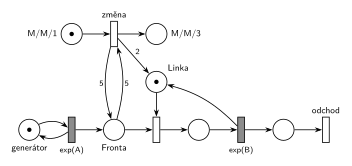

# 05–03 – Natrvalo MM3 při dlouhé frontě

## Zadání

⚠️ Původní zadání se nedochovalo, jen studentský přepis (slovensky):

> Petriho siet M/M/1. Ked bude vo fronte 5 poziadaviek, zmeni sa to na M/M/3 natrvalo

Podobné úlohy: [05–02 – Dočasně MM2 při dlouhé frontě](<../05–02 - Dočasně MM2 při dlouhé frontě/05–02 - Dočasně MM2 při dlouhé frontě.md>) (změna jen na 15 č. j.), [09–08 – Cestovní kancelář](<../09–08 - Cestovní kancelář/09–08 - Cestovní kancelář.md>) (fronta ≥ 5 → dvě přepážky navíc na 1 h).

## Interpretace

Zobrazit interpretaci (nápověda)

- **„Keď bude vo fronte 5“** = fronta dosáhne 5, test má váhu 5 (hrana do přechodu a zpět, z fronty se nic neodebere).
- **M/M/3** = tři jednotky kapacity linky. *Změna* přidá do *Linky* dvě značky (hrana s váhou 2), obsluha se nemění.
- **Natrvalo:** *změna* bere jedinou značku z *M/M/1* a ta už se nevrátí. Bez ní by se přechod provedl při každé další frontě 5 a linek by přibývalo. Místo *M/M/3* jen ukazuje stav, dá se vynechat.
- Priorita není potřeba: fronta 5 vznikne jen při obsazené lince, takže *změna* nesoupeří s obsazením o značky *Fronty*.
- Příchody a obsluhu zadání neuvádí, proto `exp(A)` a `exp(B)`.

## Petriho síť

Zobrazit Petriho síť

| Požadavek | Prvek sítě |
|---|---|
| M/M/1 | *generátor* ⇄ `exp(A)` → *Fronta* → obsazení *Linky* → `exp(B)` (vrací *Linku*) → *odchod* |
| ve frontě 5 požadavků | test s váhou 5 na *Frontě* |
| změna na M/M/3 natrvalo | *změna*: *M/M/1* → *M/M/3*, do *Linky* 2 značky |
| transakce opouští systém | *odchod* |

Kontrola simulací (A = 4, B = 6): *Linka* + obsluhované + 2 · *M/M/1* = 3. *Změna* se provede v každém běhu právě jednou. Potom je systém M/M/3 a fronta zůstává omezená, i když by ji samotná M/M/1 neudržela.

## Časté chyby

Zobrazit časté chyby

- Hrana s váhou 3 do *Linky*: k původní značce přibudou tři a vznikne M/M/4.
- Přepínač bez jednorázové značky: při každé frontě 5 přibudou další linky.
- Test fronty jen hranou dovnitř: přechod by z fronty odebral pět požadavků.
- Váha 6 („přesáhne“) místo 5.

## Původ a zdroje

Zobrazit původ a zdroje

**Původ:** zkouška 2020/21, 1. termín, skupina ve 14:00, otázka 3 (body neuvedené).

**Zdroje:**

- `Fitcheats/Zkoušky z minulých let/2020-21 - 1. termín.txt`, skupina 14:00, otázka 3 (studentský přepis zadání)
- `Fitcheats/Příprava na zkoušku/FIT - Řešené výpočetní příklady 2017-21.pdf`, str. 33 („2021 - Řádný 14:00“: síť na tabuli)
- `Fitcheats/Příprava na zkoušku/cranycrane - Kódy (generátory, Monte Carlo, Euler, RK, Petri + SIMLIB)/petri/5.png` a `5.cpp`

**Existující řešení:**

- **Řešené výpočetní příklady, str. 33:** stejná síť: přechod `P=1` s testem 5/5 na frontě, jednorázové místo s jednou značkou a hrana s váhou 2 do linky. Generátor je jen přechod `exp(x)` bez místa, výstupní přechod je. Správně.
- **cranycrane, 5.png:** totéž (test 5/5, jednorázová značka, váha 2). Kód `5.cpp` hlídá délku fronty jen při příchodu a nastaví `SetCapacity(3)`. To tu stačí, protože fronta roste jen příchody.

