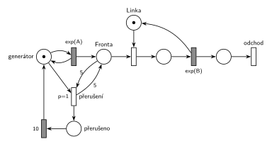

# 05–05 – Přerušení příchodů při plné frontě

## Zadání

⚠️ Původní zadání se nedochovalo, jen studentský přepis:

> Uvažujme systém M/M/1. Proces přichodu nových transakcí se na 10 časových jednotek přeruší, pokud délka fronty dosáhne pěti transakcí. Nakreslete model systému s použitím petriho sítí

Podobné úlohy: [09–06 – Klientské centrum](<../09–06 - Klientské centrum/09–06 - Klientské centrum.md>) (stejný mechanismus: fronta 10 → stop stav na 4 h), [05–06 – MM3 – zastavení příchodů](<../05–06 - MM3 – zastavení příchodů/05–06 - MM3 – zastavení příchodů.md>) (zastavení podle obsazení linek), [05–04 – Interval příchodů podle délky fronty](<../05–04 - Interval příchodů podle délky fronty/05–04 - Interval příchodů podle délky fronty.md>).

## Interpretace

Zobrazit interpretaci (nápověda)

 

- **„Dosáhne pěti“** = ve *Frontě* je aspoň 5 čekajících: test s váhou 5 (hrana do přechodu a zpět, z fronty se nic neodebere). Obsluhovaná transakce je v jiném místě a nepočítá se.
- **Přerušení příchodů:** *přerušení* odebere značku *generátoru*. Probíhající odpočet `exp(A)` tím zanikne a nikdo nepřichází. Po `10` se značka vrátí a příchody pokračují s novým odpočtem (u exponenciálního rozložení na tom nezáleží).
- **Značka generátoru je zároveň pojistka:** během přerušení chybí, takže se přerušení nemůže vyhlásit znovu, i když je ve frontě pořád 5 transakcí.
- **Po 10 č. j.:** pokud je fronta pořád aspoň 5, přerušení se hned zopakuje. Za 10 č. j. se obslouží jen pár transakcí, takže se to může stát. Kdo zadání čte jako „jen v okamžiku, kdy fronta pětky dosáhne“, musel by test navázat na příchod (např. testovat frontu z místa za příchodem). Jednodušší čtení výše u zkoušky stačí.
- **Priorita `p=1`** je pojistka, aby se test vyhodnotil dřív než ostatní okamžité přechody. Ke střetu s obsazením linky prakticky nedojde, protože fronta roste jen při obsazené lince.
- Příchody a obsluhu zadání neuvádí, proto `exp(A)` a `exp(B)`.

## Petriho síť

Zobrazit Petriho síť

 

| Požadavek | Prvek sítě |
|---|---|
| M/M/1 | *generátor* ⇄ `exp(A)` → *Fronta* → obsazení *Linky* → `exp(B)` (vrací *Linku*) → *odchod* |
| fronta dosáhne 5 | test s váhou 5 na *Frontě* |
| příchody se přeruší | *přerušení* (`p=1`) odebere značku *generátoru* → *přerušeno* |
| na 10 č. j. | *přerušeno* → `10` → *generátor* |
| transakce opouští systém | *odchod* |

Kontrola simulací (A = 5, B = 6): *Linka* + obsluhovaná transakce = 1, *generátor* + *přerušeno* = 1 a ve *Frontě* nikdy není víc než 5 transakcí.

## Časté chyby

Zobrazit časté chyby

 

- Test fronty jen hranou dovnitř: přerušení by z fronty odebralo pět transakcí.
- Zastavení příchodů odebráním transakcí z *Fronty* místo odebrání značky *generátoru*.
- Zapomenutý návrat značky po 10 č. j.: příchody by se zastavily natrvalo.
- Přerušení, které nebere značku generátoru ani jinou řídicí značku: test zůstává splněný a přechod se provádí pořád dokola.
- Váha 6 („přesáhne“) místo 5 („dosáhne“).

## Původ a zdroje

Zobrazit původ a zdroje

 

**Původ:** zkouška 2024/25, 1. termín, skupina B, otázka 3 (body neuvedené; ve skupinách A a C téhož termínu byla otázka 3 za 10 bodů).

**Zdroje:**

- `Fitcheats/Zkoušky z minulých let/2024-25 - 1. termín B.txt`, otázka 3 (studentský přepis zadání)

**Existující řešení:**

- K této úloze v materiálech žádné řešení není. Stejný mechanismus je v [09–06 – Klientské centrum](<../09–06 - Klientské centrum/09–06 - Klientské centrum.md>).

