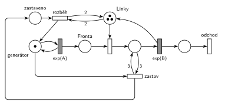

# 05–06 – MM3 – zastavení příchodů

## Zadání

> Uvažujme systém typu M/M/3. Proces příchodu nových transakcí se přeruší v okamžiku, kdy jsou všechny linky obsazené. Znovu se rozběhne, až jsou alespoň dvě linky volné. Nakreslete model systému s použitím Petriho sítí.

Podobné úlohy: [05–05 – Přerušení příchodů při plné frontě](<../05–05 - Přerušení příchodů při plné frontě/05–05 - Přerušení příchodů při plné frontě.md>) (přerušení podle délky fronty, téhož termínu), [06–03 – MD3 – poslední volné zařízení](<../06–03 - MD3 – poslední volné zařízení/06–03 - MD3 – poslední volné zařízení.md>) (obsazení poslední volné linky), [02–05 – MM3 bez fronty s opakováním](<../02–05 - MM3 bez fronty s opakováním/02–05 - MM3 bez fronty s opakováním.md>).

## Interpretace

Zobrazit interpretaci (nápověda)

 

- **M/M/3** = místo *Linky* se třemi značkami, jedno obsazení a jedna obsluha `exp(B)`. Počet obsazených linek je počet značek v místě obsluhy.
- **Přerušení příchodů:** *zastav* odebere značku *generátoru*, takže odpočet `exp(A)` zanikne. Podmínka „všechny linky obsazené“ je test s váhou 3 na místě obsluhy. Prázdné *Linky* testovat nejde (bylo by potřeba inhibiční hrany, kterou Hrubý nechce).
- **Rozběh:** *rozběh* vrátí značku *generátoru*, když jsou v *Linkách* aspoň 2 značky (test s váhou 2). Mezi tím, tedy při jedné volné lince, se nic nemění: zastavené příchody stojí, běžící běží. Tím vzniká hystereze ze zadání.
- Značky *generátor* a *zastaveno* zároveň hlídají, aby se *zastav* ani *rozběh* neprovedly dvakrát po sobě.
- **Fronta** v tomto systému čekající transakce nikdy nemá: příchody běží jen při volné lince a příchozí ji hned obsadí. Místo je tu, aby byl model čitelný jako M/M/3.
- **Pozor na test na místě obsluhy:** dvojice hran s váhou 3 značky formálně vezme a hned vrátí. Podle slajdu 139 by tím odpočty obsluh mohly začít znovu. U exponenciální obsluhy na tom nezáleží (rozložení nemá paměť). Kdo se tomu chce vyhnout, naváže zastavení na obsazení poslední volné linky: druhé obsazení s `p=0`, které navíc bere značku *generátoru*, a běžné obsazení s `p=1` jen při aspoň 2 volných linkách (hrana 2 z *Linek*, 1 zpět). Kreslí se to ale hůř.
- Příchody a obsluhu zadání neuvádí, proto `exp(A)` a `exp(B)`.

## Petriho síť

Zobrazit Petriho síť

 

| Požadavek | Prvek sítě |
|---|---|
| M/M/3 | *generátor* ⇄ `exp(A)` → *Fronta* → obsazení *Linek* (3 značky) → `exp(B)` (vrací linku) → *odchod* |
| všechny linky obsazené → příchody se přeruší | *zastav*: *generátor* + test 3 na místě obsluhy → *zastaveno* |
| aspoň dvě volné linky → příchody znovu | *rozběh*: *zastaveno* + test 2 na *Linkách* → *generátor* |
| transakce opouští systém | *odchod* |

Kontrola simulací (A = 3, B = 8): *Linky* + obsluhované = 3, *generátor* + *zastaveno* = 1 a ve *Frontě* nikdy nikdo nečeká. Příchody se zastaví asi u třetiny transakcí.

## Časté chyby

Zobrazit časté chyby

 

- Rozběh při jedné volné lince (test s váhou 1, nebo rovnou návrat značky po skončení obsluhy). Zadání chce aspoň dvě volné.
- Zastavení i rozběh bez řídicí značky: testy zůstávají splněné a přechody se provádějí pořád dokola.
- Zastavení odebráním transakcí z *Fronty* nebo blokováním obsazení místo odebrání značky *generátoru*.
- Inhibiční hrana z *Linek* na zastavení. Funguje, ale Hrubý ji nechce, test na místě obsluhy dělá totéž.

## Původ a zdroje

Zobrazit původ a zdroje

 

**Původ:** zkouška 2024/25, 1. termín (8. 1. 2025), skupina C, otázka 3, 10 bodů.

**Zdroje:**

- `Fitcheats/Zkoušky z minulých let/2024-25 - 1. termín A+C.pdf`, str. 3–4 (fotky zadání skupiny C: hlavička na str. 3, otázka 3 na str. 4, bez řešení)

**Existující řešení:**

- K této úloze v materiálech žádné řešení není.

