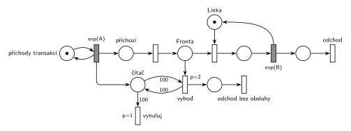

# 05–07 – Každá 100. transakce vyprázdní frontu

## Zadání

⚠️ Původní zadání se nedochovalo, jen studentský přepis (slovensky):

> Petriho síť M/M/1 kde kazda 100 transakcia vyprazdni frontu s transakciami cakajucimi na obsluhu

Podobné úlohy: [03–07 – Každá 10. transakce vyvolá poruchu](<../03–07 - Každá 10. transakce vyvolá poruchu/03–07 - Každá 10. transakce vyvolá poruchu.md>) (čítač transakcí), [04–06 – Údržba po každé 10. obsluze](<../04–06 - Údržba po každé 10. obsluze/04–06 - Údržba po každé 10. obsluze.md>), [09–03 – Psí salon](<../09–03 - Psí salon/09–03 - Psí salon.md>) (všichni čekající opustí systém, Hrubého řešení).

## Interpretace

Zobrazit interpretaci (nápověda)

 

- **„Každá 100. transakce“** se počítá při příchodu: příchod přidá značku do *čítače*. 100. příchozí najde v *čítači* 100 značek.
- **Vyprázdnění fronty** bez inhibiční hrany: *vyhoď* (`p=2`) bere z *Fronty* po jedné transakci, dokud je v *čítači* 100 značek (test s váhou 100, hrana do přechodu a zpět). Okamžité přechody se provádějí ve stejném okamžiku za sebou, takže se fronta vyprázdní celá najednou. Když je prázdná, *vyhoď* proveditelný není a na řadu přijde *vynuluj* (`p=1`), který z *čítače* odebere 100 značek.
- **Sama 100. transakce** čeká v místě *příchozí*. Do *Fronty* ji pustí přechod s `p=0` až po vyprázdnění a vynulování, takže ji *vyhoď* nevyhodí a normálně se obslouží. Kdyby šel příchod rovnou do *Fronty*, vyhodila by se i ona.
- **Transakce v obsluze** se netýká („čakajúcimi na obsluhu“): *vyhoď* bere jen z *Fronty*. Priorita `p=2` zároveň zajistí, že při vyprazdňování nikdo z fronty neobsadí linku (obsazení má `p=0`).
- Vyhozené transakce opouštějí systém vlastním výstupním přechodem *odchod bez obsluhy*.
- Přepis nepoví, zda 100. transakce frontu opouští s ostatními, ani zda se počítají příchody, nebo obsloužené transakce. Tady se počítají příchody a 100. transakce zůstává.
- Příchody a obsluhu zadání neuvádí, proto `exp(A)` a `exp(B)`.

## Petriho síť

Zobrazit Petriho síť

 

| Požadavek | Prvek sítě |
|---|---|
| M/M/1 | *generátor* ⇄ `exp(A)` → *příchozí* → *Fronta* → obsazení *Linky* → `exp(B)` (vrací *Linku*) → *odchod* |
| počítání transakcí | `exp(A)` přidá značku do *čítače* |
| 100. transakce vyprázdní frontu | *vyhoď* (`p=2`): test 100 na *čítači* + transakce z *Fronty* → *odchod bez obsluhy* |
| nové počítání | *vynuluj* (`p=1`): odebere 100 značek z *čítače* |
| 100. transakce pokračuje do fronty | přechod *příchozí* → *Fronta* (`p=0`) až po vyprázdnění |
| transakce opouští systém | *odchod*, *odchod bez obsluhy* |

Kontrola simulací (A = 5, B = 4,5): *Linka* + obsluhovaná transakce = 1 a v *čítači* nikdy nezůstane víc než 99 značek. Vynuluje se jednou na 100 příchodů a pokaždé předtím odejdou všichni čekající (celkem asi 5 % transakcí).

## Časté chyby

Zobrazit časté chyby

 

- Hrana s váhou 100 z čítače rovnou do přechodu, který vezme z fronty jednu transakci: vyhodí se jen jedna a čítač se vynuluje.
- *Vynuluj* se stejnou prioritou jako *vyhoď*: čítač se může vynulovat dřív, než se fronta vyprázdní.
- Vyprázdnění testem „fronta je prázdná“ přes inhibiční hranu. Hrubý ji nechce, stačí priorita.
- 100. transakce, která jde rovnou do *Fronty* a sama se vyhodí.
- Vyhazování i transakce, která je právě v obsluze.

## Původ a zdroje

Zobrazit původ a zdroje

 

**Původ:** zkouška 2022/23, 2. termín, skupina E, otázka 1 (body neuvedené).

**Zdroje:**

- `Fitcheats/Zkoušky z minulých let/2022-23 - 2. termín E.txt`, otázka 1 (studentský přepis zadání)

**Existující řešení:**

- K této úloze v materiálech žádné řešení není.

