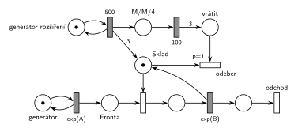

# 05–08 – Sklad s dočasně větší kapacitou

## Zadání

⚠️ Fotka je malá a rozmazaná. Text níže je čtení po zvětšení výřezu. Jistá jsou čísla (500, 3, M/M/4, 100, 1) a většina slov. Méně jistá jsou slova na začátcích řádků vlevo a to, zda před „500“ nestojí „Exp“ (na fotce ho vidět není).

> 3. (10 bodů) Nakreslete Petriho síť pro systém typu M/M/1 s linkou typu Sklad. V intervalech daných 500 časových jednotek dojde k události, která obslužnou kapacitu linky rozšíří o 3 (tj. systém se změní na M/M/4) na dobu 100 časových jednotek (pak se kapacita vrátí na 1). Po ukončení doby 100 časových jednotek rozpracované obsluhy mohou normálně dokončit obsluhu.

Podobné úlohy: [05–10 – Pomocník přidá kapacitu](<../05–10 - Pomocník přidá kapacitu/05–10 - Pomocník přidá kapacitu.md>) (+1 jednotka na 20 č. j.), [05–02 – Dočasně MM2 při dlouhé frontě](<../05–02 - Dočasně MM2 při dlouhé frontě/05–02 - Dočasně MM2 při dlouhé frontě.md>) (rozšíření podle délky fronty), [09–08 – Cestovní kancelář](<../09–08 - Cestovní kancelář/09–08 - Cestovní kancelář.md>) (dvě přepážky navíc na 1 h).

## Interpretace

<details>
<summary>Zobrazit interpretaci (nápověda)</summary>
<br>

- **M/M/1:** *příchody transakcí* ⇄ `exp(A)` → *Fronta* → obsazení jednotky *Skladu* → `exp(B)`, který jednotku vrací → *konec* → *odchod*. Příchody a obsluhu zadání neuvádí, proto `exp(A)` a `exp(B)`.
- **Linka typu Sklad** = místo s počtem značek rovným kapacitě (na začátku 1). Transakce bere jednu jednotku a obsluha ji vrací. Sklad tu zadání zmiňuje proto, že v SIMLIBu jde měnit kapacitu skladu (`SetCapacity`), v Petriho síti se kreslí stejně jako zařízení.
- **„V intervalech daných 500“** = konstanta: *rozšíření kapacity* ve smyčce s přechodem `500`. Každé jeho provedení přidá do *Skladu* 3 značky (hrana s váhou 3) a značku do *M/M/4*.
- **Po 100 č. j.** (značka *M/M/4* → `100`) přejdou 3 značky do *vrátit*. Každou z nich *odeber* (`p=1`) spáruje s jednou volnou jednotkou *Skladu* a obě zaniknou. Jednotky se tedy odebírají po jedné, jak se uvolňují: rozpracované obsluhy se dokončí („mohou normálně dokončit obsluhu“) a priorita `p=1` zajistí, že uvolněnou jednotku nestihne obsadit další transakce.
- *Odeber* nemá výstup: kapacita zanikne. Nejde o transakci, proto to není výstupní přechod. Stejně dobře by se jednotky mohly vracet do místa „rezerva“.

</details>

## Petriho síť

<details>
<summary>Zobrazit Petriho síť</summary>
<br>



</details>

## Časté chyby

<details>
<summary>Zobrazit časté chyby</summary>
<br>

- Odebrání všech tří jednotek najednou (hrana s váhou 3 ze *Skladu*): přechod čeká, až budou volné tři současně, a mezitím je dál obsazují nové transakce.
- Odebrání bez priority: uvolněnou jednotku může dřív obsadit čekající transakce a M/M/4 se protahuje.
- Přerušení rozpracovaných obsluh po 100 č. j. Zadání výslovně říká, že doběhnou.
- `exp(500)` místo konstanty 500 (zadání mluví o intervalech daných 500 časovými jednotkami).

</details>

## SIMLIB

<details>
<summary>Zobrazit SIMLIB kód</summary>
<br>

Model je izomorfní k Petriho síti výše: každé místo, přechod a značka mají svůj protějšek v kódu. Hodnoty `A = 10` a `B = 8` jsou doplněné, zadání je nedává. Sklad má pevnou kapacitu 4 a jednotky, které zrovna nemá, drží procesy mimo něj: na začátku `Mimo`, po rozšíření a 100 časových jednotkách proces `Rozsireni`. `SetCapacity` tu nestačí: kapacitu nezmenší, dokud někdo čeká ve frontě (SIMLIB skončí chybou), a po zvětšení čekající sama nepustí. Kód předpokládá, že rozšíření stihne vzít své tři jednotky zpět dřív než za 400 časových jednotek, kdy přijde další; při obsluze se středem 8 je to prakticky jisté.

```cpp
// 05–08 Sklad s dočasně větší kapacitou – model v SIMLIB/C++
#include "simlib.h"

const double A = 10;                   // střední interval příchodů exp(A), zadání ho nedává
const double B = 8;                    // střední doba obsluhy exp(B), zadání ji nedává

Store Sklad("Sklad", 4);               // místo Sklad: 4 jednotky, 3 z nich jsou mimo Sklad
int rozsireni = 0;                     // počet provedení přechodu 500

class Mimo : public Process {          // 3 jednotky, které Sklad zatím nemá
  void Behavior() { Enter(Sklad, 3); } // vezme je a skončí (jednotky zůstanou mimo Sklad)
 public:
  Mimo() : Process(1) {}
};

class Rozsireni : public Process {     // značka v M/M/4, pak 3 značky v „vrátit“
  void Behavior() {
    Leave(Sklad, 3);                   // 500: 3 značky do Skladu, čekající je hned obsadí
    Wait(100);                         // M/M/4 → 100 → vrátit
    for (int i = 0; i < 3; i++)
      Enter(Sklad, 1);                 // odeber (p=1): po jedné, jak se jednotky uvolňují
  }                                    // jednotky jsou zase mimo Sklad
 public:
  Rozsireni() : Process(1) {}          // priorita 1: ve frontě Skladu předběhne transakce
};

class GenRozsireni : public Event {    // místo „rozšíření kapacity“ ve smyčce s 500
  void Behavior() {
    rozsireni++;
    (new Rozsireni)->Activate();
    Activate(Time + 500);              // další rozšíření za přesně 500
  }
};

class Transakce : public Process {     // transakce = značka, která prochází sítí
  void Behavior() {
    Enter(Sklad, 1);                   // Fronta + obsazení (bere jednotku Skladu)
    Wait(Exponential(B));              // časovaný přechod exp(B) ...
    Leave(Sklad, 1);                   // ... který jednotku vrací
  }                                    // konec Behavior = konec + odchod
};

class Generator : public Event {       // místo „příchody transakcí“ ve smyčce s exp(A)
  void Behavior() {
    (new Transakce)->Activate();       // nová značka ve Frontě
    Activate(Time + Exponential(A));   // další příchod
  }
};

int main() {
  Init(0, 1000000);                    // modelový čas v časových jednotkách
  (new Mimo)->Activate();              // nejdřív odebrat 3 jednotky, Sklad má kapacitu 1
  (new GenRozsireni)->Activate(500);
  (new Generator)->Activate();
  Run();
  Sklad.Output();                      // obsazenost včetně jednotek mimo Sklad
  Print("Rozšíření: %d×\n", rozsireni);
}
```

| Petriho síť | SIMLIB |
|---|---|
| *příchody transakcí* ⇄ `exp(A)` | událost `Generator`, která se znovu plánuje za `Exponential(A)` |
| značka (transakce) | proces `Transakce` |
| místo *Sklad* (1 značka, v M/M/4 čtyři) | `Store Sklad("Sklad", 4)`, jednotky mimo Sklad drží `Mimo`, resp. `Rozsireni` |
| *Fronta* + obsazení | `Enter(Sklad, 1)` (fronta je vnitřní fronta skladu) |
| `exp(B)` se sloučeným uvolněním | `Wait(Exponential(B)); Leave(Sklad, 1);` |
| *rozšíření kapacity* ⇄ `500` | událost `GenRozsireni`, která se znovu plánuje za přesně 500 |
| `500` → 3 značky do *Skladu*, značka do *M/M/4* | nový proces `Rozsireni`: `Leave(Sklad, 3)` |
| *M/M/4* → `100` → 3 značky do *vrátit* | `Wait(100)` |
| *odeber* (`p=1`): *vrátit* + volná jednotka *Skladu* | třikrát `Enter(Sklad, 1)` s prioritou procesu 1 (ve frontě skladu je první) |
| *konec* → *odchod* | konec metody `Behavior()` transakce |

**Kontrola simulací.** Petriho síť: *Sklad* + obsluhované = 1 + 3 · *M/M/4* + *vrátit*, všechny přechody se provádějí (`make check`). Rozšíření proběhne každých 500 č. j. a po každém se odeberou právě 3 jednotky. SIMLIB model: v jednom běhu (10⁶ časových jednotek) proběhlo 2000 rozšíření (10⁶ / 500), fronta měla nejvýš 28 a průměrně 1,7 čekajících. Sklad byl průměrně obsazený 3,21 jednotky; odečtou-li se tři jednotky mimo Sklad (jsou mimo zhruba 80 % času, tedy průměrně asi 2,4), zbývá na obsluhy asi 0,8 = B/A (`make simlib`).

</details>

## Původ a zdroje

<details>
<summary>Zobrazit původ a zdroje</summary>
<br>

**Původ:** zkouška 2017/18, 3. termín, skupina Z, otázka 3, 10 bodů (počet bodů je na fotce špatně čitelný).

**Původní znění:**

> 3. (10 bodů) Nakreslete Petriho síť pro systém typu M/M/1 s linkou typu Sklad. V intervalech daných 500 časových jednotek dojde k události, která obslužnou kapacitu linky rozšíří o 3 (tj. systém se změní na M/M/4) na dobu 100 časových jednotek (pak se kapacita vrátí na 1). Po ukončení doby 100 č.j. rozpracované obsluhy mohou normálně dokončit obsluhu.

**Zdroje:**

- `Fitcheats/Zkoušky z minulých let/2017-18 - 3. termín Z.pdf`, str. 1 (rozmazaná fotka zadání, 438 × 720 px)

**Existující řešení:**

- K této úloze v materiálech žádné řešení není.

</details>
