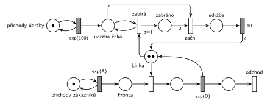

# 05–09 – Údržba zabere celou kapacitu

## Zadání

> Mějme systém M/M/2. V intervalech exp(100 č.j.) přichází údržbový proces, který chce zabrat celou kapacitu linky. Po zabrání celé kapacity linky provádí její údržbu po dobu 10 č.j. Údržbový proces nesmí ve frontě k lince zestárnout. Zadaný systém modelujte prostředky Petriho sítě.

Podobné úlohy: [05–10 – Pomocník přidá kapacitu](<../05–10 - Pomocník přidá kapacitu/05–10 - Pomocník přidá kapacitu.md>) (sesterská skupina F téhož termínu), [07–06 – MM3 – prioritní zabírají 2 linky](<../07–06 - MM3 – prioritní zabírají 2 linky/07–06 - MM3 – prioritní zabírají 2 linky.md>) (transakce zabírá dvě linky najednou), [04–07 – Údržbář na obchůzce](<../04–07 - Údržbář na obchůzce/04–07 - Údržbář na obchůzce.md>).

## Interpretace

Zobrazit interpretaci (nápověda)

 

- **M/M/2** = *Linka* se dvěma značkami (dvě jednotky kapacity).
- **Údržbový proces** vzniká v *generátoru údržby* (`exp(100)`) a čeká v místě *údržba čeká*. Probíhající obsluhy nepřerušuje, čeká na uvolnění jednotek.
- **„Nesmí ve frontě zestárnout“** = údržba má přednost před zákazníky. Jakmile čeká, dostane každou uvolněnou jednotku ona, ne další zákazník.
- **Proto zabírá po jedné jednotce:** *zabírá* (`p=1`) testuje *údržba čeká* a přesune jednu volnou jednotku do *zabráno*. Kdyby údržba brala obě jednotky najednou (hrana s váhou 2), čekala by, až budou volné obě současně. Mezitím by každou jednotlivě uvolněnou jednotku obsadil zákazník a údržba by mohla čekat neomezeně dlouho, tedy „zestárnout“.
- **Začni** vezme čekající údržbu a dvě zabrané jednotky. Po `10` se obě jednotky vrátí do *Linky* a údržbový proces skončí (nejde o transakci systému, proto bez výstupního přechodu).
- **Zabrané jednotky jsou společné:** když čekají dvě údržby, jednotky se sbírají do *zabráno* a první údržba začne, jakmile jsou tam dvě. Kdyby si každá údržba držela svou jednotku, mohly by dvě údržby mít po jedné a čekat na sebe navzájem (uváznutí).
- Příchody a obsluhu zákazníků zadání neuvádí, proto `exp(A)` a `exp(B)`.

## Petriho síť

Zobrazit Petriho síť

 

| Požadavek | Prvek sítě |
|---|---|
| M/M/2 | *generátor* ⇄ `exp(A)` → *Fronta* → obsazení *Linky* (2 značky) → `exp(B)` (vrací jednotku) → *odchod* |
| údržbový proces v intervalech exp(100) | *generátor údržby* ⇄ `exp(100)` → *údržba čeká* |
| zabrání celé kapacity, údržba nezestárne | *zabírá* (`p=1`): test *údržba čeká* + jednotka z *Linky* → *zabráno* |
| údržba 10 č. j. | *začni*: *údržba čeká* + 2 ze *zabráno* → *údržba* → `10` → 2 značky do *Linky* |
| transakce opouští systém | *odchod* |

Kontrola simulací (A = 6, B = 9): *Linka* + obsluhovaní + *zabráno* + 2 · *údržba* = 2. Údržba proběhne v průměru jednou za 100 č. j. Občas čekají dvě nebo tři údržby najednou a síť přesto neuvázne.

## Časté chyby

Zobrazit časté chyby

 

- Údržba bere obě jednotky jedním přechodem s váhou 2: při trvalém provozu může čekat neomezeně dlouho (přesně to zadání zakazuje).
- Údržba bez priority před zákazníky: uvolněná jednotka se náhodně dostane zákazníkovi.
- Přerušení rozpracovaných obsluh. Zadání chce jen přednost ve frontě, ne vyhazování z linky.
- Každá údržba si drží „svou“ první jednotku: dvě čekající údržby se mohou zablokovat.
- Po údržbě vrácená jen jedna jednotka (hrana bez váhy 2): z M/M/2 se stane M/M/1.

## Původ a zdroje

Zobrazit původ a zdroje

 

**Původ:** zkouška 2025/26, 2. termín (27. 1. 2026), skupina E, otázka 1, 10 bodů.

**Zdroje:**

- `Fitcheats/Zkoušky z minulých let/2025-26 - 2. termín E.pdf`, str. 1 (fotka zadání, studentská odpověď je zabělená)

**Existující řešení:**

- Na fotce zadání je studentská odpověď, ale celá zabělená, takže se nedá přečíst. Jiné řešení v materiálech není.

