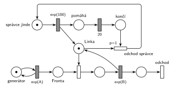

# 05–10 – Pomocník přidá kapacitu

## Zadání

> Mějme systém M/M/1. V intervalech exp(100 č.j.) přichází dobrotivý správce linky, který na dobu 20 č.j. pomáhá s obsluhou tak, že poskytuje lince další jednu jednotku kapacity (systém je pak M/M/2). Zadaný systém modelujte prostředky Petriho sítě.

Podobné úlohy: [05–09 – Údržba zabere celou kapacitu](<../05–09 - Údržba zabere celou kapacitu/05–09 - Údržba zabere celou kapacitu.md>) (sesterská skupina E téhož termínu), [05–08 – Sklad s dočasně větší kapacitou](<../05–08 - Sklad s dočasně větší kapacitou/05–08 - Sklad s dočasně větší kapacitou.md>) (+3 jednotky na 100 č. j.), [05–02 – Dočasně MM2 při dlouhé frontě](<../05–02 - Dočasně MM2 při dlouhé frontě/05–02 - Dočasně MM2 při dlouhé frontě.md>).

## Interpretace

Zobrazit interpretaci (nápověda)

- **Správce je jeden člověk:** jedna značka koluje mezi *správce jinde*, *pomáhá* a *končí*. Další příchod tak nastane až poté, co odejde, a systém je nejvýš M/M/2, jak zadání říká. Generátor ve smyčce by mohl poslat druhého správce, zatímco první ještě pomáhá (vzniklo by M/M/3). Interval `exp(100)` se tu proto měří od jeho odchodu.
- **Pomoc = jednotka kapacity navíc:** příchod správce přidá do *Linky* druhou značku. Obsluha je pořád `exp(B)`, jen mohou běžet dvě najednou.
- **Konec pomoci po 20 č. j.:** jednotku nejde vzít, dokud na ní běží obsluha. *Odchod správce* (`p=1`) proto vezme první volnou jednotku dřív, než ji obsadí další transakce. Rozpracovaná obsluha se normálně dokončí. Zadání to výslovně neříká, ale odejít uprostřed obsluhy by znamenalo vrátit zákazníka do fronty a to by zadání asi zmínilo.
- Jednotky kapacity se nerozlišují, správce tedy „odnese“ kteroukoli volnou.
- Příchody a obsluhu zákazníků zadání neuvádí, proto `exp(A)` a `exp(B)`.

## Petriho síť

Zobrazit Petriho síť

| Požadavek | Prvek sítě |
|---|---|
| M/M/1 | *generátor* ⇄ `exp(A)` → *Fronta* → obsazení *Linky* → `exp(B)` (vrací jednotku) → *odchod* |
| správce přichází v intervalech exp(100) | *správce jinde* → `exp(100)` |
| poskytne lince další jednotku (M/M/2) | `exp(100)` → značka do *Linky* + *pomáhá* |
| na 20 č. j. | *pomáhá* → `20` → *končí* |
| odchod správce | *odchod správce* (`p=1`): *končí* + volná jednotka *Linky* → *správce jinde* |
| transakce opouští systém | *odchod* |

Kontrola simulací (A = 5, B = 4): *Linka* + obsluhovaní + *správce jinde* = 2 a správce je vždy právě v jednom ze tří míst. Pomáhá asi 400krát za 10 000 transakcí, tedy zhruba jednou za 120 č. j.

## Časté chyby

Zobrazit časté chyby

- Časovaný přechod `20` se vstupem z *Linky*: jednotka by během odpočtu čekala v *Lince*, první zákazník by ji obsadil a odpočet zrušil.
- Odebrání jednotky bez priority: uvolněnou jednotku může dřív obsadit čekající zákazník a pomoc se protáhne.
- Přidání jednotky bez jejího odebrání (kapacita roste s každým příchodem správce).
- Generátor správce ve smyčce: při překryvu dvou návštěv vznikne M/M/3.

## Původ a zdroje

**Původ:** zkouška 2025/26, 2. termín (27. 1. 2026), skupina F, otázka 1, 10 bodů.

**Zdroje:**

- `Fitcheats/Zkoušky z minulých let/2025-26 - 2. termín F.pdf`, str. 1 (fotka zadání, bez řešení)

**Existující řešení:**

Zobrazit existující řešení

- K této úloze v materiálech žádné řešení není.

