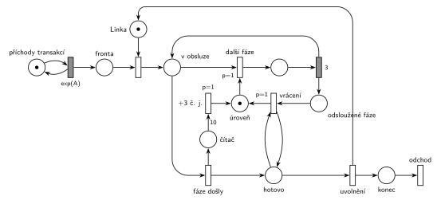

# 06-01 MD1 – prodlužování po 10 obsluhách

## Zadání

> Mějme SHO typu M/D/1, kde je na počátku doba obsluhy přesně 3 časové jednotky. Po každých 10 provedených obsluhách se doba obsluhy navýší o 3 časové jednotky. Systém modelujte Petriho sítí.

Podobné úlohy: [Údržba po každé 10. obsluze](<../../04 - Údržba a spánek/06 - Údržba po každé 10. obsluze/06 - Údržba po každé 10. obsluze.md>) (čítač 10 obsluh), [MD1 – střídání 2 a 3](<../02 - MD1 – střídání 2 a 3/02 - MD1 – střídání 2 a 3.md>), [Pražírna kávy](<../../09 - Obsluha zákazníků/20 - Pražírna kávy/20 - Pražírna kávy.md>) (opakování fází obsluhy podle počtu značek).

## Nápověda

<details>
<summary>Zobrazit nápovědu</summary>
<br>

- **Příchody a linka:** místo *příchody transakcí* ve smyčce s `exp(A)` (M/D/1 má exponenciální příchody, číslo zadání nedává) vkládá transakce do *fronty*; obsazení vezme značku *Linky* a transakce je *v obsluze*.
- **Doba obsluhy je 3, 6, 9, 12, …** (prvních 10 obsluh 3, dalších 10 obsluh 6 atd.) a roste bez omezení. Časovaný přechod má ale pevný čas. Možnosti:
  - **obsluha složená z k fází po `3`**, kde k je počet značek v místě *úroveň*. Síť je konečná a modeluje celý systém (řešení tady);
  - samostatné větve `3`, `6`, `9`, … s přepínáním po 10 obsluhách: každá úroveň potřebuje vlastní přechod, takže síť by musela být nekonečná. Nakreslit pár úrovní a „…“ je jen náčrt;
  - jeden přechod s časem „3·k“: čas časovaného přechodu v kurzové notaci nemůže záviset na značení, nejde tedy o Petriho síť, jen o poznámku.
- **Smyčka fází** (stejný princip jako iterace nákupu v úloze [Pražírna kávy](<../../09 - Obsluha zákazníků/20 - Pražírna kávy/20 - Pražírna kávy.md>)): *další fáze* (`p=1`) vezme transakci z *v obsluze* a jednu značku z *úrovně*, po `3` vrátí transakci do *v obsluze* a značku odloží do *odsloužené fáze*. Když *úroveň* dojde, provede se *fáze došly* (`p=0`). Celkem tedy obsluha trvá 3·k; *úroveň* má na začátku 1 značku.
- **Vrácení úrovně:** odsloužené značky se musí vrátit, jinak by příští obsluha neměla žádnou fázi. Vrátit je ale smí až po skončení obsluhy (během obsluhy by se hned znovu spotřebovaly a fáze by se opakovaly donekonečna). Proto transakce po *fáze došly* chvíli stojí v *hotovo*: *vrácení* (`p=1`, testovací hrany na *hotovo*) přesune všechny značky zpět a teprve potom *uvolnění* (`p=0`) vrátí *Linku*. Vše proběhne v nulovém čase.
- **Čítač obsluh:** každá skončená obsluha (*fáze došly*) přidá značku do *čítače*. Hrana s váhou 10 po desáté obsluze čítač vynuluje a přidá do *úrovně* jednu fázi, tedy +3 č. j. Jedenáctá obsluha už trvá 6.
- Po uvolnění linky jde transakce do místa *konec* a systém opouští přechodem *odchod*.
- **Systém je z principu nestabilní:** doba obsluhy roste nade všechny meze, takže fronta při jakýchkoli příchodech nakonec neomezeně roste.
- M/D/1: fáze obsluhy trvá pevně `3`, bez `exp`.

</details>

## Petriho síť

<details>
<summary>Zobrazit Petriho síť</summary>
<br>



</details>

## Časté chyby

<details>
<summary>Zobrazit časté chyby</summary>
<br>

- Jediná další větev s obsluhou 6: modeluje jen první navýšení, ne „po každých 10“.
- Čítač testovaný hranami s váhou 10 tam a zpět: nevynuluje se, takže po desáté obsluze by navyšovala každá další.
- Odsloužené fáze vracené bez čekání na konec obsluhy: smyčka fází se nikdy neukončí.
- Linka uvolněná dřív, než se fáze vrátí: další transakce může začít obsluhu s neúplnou *úrovní*.
- `exp(3)` místo pevné doby; zadání je M/D/1.

</details>

## SIMLIB

<details>
<summary>Zobrazit SIMLIB kód</summary>
<br>

Model je izomorfní k Petriho síti výše: každé místo, přechod a značka mají svůj protějšek v kódu.

```cpp
// MD1 – prodlužování po 10 obsluhách – model v SIMLIB/C++
#include "simlib.h"

const double A = 10;                   // střední interval příchodů (zadání ho nedává)

Facility Linka("Linka");               // místo „Linka“ (1 značka)
int uroven = 1;                        // místo „úroveň“: počet fází po 3 v jedné obsluze
int odslouzene = 0;                    // místo „odsloužené fáze“
int citac = 0;                         // místo „čítač“
Histogram DobaObsluhy("Doba obsluhy [č. j.]", 1.5, 3, 40);

class Transakce : public Process {     // transakce = značka, která prochází sítí
  void Behavior() {
    Seize(Linka);                      // fronta + obsazení, transakce je „v obsluze“
    double zacatek = Time;
    while (uroven > 0) {               // další fáze (p=1) bere značku z úrovně
      uroven--;
      Wait(3);                         // časovaný přechod 3 ...
      odslouzene++;                    // ... odloží značku do „odsloužené fáze“
    }                                  // úroveň došla: fáze došly (p=0), transakce je „hotovo“
    DobaObsluhy(Time - zacatek);
    if (++citac == 10) {               // fáze došly přidá značku do čítače; váha 10:
      citac = 0;                       // čítač se vynuluje ...
      uroven++;                        // ... a přechod +3 č. j. přidá fázi
    }
    uroven += odslouzene;              // vrácení (p=1): odsloužené fáze zpět do úrovně
    odslouzene = 0;
    Release(Linka);                    // uvolnění (p=0) vrací značku Linky, transakce jde do „konec“
  }                                    // konec Behavior = přechod „odchod“
};

class Generator : public Event {       // místo „příchody transakcí“ ve smyčce s exp(A)
  void Behavior() {
    (new Transakce)->Activate();       // nová značka v místě „fronta“
    Activate(Time + Exponential(A));   // další příchod
  }
};

int main() {
  Init(0, 20000);                      // modelový čas v časových jednotkách (č. j.)
  (new Generator)->Activate();
  Run();
  Linka.Output();
  DobaObsluhy.Output();
}
```

| Petriho síť | SIMLIB |
|---|---|
| *příchody transakcí* ⇄ `exp(A)` | událost `Generator`, která se znovu plánuje za `Exponential(A)` |
| značka (transakce) | proces `Transakce` |
| *fronta* + obsazení *Linky* | `Seize(Linka)` (fronta je vnitřní fronta zařízení) |
| *úroveň*, *odsloužené fáze*, *čítač* | proměnné `int uroven`, `odslouzene`, `citac` |
| *další fáze* `p=1` → `3` → zpět *v obsluze* | tělo cyklu `while (uroven > 0)`: `uroven--; Wait(3); odslouzene++;` |
| *fáze došly* `p=0` | konec cyklu (úroveň je prázdná) a `++citac` |
| hrana s váhou 10 → *+3 č. j.* | `if (++citac == 10) { citac = 0; uroven++; }` |
| *vrácení* `p=1` (testuje *hotovo*) | `uroven += odslouzene; odslouzene = 0;` ještě před uvolněním linky |
| *uvolnění* `p=0` → *konec* → *odchod* | `Release(Linka)` a konec metody `Behavior()` |

**Kontrola simulací.** Petriho síť: *Linka* + transakce v obsluze (*v obsluze*, fáze, *hotovo*) = 1, *čítač* ≤ 9, všechny přechody se provádějí (`make check`). S plnou frontou na začátku skončilo 10 obsluh v čase 30, 20 v čase 90 a 30 v čase 180, tedy doby 3, 6 a 9. Fronta podle očekávání neomezeně roste. SIMLIB model: v jednom běhu (20 000 č. j.) skončilo 359 obsluh a histogram dob obsluhy má po 10 záznamech v každé třídě 3, 6, 9, …, 105 (a 9 záznamů s dobou 108, desátá obsluha ještě běží); linka byla vytížena na 99,4 % a ve frontě na konci čekalo 1604 transakcí (`make simlib`).

</details>

## Původ a zdroje

<details>
<summary>Zobrazit původ a zdroje</summary>
<br>

**Původ:** zkouška 2024/25, 2. termín (20. 1. 2025), skupina F, otázka 3, 10 bodů.

**Původní znění:**

> Mějme SHO typu M/D/1, kde je na počátku doba obsluhy 3 časové jednotky. Po každých 10 provedených obsluhách se doba obsluhy navýší o 3 č.j. Systém modelujte Petriho sítí.

**Zdroje:**

- `Fitcheats/Zkoušky z minulých let/2024-25 - 2. termín F.pdf`, str. 2 (fotka zadání, rámeček na odpověď prázdný)

**Existující řešení:**

- Žádné řešení k této úloze není (rámeček na odpověď je na fotce prázdný).

</details>

## Reference

- [Jak síť funguje](<../../../basics/Jak síť funguje.md>)
- [Notace a vzory](<../../../basics/Notace a vzory.md>)

<!-- -->

- [Studijní plán](<../../Studijní plán.md>)
- [Seznam úloh](<../../Seznam úloh.md>)
