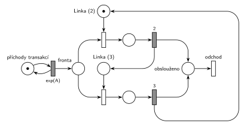

# MD1 – střídání 2 a 3

## Zadání

> Uvažujme systém typu M/D/1 s tím specifikem, že doba obsluhy se střídá mezi přesně 2 časovými jednotkami a přesně 3 časovými jednotkami (tedy v posloupnosti 2,3,2,3,...).

Podobné úlohy: [MD1 – prodlužování po 10 obsluhách](<../01 - MD1 – prodlužování po 10 obsluhách/01 - MD1 – prodlužování po 10 obsluhách.md>), [MD3 – poslední volné zařízení](<../03 - MD3 – poslední volné zařízení/03 - MD3 – poslední volné zařízení.md>), [MD1 – podle doby od poslední obsluhy](<../04 - MD1 – podle doby od poslední obsluhy/04 - MD1 – podle doby od poslední obsluhy.md>).

## Interpretace

<details>
<summary>Zobrazit interpretaci (nápověda)</summary>
<br>

- **Příchody:** místo *příchody transakcí* ve smyčce s `exp(A)` (M/D/1 má exponenciální příchody, číslo zadání nedává) vkládá transakce do *fronty*.
- **Stav „příští obsluha trvá 2 / 3“ nese sama linka.** Volná linka je jedno ze dvou míst: *Linka (2)*, nebo *Linka (3)*, vždy s jedinou značkou (*Linka (2)* + *Linka (3)* + obě obsluhy = 1). Obsazení z *Linky (2)* vede na obsluhu `2`, ta vrací značku do *Linky (3)*, a naopak. Tak se doby obsluhy pravidelně střídají a linka je pořád jen jedna.
- Obsluha je deterministická (D): časované přechody `2` a `3` bez `exp`.
- Posloupnost začíná dvojkou, proto je počáteční značka v *Linka (2)*.
- Střídá se podle pořadí obsluh, ne podle času: jestli mezi obsluhami linka chvíli stojí, na střídání nic nemění.
- Rovnocenná varianta: samostatné místo *Linka* (1 značka) a dvojice míst *příště 2* / *příště 3*, které přepíná obsazení nebo konec obsluhy. Má o jedno místo víc.
- Zadání chce **atributy na přechodech a místech**: pojmenovaná místa a časy u všech časovaných přechodů. Obsloužená transakce jde do místa *obslouženo* a systém opouští **výstupním přechodem** *odchod*.

</details>

## Petriho síť

<details>
<summary>Zobrazit Petriho síť</summary>
<br>



</details>

## Časté chyby

<details>
<summary>Zobrazit časté chyby</summary>
<br>

- Výběr doby obsluhy pravděpodobností 50 % / 50 %: v průměru stejné, ale posloupnost 2, 3, 2, 3 to není.
- Rozdělení příchodů střídavě do dvou front („lichá“ a „sudá“ transakce): místo neuchovává pořadí, linka pak může obsloužit dvě „dvojkové“ za sebou.
- Dvě samostatné linky (jedna s obsluhou 2, druhá 3), každá se svou značkou: to je M/D/2.
- `exp(2)` a `exp(3)` místo pevných dob; zadání je M/D/1.
- Chybějící výstupní přechod nebo nepojmenovaná místa (zadání je výslovně chce).

</details>

## SIMLIB

<details>
<summary>Zobrazit SIMLIB kód</summary>
<br>

Model je izomorfní k Petriho síti výše: každé místo, přechod a značka mají svůj protějšek v kódu.

```cpp
// MD1 – střídání 2 a 3 – model v SIMLIB/C++
#include "simlib.h"

const double A = 3;                    // střední interval příchodů (zadání ho nedává)

Facility Linka("Linka");               // značka linky (v místě Linka (2), nebo Linka (3))
bool pristi2 = true;                   // true = volná linka je v místě Linka (2), false = v Linka (3)
long obsluh2 = 0, obsluh3 = 0;         // kolikrát se provedl přechod 2 a přechod 3
Histogram Doba("Doba transakce v systému [č. j.]", 0, 2, 25);

class Transakce : public Process {     // transakce = značka, která prochází sítí
  void Behavior() {
    double prichod = Time;
    Seize(Linka);                      // fronta + obsazení (horní řada z Linka (2), dolní z Linka (3))
    if (pristi2) {
      Wait(2);                         // časovaný přechod 2 ...
      pristi2 = false;                 // ... vrací značku linky do místa Linka (3)
      obsluh2++;
    } else {
      Wait(3);                         // časovaný přechod 3 ...
      pristi2 = true;                  // ... vrací značku linky do místa Linka (2)
      obsluh3++;
    }
    Release(Linka);
    Doba(Time - prichod);              // místo „obslouženo“
  }                                    // konec Behavior = přechod „odchod“
};

class Generator : public Event {       // místo „příchody transakcí“ ve smyčce s exp(A)
  void Behavior() {
    (new Transakce)->Activate();       // nová značka v místě „fronta“
    Activate(Time + Exponential(A));   // další příchod
  }
};

int main() {
  Init(0, 100000);                     // modelový čas v časových jednotkách (č. j.)
  (new Generator)->Activate();
  Run();
  Print("Obsluh s dobou 2: %ld, s dobou 3: %ld\n", obsluh2, obsluh3);
  Linka.Output();
  Doba.Output();
}
```

| Petriho síť | SIMLIB |
|---|---|
| *příchody transakcí* ⇄ `exp(A)` | událost `Generator`, která se znovu plánuje za `Exponential(A)` |
| značka (transakce) | proces `Transakce` |
| *fronta* + obsazení linky | `Seize(Linka)` (fronta je vnitřní fronta zařízení) |
| *Linka (2)* / *Linka (3)* (dohromady 1 značka) | `Facility Linka` a stav `bool pristi2` |
| časovaný přechod `2`, který vrací značku do *Linka (3)* | `Wait(2); pristi2 = false;` a pak `Release(Linka)` |
| časovaný přechod `3`, který vrací značku do *Linka (2)* | `Wait(3); pristi2 = true;` a pak `Release(Linka)` |
| *obslouženo* → přechod *odchod* | konec metody `Behavior()` |

**Kontrola simulací.** Petriho síť: invariant jedné linky platí, všechny přechody se provádějí, fronta zůstává omezená (`make check`); při `A = 3` proběhlo přesně 5000 obsluh s dobou 2 a 5000 s dobou 3 (střídají se). SIMLIB model: v jednom běhu (100 000 č. j.) proběhlo 16 729 obsluh s dobou 2 a 16 729 s dobou 3 a linka byla vytížena na 83,6 %; teoreticky je to 83,3 % (střední doba obsluhy 2,5 č. j. na střední interval příchodů 3 č. j.) (`make simlib`).

</details>

## Původ a zdroje

<details>
<summary>Zobrazit původ a zdroje</summary>
<br>

**Původ:** zkouška 2025/26, 1. termín (13. 1. 2026), skupina A, otázka 1, 10 bodů.

**Původní znění:**

> Zadaný systém modelujte prostředky Petriho sítě s vyznačením atributů na přechodech a místech. Vyznačte přechodem, kde transakce opouští systém.
> Uvažujme systém typu M/D/1 s tím specifikem, že doba obsluhy se střídá mezi 2 č.j. a 3 č.j. (tedy v posloupnosti 2,3,2,3,...).

**Zdroje:**

- `Fitcheats/Zkoušky z minulých let/2025-26 - 1. termín A.pdf`, str. 1 (fotka zadání)

**Existující řešení:**

- Žádné řešení k této úloze není.

</details>
