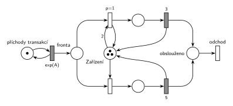

# 06-03 MD3 – poslední volné zařízení

## Zadání

> Mějme systém M/D/3. Doba obsluhy transakce se řídí následujícím pravidlem: pokud příchozí transakce obsadí poslední volné zařízení, pak je její doba obsluhy přesně 5 časových jednotek jinak je doba obsluhy nastavena na přesně 3 časové jednotky. Systém modelujte prostředky Petriho sítí.

Podobné úlohy: [MD1 – střídání 2 a 3](<../02 - MD1 – střídání 2 a 3/02 - MD1 – střídání 2 a 3.md>), [MM3 – zastavení příchodů](<../../05 - Délka fronty a kapacita/06 - MM3 – zastavení příchodů/06 - MM3 – zastavení příchodů.md>) (M/M/3 a test počtu volných linek), [Doba obsluhy podle délky fronty](<../../05 - Délka fronty a kapacita/01 - Doba obsluhy podle délky fronty/01 - Doba obsluhy podle délky fronty.md>).

## Nápověda

<details>
<summary>Zobrazit nápovědu</summary>
<br>

- **Příchody:** místo *příchody transakcí* ve smyčce s `exp(A)` (M/D/3 má exponenciální příchody, číslo zadání nedává) vkládá transakce do *fronty*.
- **Tři zařízení = místo *Zařízení* se 3 značkami.** Zadání je nerozlišuje, takže stačí jedno místo; *Zařízení* + obsluhované transakce = 3.
- **„Obsadí poslední volné zařízení“** = v okamžiku obsazení je volné právě jedno. Podmínka se testuje prioritou:
  - obsazení `p=1` (horní řada) bere z *Zařízení* **2 značky a 1 hned vrací**. Provede se jen při aspoň dvou volných zařízeních, obsadí jedno a obsluha trvá `3`;
  - obsazení `p=0` (dolní řada) bere 1 značku. Na řadu přijde jen tehdy, když `p=1` provést nejde, tedy když je volné poslední zařízení. Obsluha trvá `5`.
- Uvolnění zařízení je sloučené s časovaným přechodem obsluhy: `3` i `5` po skončení vrací značku do *Zařízení*.
- **Transakce z fronty dostane vždy `5`.** Fronta se tvoří jen při obsazených zařízeních, takže kdo z ní nastupuje, bere právě uvolněné, tedy poslední volné zařízení. „Příchozí transakce“ tu čtu jako „transakce, která přichází k zařízení“. Kdyby pravidlo platilo jen pro transakci, která nečekala, zadání by muselo říct, kolik trvá obsluha transakce z fronty.
- Důsledek: při frontě má systém kapacitu jen 3 obsluhy za 5 č. j. Proto je v simulaci zvolené `exp(2)` (při `exp(1,5)` fronta neomezeně roste).
- M/D/3: obsluha je deterministická, časované přechody `3` a `5` bez `exp`.
- Obsloužená transakce jde do místa *obslouženo* a systém opouští přechodem *odchod*.

</details>

## Petriho síť

<details>
<summary>Zobrazit Petriho síť</summary>
<br>



</details>

## Časté chyby

<details>
<summary>Zobrazit časté chyby</summary>
<br>

- Obě obsazení se stejnou prioritou: mezi `3` a `5` by se losovalo bez ohledu na počet volných zařízení.
- Test „aspoň 2 volná“ hranou s váhou 2 bez vrácení jedné značky: transakce by obsadila dvě zařízení.
- Inhibiční hrana („žádné další volné“) místo priority: funguje, ale Hrubý ji nechce.
- Tři samostatná zařízení s pevně danou dobou obsluhy (např. „třetí zařízení má vždy 5“): poslední volné nemusí být pořád stejné zařízení.
- `exp(3)` a `exp(5)` místo pevných dob; zadání je M/D/3.

</details>

## SIMLIB

<details>
<summary>Zobrazit SIMLIB kód</summary>
<br>

Model je izomorfní k Petriho síti výše: každé místo, přechod a značka mají svůj protějšek v kódu.

```cpp
// MD3 – poslední volné zařízení – model v SIMLIB/C++
#include "simlib.h"

const double A = 2;                    // střední interval příchodů (zadání ho nedává)

Store Zarizeni("Zařízení", 3);         // místo „Zařízení“ se 3 značkami
long obsluh3 = 0, obsluh5 = 0;         // kolikrát se provedl přechod 3 a přechod 5
Histogram Doba("Doba transakce v systému [č. j.]", 0, 2, 25);

class Transakce : public Process {     // transakce = značka, která prochází sítí
  void Behavior() {
    double prichod = Time;
    Enter(Zarizeni, 1);                // fronta + obsazení jednoho zařízení
    if (Zarizeni.Free() > 0) {         // zbylo volné zařízení: provedl se přechod p=1 (vezme 2, vrátí 1)
      Wait(3);                         // časovaný přechod 3
      obsluh3++;
    } else {                           // obsadila poslední volné: přechod p=0
      Wait(5);                         // časovaný přechod 5
      obsluh5++;
    }
    Leave(Zarizeni, 1);                // přechod 3 / 5 vrací značku do „Zařízení“
    Doba(Time - prichod);              // místo „obslouženo“
  }                                    // konec Behavior = přechod „odchod“
};

class Generator : public Event {       // místo „příchody transakcí“ ve smyčce s exp(A)
  void Behavior() {
    (new Transakce)->Activate();       // nová značka v místě „fronta“
    Activate(Time + Exponential(A));   // další příchod
  }
};

int main() {
  Init(0, 100000);                     // modelový čas v časových jednotkách (č. j.)
  (new Generator)->Activate();
  Run();
  Print("Obsluh s dobou 3: %ld, s dobou 5: %ld\n", obsluh3, obsluh5);
  Zarizeni.Output();
  Doba.Output();
}
```

| Petriho síť | SIMLIB |
|---|---|
| *příchody transakcí* ⇄ `exp(A)` | událost `Generator`, která se znovu plánuje za `Exponential(A)` |
| značka (transakce) | proces `Transakce` |
| *Zařízení* (3 značky) | `Store Zarizeni("Zařízení", 3)` |
| *fronta* + obsazení | `Enter(Zarizeni, 1)` (fronta je vnitřní fronta skladu) |
| obsazení `p=1` (vezme 2, vrátí 1) / `p=0` | `if (Zarizeni.Free() > 0)` po obsazení: volné zařízení zbylo, právě když byla volná aspoň 2 |
| časovaný přechod `3` / `5` se sloučeným uvolněním | `Wait(3)` / `Wait(5)` a pak `Leave(Zarizeni, 1)` |
| *obslouženo* → přechod *odchod* | konec metody `Behavior()` |

**Kontrola simulací.** Petriho síť: invariant tří zařízení platí, všechny přechody se provádějí, fronta zůstává omezená (`make check`); při `A = 2` trvalo asi 76 % obsluh 5 a 24 % obsluh 3 a v obsluze `3` byly nejvýš 2 transakce najednou (třetí zařízení vždy dostane obsluhu 5). SIMLIB model: v jednom běhu (100 000 č. j.) trvalo 76,6 % obsluh 5 (shodně se sítí) a v průměru bylo obsazeno 2,27 zařízení ze 3. To odpovídá Littleovu vzorci: 1/2 transakce za č. j. × střední doba obsluhy 0,766 × 5 + 0,234 × 3 = 4,53 č. j. dává 2,27 (`make simlib`).

</details>

## Původ a zdroje

<details>
<summary>Zobrazit původ a zdroje</summary>
<br>

**Původ:** zkouška 2024/25, 3. termín (6. 2. 2025), skupina H, otázka 3, 10 bodů.

**Původní znění:**

> Mějme systém M/D/3. Doba obsluhy transakce se řídí následujícím pravidlem: pokud příchozí transakce obsadí poslední volné zařízení, pak je její doba obsluhy 5 č.j. jinak je doba obsluhy nastavena na 3 č.j. Systém modelujte prostředky Petriho sítí.

**Zdroje:**

- `Fitcheats/Zkoušky z minulých let/2024-25 - 3. termín H.pdf`, str. 2, vlevo dole (fotka zadání z dálky; text je drobný, ale po zvětšení čitelný, včetně čísel 5 a 3)

**Existující řešení:**

- Žádné řešení k této úloze není.

</details>

## Reference

- [Jak síť funguje](<../../../basics/Jak síť funguje.md>)
- [Notace a vzory](<../../../basics/Notace a vzory.md>)

<!-- -->

- [Studijní plán](<../../Studijní plán.md>)
- [Seznam úloh](<../../Seznam úloh.md>)
