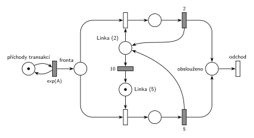

# MD1 – podle doby od poslední obsluhy (06/04)

## Zadání

> Pokud od doby poslední obsluhy uplynulo méně než 10 časových jednotek, další transakce bude obsluhována přesně 2 časové jednotky, jinak přesně 5 časových jednotek. (M/D/1)

Otázka 3: „Popsat onu Petriho síť v “pseudojazyku vycházejícího ze SIMLIBu”“.

Podobné úlohy: [MD1 – střídání 2 a 3](<../02 - MD1 – střídání 2 a 3/02 - MD1 – střídání 2 a 3.md>) (stejná stavba se dvěma stavy linky), [Automat na kávu – údržba po nečinnosti](<../../04 - Údržba a spánek/01 - Automat na kávu – údržba po nečinnosti/01 - Automat na kávu – údržba po nečinnosti.md>) (časovač nečinnosti na místě linky).

## Nápověda

<details>
<summary>Zobrazit nápovědu</summary>
<br>

- **Příchody:** místo *příchody transakcí* ve smyčce s `exp(A)` (M/D/1 má exponenciální příchody, číslo zadání nedává) vkládá transakce do *fronty*.
- **Volná linka má dva stavy:** *Linka (2)* a *Linka (5)*, dohromady s jedinou značkou (*Linka (2)* + *Linka (5)* + obě obsluhy = 1). Obsazení z *Linky (2)* vede na obsluhu `2`, obsazení z *Linky (5)* na obsluhu `5`; obsluha je deterministická, bez `exp`.
- **„Od doby poslední obsluhy“ = od konce poslední obsluhy**, tedy jak dlouho je linka volná. Každá obsluha (2 i 5) vrací linku do stavu *Linka (2)*: další transakce, která přijde do 10 č. j., je obsluhována 2.
- **Měření nečinnosti:** časovaný přechod `10` přímo na místě *Linka (2)*. Když do 10 č. j. přijde transakce, obsazení si značku vezme a odpočet zanikne (slajd 139). Jinak po 10 č. j. přejde značka do *Linka (5)* a příští obsluha trvá 5. Stejný princip jako časovač nečinnosti u automatu na kávu.
- Čeká-li po skončení obsluhy fronta, další transakce linku obsadí hned, takže dostane 2.
- **Na začátku** žádná předchozí obsluha nebyla, proto je značka v *Linka (5)*. Zápis zadání to neřeší; se značkou v *Linka (2)* by se lišila jen první obsluha.
- Jiné čtení: počítat 10 od **začátku** poslední obsluhy. Pak by se odpočet spouštěl už obsazením linky a s obsluhou 5 by vždycky přesáhl 10. Zápis „od doby poslední obsluhy … uplynulo“ spíš míří na dobu od jejího skončení.
- Obsloužená transakce jde do místa *obslouženo* a systém opouští přechodem *odchod*.

</details>

## Petriho síť

<details>
<summary>Zobrazit Petriho síť</summary>
<br>



</details>

## Časté chyby

<details>
<summary>Zobrazit časté chyby</summary>
<br>

- Časovač `10` na *frontě*: měří čekání transakce, ne dobu od poslední obsluhy.
- Linka, která po obsluze `5` zůstane ve stavu „5“: po každé obsluze se odpočet musí spustit znovu.
- Časovač, který běží i během obsluhy (např. vlastní místo spouštěné obsazením linky a nerušené): pak se počítá od začátku obsluhy, ne od jejího konce.
- `exp(2)` a `exp(5)` místo pevných dob; zadání je M/D/1.

</details>

## SIMLIB

<details>
<summary>Zobrazit SIMLIB kód</summary>
<br>

Model je izomorfní k Petriho síti výše: každé místo, přechod a značka mají svůj protějšek v kódu. Odpovídá i na navazující otázku 3 (popis sítě pseudokódem podle SIMLIBu).

```cpp
// MD1 – podle doby od poslední obsluhy – model v SIMLIB/C++
#include "simlib.h"

const double A = 6;                    // střední interval příchodů (zadání ho nedává)

Facility Linka("Linka");               // značka linky (v místě Linka (2), nebo Linka (5))
bool linka2 = false;                   // true = volná linka je v Linka (2); na začátku je v Linka (5)
Event *odpocet = nullptr;              // běžící odpočet časovaného přechodu 10
long obsluh2 = 0, obsluh5 = 0;         // kolikrát se provedl přechod 2 a přechod 5
Histogram Doba("Doba transakce v systému [č. j.]", 0, 2, 25);

class Vychladnuti : public Event {     // časovaný přechod 10 na místě Linka (2)
  void Behavior() {
    linka2 = false;                    // značka přejde z Linka (2) do Linka (5)
    odpocet = nullptr;
  }
};

class Transakce : public Process {     // transakce = značka, která prochází sítí
  void Behavior() {
    double prichod = Time;
    Seize(Linka);                      // fronta + obsazení
    if (linka2) {                      // obsazení z Linka (2) vezme značku ...
      odpocet->Cancel();               // ... a odpočet 10 zaniká
      odpocet = nullptr;
      Wait(2);                         // časovaný přechod 2
      obsluh2++;
    } else {                           // obsazení z Linka (5)
      Wait(5);                         // časovaný přechod 5
      obsluh5++;
    }
    linka2 = true;                     // přechod 2 / 5 vrací značku do Linka (2) ...
    odpocet = new Vychladnuti;
    odpocet->Activate(Time + 10);      // ... a tím začíná odpočet 10
    Release(Linka);
    Doba(Time - prichod);              // místo „obslouženo“
  }                                    // konec Behavior = přechod „odchod“
};

class Generator : public Event {       // místo „příchody transakcí“ ve smyčce s exp(A)
  void Behavior() {
    (new Transakce)->Activate();       // nová značka v místě „fronta“
    Activate(Time + Exponential(A));   // další příchod
  }
};

int main() {
  Init(0, 100000);                     // modelový čas v časových jednotkách (č. j.)
  (new Generator)->Activate();
  Run();
  Print("Obsluh s dobou 2: %ld, s dobou 5: %ld\n", obsluh2, obsluh5);
  Linka.Output();
  Doba.Output();
}
```

| Petriho síť | SIMLIB |
|---|---|
| *příchody transakcí* ⇄ `exp(A)` | událost `Generator`, která se znovu plánuje za `Exponential(A)` |
| značka (transakce) | proces `Transakce` |
| *fronta* + obsazení linky | `Seize(Linka)` (fronta je vnitřní fronta zařízení) |
| *Linka (2)* / *Linka (5)* (dohromady 1 značka) | `Facility Linka` a stav `bool linka2` |
| časovaný přechod `10` na *Linka (2)* | událost `Vychladnuti` naplánovaná za 10 po konci obsluhy |
| zánik odpočtu `10`, když obsazení vezme značku z *Linka (2)* | `odpocet->Cancel()` |
| časovaný přechod `2` / `5`, který vrací značku do *Linka (2)* | `Wait(2)` / `Wait(5)`, pak `linka2 = true`, nový odpočet a `Release(Linka)` |
| *obslouženo* → přechod *odchod* | konec metody `Behavior()` |

**Kontrola simulací.** Petriho síť: invariant jedné linky platí, všechny přechody se provádějí, fronta zůstává omezená (`make check`); při `A = 6` trvalo asi 89 % obsluh 2 a počet obsluh s dobou 5 odpovídá počtu přechodů `10` (+1 za první obsluhu). SIMLIB model: v jednom běhu (100 000 č. j.) trvalo 88,6 % obsluh 2 (shodně se sítí) a linka byla vytížena na 38,9 %; podle střední doby obsluhy 0,886 × 2 + 0,114 × 5 = 2,34 č. j. na střední interval příchodů 6 č. j. by to mělo být 39,0 % (`make simlib`).

</details>

## Původ a zdroje

<details>
<summary>Zobrazit původ a zdroje</summary>
<br>

**Původ:** zkouška 2020/21, 1. opravný termín (9:00), otázka 2 (počet bodů neznámý). Navazující otázka 3 chtěla tutéž síť popsat pseudokódem podle SIMLIBu.

**Původní znění** (jen zápis studenta ve sbírce, originál zkoušky chybí):

> Pokud od doby poslední obsluhy uplynulo méně než 10jč. (jednotek času), další transakce bude obsluhována 2jč., jinak 5jč. (M/D/1)

**Zdroje:**

- `Fitcheats/Příprava na zkoušku/FIT - Řešené výpočetní příklady 2017-21.pdf`, str. 35 („2021 - 1. opravný 9:00“: zadání z paměti, k SIMLIB části jen odkaz na onlinegdb, síť chybí)

**Existující řešení:**

- **Řešené výpočetní příklady, str. 35:** jen zadání a odkaz na SIMLIB kód na onlinegdb, Petriho síť chybí.

</details>

## Reference

- [Jak síť funguje](<../../../basics/Jak síť funguje.md>)
- [Notace a vzory](<../../../basics/Notace a vzory.md>)

<!-- -->

- [Studijní plán](<../../Studijní plán.md>)
- [Seznam úloh](<../../Seznam úloh.md>)
