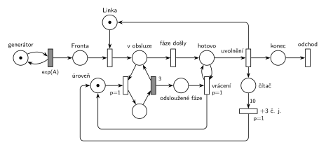

# 06–01 – MD1 – prodlužování po 10 obsluhách

## Zadání

> Mějme SHO typu M/D/1, kde je na počátku doba obsluhy 3 časové jednotky. Po každých 10 provedených obsluhách se doba obsluhy navýší o 3 č.j. Systém modelujte Petriho sítí.

Podobné úlohy: [04–06 – Údržba po každé 10. obsluze](<../04–06 - Údržba po každé 10. obsluze/04–06 - Údržba po každé 10. obsluze.md>) (čítač 10 obsluh), [06–02 – MD1 – střídání 2 a 3](<../06–02 - MD1 – střídání 2 a 3/06–02 - MD1 – střídání 2 a 3.md>), [09–20 – Pražírna kávy](<../09–20 - Pražírna kávy/09–20 - Pražírna kávy.md>) (opakování fází obsluhy podle počtu značek).

## Interpretace

Zobrazit interpretaci (nápověda)

- **Doba obsluhy je 3, 6, 9, 12, …** (prvních 10 obsluh 3, dalších 10 obsluh 6 atd.) a roste bez omezení. Časovaný přechod má ale pevný čas. Možnosti:
  - **obsluha složená z k fází po `3`**, kde k je počet značek v místě *úroveň*. Síť je konečná a modeluje celý systém (řešení tady);
  - samostatné větve `3`, `6`, `9`, … s přepínáním po 10 obsluhách: každá úroveň potřebuje vlastní přechod, takže síť by musela být nekonečná. Nakreslit pár úrovní a „…“ je jen náčrt;
  - jeden přechod s časem „3·k“: čas časovaného přechodu v kurzové notaci nemůže záviset na značení, nejde tedy o Petriho síť, jen o poznámku.
- **Smyčka fází** (stejný princip jako iterace nákupu v [09–20](<../09–20 - Pražírna kávy/09–20 - Pražírna kávy.md>)): *další fáze* (`p=1`) vezme transakci z *v obsluze* a jednu značku z *úrovně*, po `3` vrátí transakci do *v obsluze* a značku odloží do *odsloužené fáze*. Když *úroveň* dojde, provede se *fáze došly* (`p=0`). Celkem tedy obsluha trvá 3·k.
- **Vrácení úrovně:** odsloužené značky se musí vrátit, jinak by příští obsluha neměla žádnou fázi. Vrátit je ale smí až po skončení obsluhy (během obsluhy by se hned znovu spotřebovaly a fáze by se opakovaly donekonečna). Proto transakce po *fáze došly* chvíli stojí v *hotovo*: *vrácení* (`p=1`, testovací hrany na *hotovo*) přesune všechny značky zpět a teprve potom *uvolnění* (`p=0`) vrátí *Linku* a transakce odchází. Vše proběhne v nulovém čase.
- **Čítač obsluh:** *uvolnění* přidá značku do *čítače*. Hrana s váhou 10 po desáté obsluze čítač vynuluje a přidá do *úrovně* jednu fázi, tedy +3 č. j. Jedenáctá obsluha už trvá 6.
- **Systém je z principu nestabilní:** doba obsluhy roste nade všechny meze, takže fronta při jakýchkoli příchodech nakonec neomezeně roste.
- M/D/1: příchody `exp(A)` (číslo zadání nedává), fáze obsluhy pevně `3`.

## Řešení

Zobrazit řešení

| Požadavek | Prvek sítě |
|---|---|
| příchody (M), jedna linka | *generátor* ⇄ `exp(A)` → *Fronta* → obsazení *Linky* → *v obsluze* |
| doba obsluhy 3·k (D) | *další fáze* `p=1` (bere značku z *úrovně*) → `3` → zpět *v obsluze*; *úroveň* má na začátku 1 značku |
| obsluha končí, když fáze došly | *fáze došly* `p=0` → *hotovo* |
| příští obsluha má zase k fází | *vrácení* `p=1`: *odsloužené fáze* → *úroveň*, dokud je transakce v *hotovo* |
| uvolnění linky, odchod | *uvolnění* `p=0` vrací *Linku* → *konec* → *odchod* |
| po každých 10 obsluhách +3 | *uvolnění* → *čítač*; váha 10 → *+3 č. j.* → +1 značka do *úrovně* |

Kontrola simulací: *Linka* + transakce v obsluze (*v obsluze*, fáze, *hotovo*) = 1, *čítač* ≤ 9. S plnou frontou na začátku skončilo 10 obsluh v čase 30, 20 v čase 90 a 30 v čase 180, tedy doby 3, 6 a 9. Fronta podle očekávání neomezeně roste.

## Časté chyby

Zobrazit časté chyby

- Jediná další větev s obsluhou 6: modeluje jen první navýšení, ne „po každých 10“.
- Čítač testovaný hranami s váhou 10 tam a zpět: nevynuluje se, takže po desáté obsluze by navyšovala každá další.
- Odsloužené fáze vracené bez čekání na konec obsluhy: smyčka fází se nikdy neukončí.
- Linka uvolněná dřív, než se fáze vrátí: další transakce může začít obsluhu s neúplnou *úrovní*.
- `exp(3)` místo pevné doby; zadání je M/D/1.

## Původ a zdroje

**Původ:** zkouška 2024/25, 2. termín (20. 1. 2025), skupina F, otázka 3, 10 bodů.

**Zdroje:**

- `Fitcheats/Zkoušky z minulých let/2024-25 - 2. termín F.pdf`, str. 2 (fotka zadání, rámeček na odpověď prázdný)

**Existující řešení:**

Zobrazit existující řešení

- Žádné řešení k této úloze není (rámeček na odpověď je na fotce prázdný).

