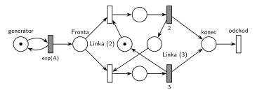

# 06–02 – MD1 – střídání 2 a 3

## Zadání

> Zadaný systém modelujte prostředky Petriho sítě s vyznačením atributů na přechodech a místech. Vyznačte přechodem, kde transakce opouští systém.
> Uvažujme systém typu M/D/1 s tím specifikem, že doba obsluhy se střídá mezi 2 č.j. a 3 č.j. (tedy v posloupnosti 2,3,2,3,...).

Podobné úlohy: [06–01 – MD1 – prodlužování po 10 obsluhách](<../06–01 - MD1 – prodlužování po 10 obsluhách/06–01 - MD1 – prodlužování po 10 obsluhách.md>), [06–03 – MD3 – poslední volné zařízení](<../06–03 - MD3 – poslední volné zařízení/06–03 - MD3 – poslední volné zařízení.md>), [06–04 – MD1 – podle doby od poslední obsluhy](<../06–04 - MD1 – podle doby od poslední obsluhy/06–04 - MD1 – podle doby od poslední obsluhy.md>).

## Interpretace

Zobrazit interpretaci (nápověda)

- **M/D/1:** příchody exponenciální (číslo zadání nedává, proto `exp(A)`), obsluha deterministická: časované přechody `2` a `3` bez `exp`.
- **Stav „příští obsluha trvá 2 / 3“ nese sama linka.** Volná linka je jedno ze dvou míst: *Linka (2)*, nebo *Linka (3)*, vždy s jedinou značkou. Obsazení z *Linky (2)* vede na obsluhu `2`, ta vrací značku do *Linky (3)*, a naopak. Tak se doby obsluhy pravidelně střídají a linka je pořád jen jedna.
- Posloupnost začíná dvojkou, proto je počáteční značka v *Linka (2)*.
- Střídá se podle pořadí obsluh, ne podle času: jestli mezi obsluhami linka chvíli stojí, na střídání nic nemění.
- Rovnocenná varianta: samostatné místo *Linka* (1 značka) a dvojice míst *příště 2* / *příště 3*, které přepíná obsazení nebo konec obsluhy. Má o dvě místa víc.
- Zadání chce **atributy na přechodech a místech**: pojmenovaná místa a časy u všech časovaných přechodů, a **výstupní přechod** *odchod*.

## Řešení

Zobrazit řešení

| Požadavek | Prvek sítě |
|---|---|
| příchody (M) | *generátor* ⇄ `exp(A)` → *Fronta* |
| jedna linka | *Linka (2)* + *Linka (3)* + obě obsluhy = 1 |
| obsluha 2, pak 3, pak 2, … (D) | obsazení z *Linky (2)* → `2` → *Linka (3)*; obsazení z *Linky (3)* → `3` → *Linka (2)* |
| transakce opouští systém | *konec* → *odchod* |

Kontrola simulací: invariant jedné linky platí. Při `A = 3` proběhlo přesně 5000 obsluh s dobou 2 a 5000 s dobou 3 (střídají se).

## Časté chyby

Zobrazit časté chyby

- Výběr doby obsluhy pravděpodobností 50 % / 50 %: v průměru stejné, ale posloupnost 2, 3, 2, 3 to není.
- Rozdělení příchodů střídavě do dvou front („lichá“ a „sudá“ transakce): místo neuchovává pořadí, linka pak může obsloužit dvě „dvojkové“ za sebou.
- Dvě samostatné linky (jedna s obsluhou 2, druhá 3), každá se svou značkou: to je M/D/2.
- `exp(2)` a `exp(3)` místo pevných dob; zadání je M/D/1.
- Chybějící výstupní přechod nebo nepojmenovaná místa (zadání je výslovně chce).

## Původ a zdroje

**Původ:** zkouška 2025/26, 1. termín (13. 1. 2026), skupina A, otázka 1, 10 bodů.

**Zdroje:**

- `Fitcheats/Zkoušky z minulých let/2025-26 - 1. termín A.pdf`, str. 1 (fotka zadání)

**Existující řešení:**

Zobrazit existující řešení

- Žádné řešení k této úloze není.

