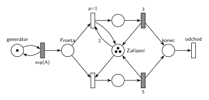

# 06–03 – MD3 – poslední volné zařízení

## Zadání

> Mějme systém M/D/3. Doba obsluhy transakce se řídí následujícím pravidlem: pokud příchozí transakce obsadí poslední volné zařízení, pak je její doba obsluhy 5 č.j. jinak je doba obsluhy nastavena na 3 č.j. Systém modelujte prostředky Petriho sítí.

Podobné úlohy: [06–02 – MD1 – střídání 2 a 3](<../06–02 - MD1 – střídání 2 a 3/06–02 - MD1 – střídání 2 a 3.md>), [05–06 – MM3 – zastavení příchodů](<../05–06 - MM3 – zastavení příchodů/05–06 - MM3 – zastavení příchodů.md>) (M/M/3 a test počtu volných linek), [05–01 – Doba obsluhy podle délky fronty](<../05–01 - Doba obsluhy podle délky fronty/05–01 - Doba obsluhy podle délky fronty.md>).

## Interpretace

Zobrazit interpretaci (nápověda)

- **Tři zařízení = místo *Zařízení* se 3 značkami.** Zadání je nerozlišuje, takže stačí jedno místo.
- **„Obsadí poslední volné zařízení“** = v okamžiku obsazení je volné právě jedno. Podmínka se testuje prioritou:
  - obsazení `p=1` bere z *Zařízení* **2 značky a 1 hned vrací**. Provede se jen při aspoň dvou volných zařízeních, obsadí jedno a obsluha trvá `3`;
  - obsazení `p=0` bere 1 značku. Na řadu přijde jen tehdy, když `p=1` provést nejde, tedy když je volné poslední zařízení. Obsluha trvá `5`.
- **Transakce z fronty dostane vždy `5`.** Fronta se tvoří jen při obsazených zařízeních, takže kdo z ní nastupuje, bere právě uvolněné, tedy poslední volné zařízení. „Příchozí transakce“ tu čtu jako „transakce, která přichází k zařízení“. Kdyby pravidlo platilo jen pro transakci, která nečekala, zadání by muselo říct, kolik trvá obsluha transakce z fronty.
- Důsledek: při frontě má systém kapacitu jen 3 obsluhy za 5 č. j. Proto je v simulaci zvolené `exp(2)` (při `exp(1,5)` fronta neomezeně roste).
- M/D/3: příchody `exp(A)` (číslo zadání nedává), obsluha deterministická `3` a `5`.

## Petriho síť

Zobrazit Petriho síť

| Požadavek | Prvek sítě |
|---|---|
| příchody (M) | *generátor* ⇄ `exp(A)` → *Fronta* |
| 3 zařízení | *Zařízení* (3 značky) + obsluhované transakce = 3 |
| volná jsou aspoň 2 → obsluha 3 | obsazení `p=1`: vezme 2, vrátí 1 → `3` (vrací zařízení) |
| obsazuje poslední volné → obsluha 5 | obsazení `p=0`: vezme 1 → `5` (vrací zařízení) |
| transakce opouští systém | *konec* → *odchod* |

Kontrola simulací: invariant tří zařízení platí. Při `A = 2` trvalo asi 76 % obsluh 5 a 24 % obsluh 3; v obsluze `3` byly nejvýš 2 transakce najednou (třetí zařízení vždy dostane obsluhu 5).

## Časté chyby

Zobrazit časté chyby

- Obě obsazení se stejnou prioritou: mezi `3` a `5` by se losovalo bez ohledu na počet volných zařízení.
- Test „aspoň 2 volná“ hranou s váhou 2 bez vrácení jedné značky: transakce by obsadila dvě zařízení.
- Inhibiční hrana („žádné další volné“) místo priority: funguje, ale Hrubý ji nechce.
- Tři samostatná zařízení s pevně danou dobou obsluhy (např. „třetí zařízení má vždy 5“): poslední volné nemusí být pořád stejné zařízení.
- `exp(3)` a `exp(5)` místo pevných dob; zadání je M/D/3.

## Původ a zdroje

Zobrazit původ a zdroje

**Původ:** zkouška 2024/25, 3. termín (6. 2. 2025), skupina H, otázka 3, 10 bodů.

**Zdroje:**

- `Fitcheats/Zkoušky z minulých let/2024-25 - 3. termín H.pdf`, str. 2, vlevo dole (fotka zadání z dálky; text je drobný, ale po zvětšení čitelný, včetně čísel 5 a 3)

**Existující řešení:**

- Žádné řešení k této úloze není.

