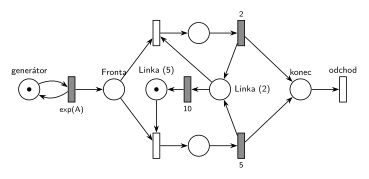

# 06–04 – MD1 – podle doby od poslední obsluhy

## Zadání

⚠️ Zadání je známé jen jako zápis studenta ve sbírce, originál zkoušky chybí.

> Pokud od doby poslední obsluhy uplynulo méně než 10jč. (jednotek času), další transakce bude obsluhována 2jč., jinak 5jč. (M/D/1)

Otázka 3: „Popsat onu Petriho síť v “pseudojazyku vycházejícího ze SIMLIBu”“.

Podobné úlohy: [06–02 – MD1 – střídání 2 a 3](<../06–02 - MD1 – střídání 2 a 3/06–02 - MD1 – střídání 2 a 3.md>) (stejná stavba se dvěma stavy linky), [04–01 – Automat na kávu – údržba po nečinnosti](<../04–01 - Automat na kávu – údržba po nečinnosti/04–01 - Automat na kávu – údržba po nečinnosti.md>) (časovač nečinnosti na místě linky).

## Interpretace

Zobrazit interpretaci (nápověda)

- **„Od doby poslední obsluhy“ = od konce poslední obsluhy**, tedy jak dlouho je linka volná. Každá obsluha (2 i 5) vrací linku do stavu *Linka (2)*: další transakce, která přijde do 10 č. j., je obsluhována 2.
- **Měření nečinnosti:** časovaný přechod `10` přímo na místě *Linka (2)*. Když do 10 č. j. přijde transakce, obsazení si značku vezme a odpočet zanikne (slajd 139). Jinak po 10 č. j. přejde značka do *Linka (5)* a příští obsluha trvá 5. Stejný princip jako časovač nečinnosti u automatu na kávu.
- Čeká-li po skončení obsluhy fronta, další transakce linku obsadí hned, takže dostane 2.
- **Na začátku** žádná předchozí obsluha nebyla, proto je značka v *Linka (5)*. Zápis zadání to neřeší; se značkou v *Linka (2)* by se lišila jen první obsluha.
- Jiné čtení: počítat 10 od **začátku** poslední obsluhy. Pak by se odpočet spouštěl už obsazením linky a s obsluhou 5 by vždycky přesáhl 10. Zápis „od doby poslední obsluhy … uplynulo“ spíš míří na dobu od jejího skončení.
- M/D/1: příchody `exp(A)` (číslo zadání nedává), obsluha deterministická `2` a `5`.
- SIMLIB část otázky tu není řešená.

## Řešení

Zobrazit řešení

| Požadavek | Prvek sítě |
|---|---|
| příchody (M) | *generátor* ⇄ `exp(A)` → *Fronta* |
| jedna linka | *Linka (2)* + *Linka (5)* + obě obsluhy = 1 |
| konec obsluhy | `2` i `5` vrací značku do *Linka (2)* |
| od konce obsluhy uplynulo 10 | časovaný `10` z *Linka (2)* do *Linka (5)* |
| méně než 10 → obsluha 2, jinak 5 | obsazení z *Linka (2)* → `2`; obsazení z *Linka (5)* → `5` |
| transakce opouští systém | *konec* → *odchod* |

Kontrola simulací: invariant jedné linky platí. Při `A = 6` trvalo asi 89 % obsluh 2; počet obsluh s dobou 5 odpovídá počtu přechodů `10` (+1 za první obsluhu).

## Časté chyby

Zobrazit časté chyby

- Časovač `10` na *Frontě*: měří čekání transakce, ne dobu od poslední obsluhy.
- Linka, která po obsluze `5` zůstane ve stavu „5“: po každé obsluze se odpočet musí spustit znovu.
- Časovač, který běží i během obsluhy (např. vlastní místo spouštěné obsazením linky a nerušené): pak se počítá od začátku obsluhy, ne od jejího konce.
- `exp(2)` a `exp(5)` místo pevných dob; zadání je M/D/1.

## Původ a zdroje

**Původ:** zkouška 2020/21, 1. opravný termín (9:00), otázka 2 (počet bodů neznámý). Navazující otázka 3 chtěla tutéž síť popsat pseudokódem podle SIMLIBu.

**Zdroje:**

- `Fitcheats/Příprava na zkoušku/FIT - Řešené výpočetní příklady 2017-21.pdf`, str. 35 („2021 - 1. opravný 9:00“: zadání z paměti, k SIMLIB části jen odkaz na onlinegdb, síť chybí)

**Existující řešení:**

Zobrazit existující řešení

- **Řešené výpočetní příklady, str. 35:** jen zadání a odkaz na SIMLIB kód na onlinegdb, Petriho síť chybí.

