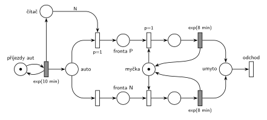

# Každá N-tá s prioritou procesu (07/02)

## Zadání

> Vymyslete příklad systému hromadné obsluhy typu M/M/1, který bude demonstrovat použití priority procesu u každé N-té transakce. Sestavte jeho model v Petriho síti a SIMLIBu (bez main() a generátoru).

Podobné úlohy:

- [Každá 10. s prioritou obsluhy](<../03 - Každá 10. s prioritou obsluhy/03 - Každá 10. s prioritou obsluhy.md>): stejný čítač, ale priorita obsluhy (přerušení)
- [Příklad s prioritou procesu](<../01 - Příklad s prioritou procesu/01 - Příklad s prioritou procesu.md>): prioritní je náhodně 20 % transakcí
- [Každá 10. transakce vyvolá poruchu](<../../03 - Poruchy/07 - Každá 10. transakce vyvolá poruchu/07 - Každá 10. transakce vyvolá poruchu.md>): čítač s hranou váhy 10

## Nápověda

<details>
<summary>Zobrazit nápovědu</summary>
<br>

- **Vymyšlený příklad:** myčka aut. Auta přijíždějí v intervalech `exp(10 min)`, mytí trvá `exp(8 min)`. Každé N-té auto dostane v rámci věrnostní akce přednost: předjede všechna čekající auta, rozjeté mytí ale nepřeruší.
- **Příjezdy** modeluje místo *příjezdy aut* ve smyčce s časovaným přechodem `exp(10 min)`. **Myčka** je zařízení s kapacitou 1: místo *myčka* s jednou značkou mezi oběma řadami, oba časované přechody `exp(8 min)` ji po mytí vracejí.
- **Čítač:** každý příjezd přidá značku do místa *čítač*. Když jich je N, přechod s hranou váhy N (a `p=1`) pošle právě přijíždějící auto do *fronty P* a čítač vynuluje. Jinak se provede přechod s `p=0` do *fronty N*. Váha N počítá i právě přijíždějící auto: první až (N−1). auto jde do *fronty N*, N-té do *fronty P*.
- Rozhoduje se hned při příjezdu: priorita procesu je vlastnost transakce a platí po celou dobu jejího čekání ve frontě.
- **Priorita procesu = pořadí ve frontě** (slajd 182). N-té auto proto jde do vlastní *fronty P* a obsazení *myčky* z ní má `p=1`. Přednost se projeví, když se myčka uvolní a čekají auta v obou frontách.
- **Mytí se nepřerušuje:** žádný přechod nebere značku z místa mytí.
- Umyté auto **opouští systém** přechodem *odchod*.
- N zůstává symbolem jako v zadání, simulace počítá s N = 5.

</details>

## Petriho síť

<details>
<summary>Zobrazit Petriho síť</summary>
<br>



</details>

## Časté chyby

<details>
<summary>Zobrazit časté chyby</summary>
<br>

- N-tá transakce přeruší probíhající obsluhu. To je priorita obsluhy (úloha ze skupiny H).
- Čítač, který se nevynuluje (hrana váhy N jen testuje a vrací značky), nebo hrana váhy N−1 při čítači, do kterého přispívá i právě příchozí transakce.
- „Prioritní“ přechod, který bere libovolnou značku ze společné fronty. Priorita patří N-té transakci, takže ta musí mít vlastní místo.
- Čítač bez priority na přechodu váhy N: N-tá transakce pak může projít i obyčejnou větví.
- V SIMLIBu `Seize(Mycka, 1)` místo `Priority = 1` (priorita obsluhy), nebo čítač, který se po N-tém autě nevynuluje.

</details>

## SIMLIB

<details>
<summary>Zobrazit SIMLIB kód</summary>
<br>

Model je izomorfní k Petriho síti výše: každé místo, přechod a značka mají svůj protějšek v kódu. Zadání chce kód bez `main()` a generátoru; tady jsou, aby šel model spustit. Obě fronty sítě jsou v SIMLIBu jedna vnitřní fronta zařízení seřazená podle atributu `Priority`.

```cpp
// Myčka aut, každé N-té auto s prioritou procesu – model v SIMLIB/C++
#include "simlib.h"

const int N = 5;                           // hodnota symbolu N
int citac = 0;                             // místo „čítač“ (počet značek)

Facility Mycka("Myčka");                   // místo „myčka“ s jednou značkou
Histogram CekaniP("Čekání N-tých aut [min]", 0, 5, 12);
Histogram CekaniN("Čekání ostatních aut [min]", 0, 20, 12);

class Auto : public Process {              // transakce = značka, která prochází sítí
  void Behavior() {
    double prichod = Time;
    bool nte = (++citac == N);             // příjezd přidá značku do čítače
    if (nte) {                             // přechod s hranou váhy N (p=1) ...
      citac = 0;                           // ... odebere všech N značek
      Priority = 1;                        // priorita procesu = p=1 na obsazení z „fronty P“
    }                                      // jinak přechod do „fronty N“ (p=0)
    Seize(Mycka);                          // fronta + obsazení; N-té auto předjede čekající
    (nte ? CekaniP : CekaniN)(Time - prichod);
    Wait(Exponential(8));                  // časovaný přechod exp(8 min) ...
    Release(Mycka);                        // ... který vrací značku myčce
  }                                        // konec Behavior = přechod „odchod“
};

// zadání main() ani generátor nechce, bez nich ale model nejde spustit
class Prijezdy : public Event {            // místo „příjezdy aut“ ve smyčce s exp(10 min)
  void Behavior() {
    (new Auto)->Activate();
    Activate(Time + Exponential(10));
  }
};

int main() {
  Init(0, 60 * 10000);                     // modelový čas v minutách: 10 000 hodin
  (new Prijezdy)->Activate();
  Run();
  Mycka.Output();
  CekaniP.Output();
  CekaniN.Output();
}
```

| Petriho síť | SIMLIB |
|---|---|
| *příjezdy aut* ⇄ `exp(10 min)` | událost `Prijezdy`, která se znovu plánuje za `Exponential(10)` |
| značka (auto) | proces `Auto` |
| místo *čítač*, hrana z příjezdu | `int citac`, `++citac` na začátku `Behavior()` |
| přechod s hranou váhy N a `p=1` | `if (++citac == N) { citac = 0; Priority = 1; }` |
| *fronta P* a *fronta N*, obsazení s `p=1` a `p=0` | `Seize(Mycka)`: vnitřní fronta zařízení je seřazená podle priority procesu |
| místo *myčka* (1 značka) | `Facility Mycka` |
| časovaný přechod `exp(8 min)` se sloučeným uvolněním | `Wait(Exponential(8)); Release(Mycka);` |
| přechod *odchod* | konec metody `Behavior()` |

**Kontrola simulací.** Petriho síť: *myčka* + mytá auta = 1, *čítač* nikdy nepřesáhne N, do *fronty P* jde přesně každé páté auto (N = 5) a všechny přechody se provádějí (`make check`). SIMLIB model: v jednom běhu (10 000 h) byla myčka vytížena na 80 % (teoreticky 8/10). N-tá auta čekala v průměru 6,6 min, ostatní 39,3 min; bez priorit by čekala všechna v průměru 32 min. Vzorec pro M/M/1 s prioritou bez přerušení dává 7,6 a 38,1 min; počítá ale s poissonovskými příchody obou druhů, kdežto každé páté auto přijíždí pravidelněji (`make simlib`).

</details>

## Původ a zdroje

<details>
<summary>Zobrazit původ a zdroje</summary>
<br>

**Původ:** zkouška 2022/23, 3. termín, skupina G, otázka 2, 10 bodů. Ve skupině H stejného termínu byla sesterská úloha s prioritou obsluhy ([Každá 10. s prioritou obsluhy](<../03 - Každá 10. s prioritou obsluhy/03 - Každá 10. s prioritou obsluhy.md>)).

**Zdroje:**

- `Fitcheats/Zkoušky z minulých let/2022-23 - 3. termín G.pdf`, str. 2 (fotka zadání, rámeček na odpověď je prázdný)

**Existující řešení:**

- K tomuto zadání žádné řešení není. K sesterské úloze s prioritou obsluhy existuje chybné řešení cranycrane, rozbor je v úloze [Každá 10. s prioritou obsluhy](<../03 - Každá 10. s prioritou obsluhy/03 - Každá 10. s prioritou obsluhy.md>).

</details>

## Reference

- [Jak síť funguje](<../../../basics/Jak síť funguje.md>)
- [Notace a vzory](<../../../basics/Notace a vzory.md>)

<!-- -->

- [Studijní plán](<../../Studijní plán.md>)
- [Seznam úloh](<../../Seznam úloh.md>)
