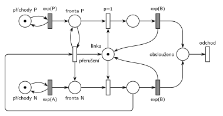

# Dva proudy příchodů

## Zadání

> Uvažujme systém typu M/M/1, kde však jsou dva zcela nezávislé procesy příchodů (Normální, Prioritní). Transakce pocházející z Prioritního procesu příchodů mají na lince vyšší *prioritu obsluhy* (!) než transakce z Normálního procesu příchodů.

Podobné úlohy:

- [Priorita procesu a obsluhy](<../05 - Priorita procesu a obsluhy/05 - Priorita procesu a obsluhy.md>): tatáž síť jako ukázka b), vedle ní priorita procesu
- [Každá 10. s prioritou obsluhy](<../03 - Každá 10. s prioritou obsluhy/03 - Každá 10. s prioritou obsluhy.md>): stejné přerušení, prioritní je každá 10. transakce
- [Porucha s opravou, návrat do fronty](<../../03 - Poruchy/03 - Porucha s opravou, návrat do fronty/03 - Porucha s opravou, návrat do fronty.md>): porucha zabírá linku stejnými dvěma kroky

## Nápověda

<details>
<summary>Zobrazit nápovědu</summary>
<br>

- Čísla zadání nedává: příchody `exp(A)` a `exp(P)`, obsluha `exp(B)` pro oba druhy (M/M/1 má jednu linku a jeden typ obsluhy).
- **Dva nezávislé proudy příchodů:** místa *příchody P* a *příchody N*, každé ve smyčce s vlastním časovaným přechodem. Každý proud má vlastní frontu, protože z jednoho místa nejde poznat, která značka je prioritní.
- **Jedna linka:** místo *linka* s jednou značkou mezi oběma řadami. Obě obsazení ji berou, oba časované přechody `exp(B)` ji vracejí.
- **Priorita obsluhy, ne priorita procesu.** Vykřičník míří právě na tento rozdíl (slajdy 182, 184 a 187). Priorita procesu jen mění pořadí ve frontě. Priorita obsluhy (SIMLIB `Seize(Linka, 1)`) navíc znamená, že prioritní transakce, která přijde k lince obsazené normální transakcí, její obsluhu **přeruší** a linku zabere. Síť bez přerušení (jen `p=1` na obsazení) by byla priorita procesu, viz ukázka a) v úloze [Priorita procesu a obsluhy](<../05 - Priorita procesu a obsluhy/05 - Priorita procesu a obsluhy.md>).
- **Přerušení ve dvou krocích**, stejně jako porucha v úloze [Porucha s opravou, návrat do fronty](<../../03 - Poruchy/03 - Porucha s opravou, návrat do fronty/03 - Porucha s opravou, návrat do fronty.md>). Přechod *přerušení* vezme normální transakci z obsluhy, vrátí ji do *fronty N* a značku vrátí *lince*. Prioritní transakce přitom zůstává ve *frontě P* (hrana tam a zpět). Hned potom ji obsazení s `p=1` spojí s uvolněnou linkou.
- **`p=1` na obsazení prioritní** je nutná: po přerušení je linka volná a ve *frontě N* čeká (přinejmenším) přerušená transakce. Stejná priorita zároveň řeší i obyčejné uvolnění linky: čekají-li oba druhy, jde dřív prioritní.
- **Přerušení parametr nepotřebuje.** Je proveditelné jen při obsazené lince, kdy žádné obsazení proveditelné není. Před časovaným `exp(B)` má okamžitý přechod přednost vždy, takže odpočet obsluhy zanikne (slajd 139). Bere jen z obsluhy N, takže prioritní transakce jinou prioritní nepřeruší a čeká ve *frontě P*.
- **Co s přerušenou transakcí.** SIMLIB ji odloží do vnitřní fronty zařízení a po uvolnění linky ji obslouží přednostně až do konce (slajd 187). V síti se vrací do *fronty N*. Pro značení je to totéž: síť nerozlišuje, která z čekajících normálních transakcí jde na linku, a díky exponenciálnímu rozložení má zbytek obsluhy stejné rozložení jako celá `exp(B)`. Kdo chce vnitřní frontu nakreslit, přidá místo *přerušené* a jeho obsazení linky s prioritou mezi oběma obsazeními (pak prioritní `p=2`, přerušená `p=1`).
- **Hrana z obsluhy N do přerušení** obchází proud N zdola a zleva. Přímá cesta by křížila hrany linky: přechod *přerušení* musí sousedit s *frontou P*, *frontou N* i *linkou*, a ty jsou na druhé straně spojnice obsazení – linka – obsazení než obsluha N.
- Přerušení jde zapsat i jedním přechodem (*fronta P* + obsluha N → obsluha P + *fronta N*). Je to také správně, jen se to nenakreslí bez křížení nebo dlouhých objížděk.
- Obsloužená transakce **opouští systém** přechodem *odchod*.

</details>

## Petriho síť

<details>
<summary>Zobrazit Petriho síť</summary>
<br>



</details>

## Časté chyby

<details>
<summary>Zobrazit časté chyby</summary>
<br>

- Jen `p=1` na obsazení bez přerušení. To je priorita procesu, ne priorita obsluhy, kterou zadání zdůrazňuje vykřičníkem.
- Jedna společná fronta pro oba proudy. Z místa nejde poznat, která značka je prioritní, takže přerušení ani přednost nejde vyjádřit.
- Přerušení, které nevrátí značku *lince* (nebo ji vrátí a prioritní ji pak nezabere): linka se ztratí, nebo ji znovu dostane normální transakce.
- Přerušená transakce zahozená nebo poslaná na *odchod*. Při prioritě obsluhy se její obsluha jen odkládá.
- Přerušení i z obsluhy prioritní transakce: prioritní by se navzájem vyhazovaly.
- V SIMLIBu `Priority = 1` místo `Seize(Linka, 1)`: to je priorita procesu, obsluha by se nepřerušila.

</details>

## SIMLIB

<details>
<summary>Zobrazit SIMLIB kód</summary>
<br>

Model je izomorfní k Petriho síti výše: každé místo, přechod a značka mají svůj protějšek v kódu. Celý rozdíl proti prioritě procesu je druhý parametr `Seize(Linka, 1)`; přerušení i návrat přerušené transakce zařídí zařízení samo. Počítadlo `preruseni` jen ukazuje, kdy se v síti provede přechod *přerušení*.

```cpp
// Dva proudy příchodů, prioritní mají vyšší prioritu obsluhy – model v SIMLIB/C++
#include "simlib.h"

const double A = 10, P = 30, B = 6;        // hodnoty symbolů A, P a B
long preruseni = 0;                        // kolikrát se provedl přechod „přerušení“

Facility Linka("Linka");                   // místo „linka“ s jednou značkou
Histogram DobaP("Doba prioritních v systému", 0, 2, 15);
Histogram DobaN("Doba normálních v systému", 0, 5, 15);

class Transakce : public Process {         // transakce = značka, která prochází sítí
 public:
  bool prioritni;                          // ve které řadě sítě značka je
  explicit Transakce(bool p) : prioritni(p) {}
  void Behavior() {
    double prichod = Time;
    if (prioritni) {
      if (Linka.Busy() && !static_cast<Transakce *>(Linka.In())->prioritni)
        preruseni++;                       // linku drží normální: přechod „přerušení“
      Seize(Linka, 1);                     // priorita obsluhy: přeruší normální transakci,
                                           // ta čeká ve vnitřní frontě přerušených (Q2)
    } else
      Seize(Linka);                        // „fronta N“ + obsazení (p=0)
    Wait(Exponential(B));                  // časovaný přechod exp(B); u přerušené jen zbytek
    Release(Linka);                        // vrací značku lince
    (prioritni ? DobaP : DobaN)(Time - prichod);
  }                                        // konec Behavior = přechod „odchod“
};

class Prichody : public Event {            // místo „příchody P“ (N) ve smyčce s exp(P) (exp(A))
  double interval;
  bool prioritni;
 public:
  Prichody(double i, bool p) : interval(i), prioritni(p) {}
  void Behavior() {
    (new Transakce(prioritni))->Activate();
    Activate(Time + Exponential(interval));
  }
};

int main() {
  Init(0, 1000000);                        // časová jednotka podle A, P a B (např. minuty)
  (new Prichody(P, true))->Activate();     // dva nezávislé proudy příchodů
  (new Prichody(A, false))->Activate();
  Run();
  Print("Přerušení: %ld z %ld prioritních transakcí\n", preruseni, DobaP.stat.Number());
  Linka.Output();
  DobaP.Output();
  DobaN.Output();
}
```

| Petriho síť | SIMLIB |
|---|---|
| *příchody P* ⇄ `exp(P)`, *příchody N* ⇄ `exp(A)` | dvě události `Prichody(P, true)` a `Prichody(A, false)` |
| značka (transakce) v horní / dolní řadě | proces `Transakce` s atributem `prioritni` |
| místo *linka* (1 značka) | `Facility Linka` |
| *fronta P*, obsazení s `p=1` | `Seize(Linka, 1)`: ve frontě Q1 se řadí před normální |
| *fronta N*, obsazení s `p=0` | `Seize(Linka)` |
| přechod *přerušení*: obsluha N → *fronta N* + *linka*, test *fronty P* | `Seize(Linka, 1)` u obsazené linky: normální transakce jde do fronty přerušených Q2, linku dostane prioritní |
| zaniklý odpočet `exp(B)` a nový po návratu na linku | `Release` vezme přerušenou z Q2 a naplánuje jí zbytek obsluhy |
| časovaný přechod `exp(B)` se sloučeným uvolněním | `Wait(Exponential(B)); Release(Linka);` |
| přechod *odchod* | konec metody `Behavior()` |

**Kontrola simulací.** Petriho síť: *linka* + obsluha P + obsluha N = 1, všechny přechody se provádějí, fronty zůstávají omezené (`make check`). Asi 60 % prioritních transakcí přeruší obsluhu (tak velkou část času linku drží normální transakce), *fronta P* zůstává krátká. SIMLIB model (A = 10, P = 30, B = 6, 10⁶ časových jednotek): linka byla vytížena na 80 % (teoreticky 6/30 + 6/10), přerušení se provedlo u 60 % prioritních transakcí (teoreticky podíl času, kdy linku drží normální: 6/10). Prioritní transakce byly v systému v průměru 7,5 časové jednotky, normální 37,1; vzorce pro M/M/1 s prioritou obsluhy dávají 6/(1 − 0,2) = 7,5 a 7,5 + 4,8/(0,8 × 0,2) = 37,5 (`make simlib`).

</details>

## Původ a zdroje

<details>
<summary>Zobrazit původ a zdroje</summary>
<br>

**Původ:** zkouška 2025/26, 1. termín, skupina B, otázka 1, 10 bodů.

**Původní znění:**

> Zadaný systém modelujte prostředky Petriho sítě s vyznačením atributů na přechodech a místech. Vyznačte přechodem, kde transakce opouští systém.
>
> Uvažujme systém typu M/M/1, kde však jsou dva zcela nezávislé procesy příchodů (Normální, Prioritní). Transakce pocházející z Prioritního procesu příchodů mají na lince vyšší *prioritu obsluhy* (!) než transakce z Normálního procesu příchodů.

**Zdroje:**

- `Fitcheats/Zkoušky z minulých let/2025-26 - 1. termín B.pdf`, str. 1 (fotka zadání, 13. 1. 2026; rámeček na odpověď je prázdný)

**Existující řešení:**

- K tomuto zadání žádné řešení není. Variantu s přerušením kreslí **Studentská skripta 2015-16, str. 40** a je chybná, rozbor je v úloze [Priorita procesu a obsluhy](<../05 - Priorita procesu a obsluhy/05 - Priorita procesu a obsluhy.md>).

</details>

## Reference

- [Jak síť funguje](<../../../basics/Jak síť funguje.md>)
- [Notace a vzory](<../../../basics/Notace a vzory.md>)

<!-- -->

- [Studijní plán](<../../Studijní plán.md>)
- [Seznam úloh](<../../Seznam úloh.md>)
