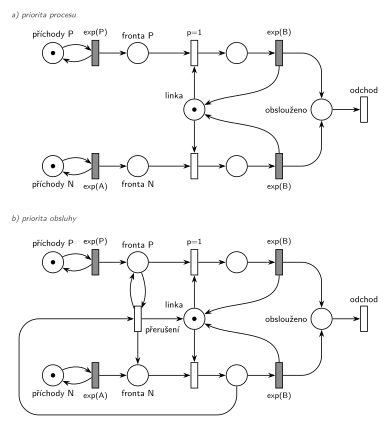

# Priorita procesu a obsluhy

## Zadání

> Uvažujme Systémy hromadné obsluhy (SHO). Definujte sémantiku pojmů 1) priorita procesu a 2) priorita obsluhy. Na co tyto priority mají vliv v kontextu transakcí? Demonstrujte na ukázkách modelů v Petriho sítí.

Podobné úlohy:

- [Příklad s prioritou procesu](<../01 - Příklad s prioritou procesu/01 - Příklad s prioritou procesu.md>) a [Každá N-tá s prioritou procesu](<../02 - Každá N-tá s prioritou procesu/02 - Každá N-tá s prioritou procesu.md>): ukázka a) jako celá úloha
- [Dva proudy příchodů](<../04 - Dva proudy příchodů/04 - Dva proudy příchodů.md>) a [Každá 10. s prioritou obsluhy](<../03 - Každá 10. s prioritou obsluhy/03 - Každá 10. s prioritou obsluhy.md>): ukázka b) jako celá úloha
- Bez Petriho sítě: zkouška 2016/17, 1. termín („v simlibe napisat prioritu obsluhy a kedy sa v praxi pouziva“) a 2021/22, 1. termín, skupina D (implementace `Facility` a `Seize` s prioritou obsluhy).

## Nápověda

<details>
<summary>Zobrazit nápovědu</summary>
<br>

- Otázka má tři části: definice, vliv na transakce a ukázky v Petriho síti. Na ukázky stačí dvě malé sítě, které se liší jediným prvkem. Tak je rozdíl nejlépe vidět.
- **1) Priorita procesu** (v SIMLIBu atribut `Priority`, slajd 182) je vlastnost transakce, podle které se řadí do front. Když se zařízení nebo sklad uvolní, dostane ho z čekajících transakce s vyšší prioritou procesu, i když přišla později. Probíhající obsluhu neovlivní. Kromě toho rozhoduje o pořadí aktivačních záznamů se stejným časem v kalendáři (záznam obsahuje prioritu, slajd 177).
- **2) Priorita obsluhy** (v SIMLIBu druhý parametr `Seize(F, p)`, slajdy 184 a 187) je vlastnost požadavku na zařízení (Facility; sklad ji nemá, slajd 188). Žádá-li transakce s vyšší prioritou obsluhy o zařízení, které právě obsluhuje transakci s nižší, obsluhu přeruší a zařízení zabere. Přerušená transakce čeká ve vnitřní frontě zařízení a po uvolnění svou obsluhu přednostně dokončí. Používá se hlavně pro poruchy (slajd 187). V obecné řeči SHO jde o „slabou“ a „silnou“ prioritu (slajd 144).
- **Vliv na transakce:** priorita procesu mění jen čekání, tedy kdo začne dřív. Priorita obsluhy mění i samotnou obsluhu: transakce s nižší prioritou může být uprostřed obsluhy přerušena a její pobyt v systému se prodlouží. Prioritní transakce nečeká ani na dokončení cizí obsluhy.
- **Nepoplést se třetím významem slova.** Priorita přechodu `p=` v Petriho síti (slajd 132) není ani jedna z obou priorit. Je to jen prostředek, kterým se obě modelují.
- **Ukázky:** M/M/1 s jednou linkou (místo *linka* s jednou značkou) a dvěma druhy transakcí ze dvou nezávislých proudů příchodů `exp(P)` (prioritní) a `exp(A)` (normální), obsluha `exp(B)`. Stejně dobře by šlo větvení jednoho proudu ([Příklad s prioritou procesu](<../01 - Příklad s prioritou procesu/01 - Příklad s prioritou procesu.md>)) nebo čítač ([Každá N-tá s prioritou procesu](<../02 - Každá N-tá s prioritou procesu/02 - Každá N-tá s prioritou procesu.md>)). Místo nerozliší jednotlivé značky, proto má každý druh vlastní frontu a vlastní místo obsluhy.
- **a) priorita procesu** = `p=1` na obsazení linky z *fronty P*. Projeví se jen ve chvíli, kdy je linka volná a čekají oba druhy.
- **b) priorita obsluhy** = navíc přechod *přerušení*. Vezme normální transakci z obsluhy (odpočet `exp(B)` zanikne, slajd 139), vrátí ji do *fronty N* a značku vrátí *lince*. Prioritní transakce zůstane ve *frontě P* (hrana tam a zpět) a hned nato linku zabere díky `p=1`. Hrana z obsluhy N do přerušení obchází proud N zdola, přímá cesta by křížila hrany linky.
- V síti b) se přerušená transakce vrací do *fronty N*, ne do zvláštní vnitřní fronty. Pro značení je to totéž, protože síť nerozlišuje, která normální transakce jde na linku, a exponenciální zbytek obsluhy má stejné rozložení jako celá obsluha (podrobněji v úloze [Dva proudy příchodů](<../04 - Dva proudy příchodů/04 - Dva proudy příchodů.md>)).
- V obou sítích transakce **opouští systém** přechodem *odchod*.

</details>

## Petriho síť

<details>
<summary>Zobrazit Petriho síť</summary>
<br>



</details>

## Časté chyby

<details>
<summary>Zobrazit časté chyby</summary>
<br>

- Priorita obsluhy vysvětlená jako předbíhání ve frontě. To je priorita procesu. Rozdíl je právě v přerušení.
- Záměna s prioritou přechodu `p=` v Petriho síti.
- Priorita obsluhy u skladu (Store ji nemá, slajd 188).
- Jedna fronta nebo jedno místo obsluhy pro oba druhy transakcí: síť pak nepozná, kterou značku upřednostnit nebo přerušit.
- Přerušená transakce, která zmizí, nebo přerušení, které nevrátí značku *lince*.
- V SIMLIBu záměna `Priority = 1` (priorita procesu) a `Seize(F, 1)` (priorita obsluhy).

</details>

## SIMLIB

<details>
<summary>Zobrazit SIMLIB kód</summary>
<br>

Model je izomorfní k oběma Petriho sítím výše: jeden program, v němž každá síť má svou linku, své dva proudy příchodů a svou třídu transakcí. Sítě se liší jediným přechodem *přerušení* a programy jediným řádkem: `Priority = 1` před `Seize(LinkaA)` proti `Seize(LinkaB, 1)`.

```cpp
// Priorita procesu a obsluhy – obě ukázkové sítě v jednom programu SIMLIB/C++
#include "simlib.h"

const double A = 10, P = 30, B = 6;        // hodnoty symbolů A, P a B

Facility LinkaA("a) Linka s prioritou procesu");   // místo „linka“ v síti a)
Facility LinkaB("b) Linka s prioritou obsluhy");   // místo „linka“ v síti b)
Histogram DobaAP("a) Doba prioritních v systému", 0, 5, 15);
Histogram DobaAN("a) Doba normálních v systému", 0, 5, 15);
Histogram DobaBP("b) Doba prioritních v systému", 0, 5, 15);
Histogram DobaBN("b) Doba normálních v systému", 0, 5, 15);

class TransakceA : public Process {        // značka v síti a)
  bool prioritni;                          // horní (P), nebo dolní (N) řada
 public:
  explicit TransakceA(bool p) : prioritni(p) {}
  void Behavior() {
    double prichod = Time;
    if (prioritni)
      Priority = 1;                        // priorita procesu = p=1 na obsazení z „fronty P“
    Seize(LinkaA);                         // řadí se ve frontě před normální, nikoho nepřeruší
    Wait(Exponential(B));                  // časovaný přechod exp(B) ...
    Release(LinkaA);                       // ... vrací značku lince
    (prioritni ? DobaAP : DobaAN)(Time - prichod);
  }                                        // konec Behavior = přechod „odchod“
};

class TransakceB : public Process {        // značka v síti b)
  bool prioritni;
 public:
  explicit TransakceB(bool p) : prioritni(p) {}
  void Behavior() {
    double prichod = Time;
    Seize(LinkaB, prioritni ? 1 : 0);      // priorita obsluhy = p=1 + přechod „přerušení“:
                                           // normální transakci odloží do fronty přerušených Q2
    Wait(Exponential(B));                  // přerušená dokončí jen zbytek obsluhy
    Release(LinkaB);
    (prioritni ? DobaBP : DobaBN)(Time - prichod);
  }
};

class Prichody : public Event {            // místo „příchody P“ (N) ve smyčce s exp(P) (exp(A))
  bool prioritni, sitB;
 public:
  Prichody(bool p, bool b) : prioritni(p), sitB(b) {}
  void Behavior() {
    if (sitB)
      (new TransakceB(prioritni))->Activate();
    else
      (new TransakceA(prioritni))->Activate();
    Activate(Time + Exponential(prioritni ? P : A));
  }
};

int main() {
  Init(0, 1000000);                        // časová jednotka podle A, P a B (např. minuty)
  for (bool sitB : {false, true}) {        // každá síť má své dva nezávislé proudy
    (new Prichody(true, sitB))->Activate();
    (new Prichody(false, sitB))->Activate();
  }
  Run();
  LinkaA.Output();
  LinkaB.Output();
  DobaAP.Output();
  DobaAN.Output();
  DobaBP.Output();
  DobaBN.Output();
}
```

| Petriho síť | SIMLIB |
|---|---|
| *příchody P* ⇄ `exp(P)`, *příchody N* ⇄ `exp(A)` (v každé síti) | dvojice událostí `Prichody(true, sitB)` a `Prichody(false, sitB)` |
| značka v síti a) / b) | proces `TransakceA` / `TransakceB` |
| místo *linka* (1 značka) | `Facility LinkaA`, `Facility LinkaB` |
| a) obsazení z *fronty P* s `p=1` | `Priority = 1; Seize(LinkaA);` (řazení ve frontě) |
| b) obsazení s `p=1` a přechod *přerušení*: obsluha N → *fronta N* + *linka* | `Seize(LinkaB, 1)`: přerušená normální čeká ve frontě přerušených Q2 |
| časovaný přechod `exp(B)` se sloučeným uvolněním | `Wait(Exponential(B)); Release(...);` |
| přechod *odchod* | konec metody `Behavior()` |

**Kontrola simulací.** Petriho sítě: v obou *linka* + obsluha P + obsluha N = 1, všechny přechody se provádějí a fronty zůstávají omezené (`make check`). V síti b) asi 60 % prioritních transakcí přeruší obsluhu, v síti a) prioritní transakce jen předbíhají ve frontě. SIMLIB model (A = 10, P = 30, B = 6, 10⁶ časových jednotek): obě linky byly vytíženy na 80 %. Prioritní transakce byly v systému v průměru 12,0 (a) a 7,5 (b) časové jednotky, normální 35,3 (a) a 37,6 (b). Vzorce pro M/M/1 s prioritou bez přerušení dávají 12 a 36, s přerušením 7,5 a 37,5. Priorita obsluhy tedy prioritním transakcím ušetří čekání na dokončení cizí obsluhy a normální za to zaplatí jen málo (`make simlib`).

</details>

## Původ a zdroje

<details>
<summary>Zobrazit původ a zdroje</summary>
<br>

**Původ:** zkouška 2025/26, 1. termín, skupina C, otázka 3, 10 bodů. Stejnou dvojici pojmů obsahovala teoretická otázka zkoušky „2019 - 2. opravný“ (bod d) „Priorita procesu, priorita obsluhy“).

**Zdroje:**

- `Fitcheats/Zkoušky z minulých let/2025-26 - 1. termín C.pdf`, str. 3 (fotka zadání, rámeček na odpověď je prázdný)
- `Přednášky - Prezentace 2025/IMS - Prezentace.pdf`, slajdy 143–144 (prioritní fronty a čtyři varianty prioritní obsluhy), 182 (priorita procesu), 184 (dvě fronty zařízení, dva typy priority), 187 (priorita obsluhy), 188 (sklad)
- `Fitcheats/Skripta/FIT - Studentská skripta 2015-16.pdf`, str. 39–40 (otázka 7: varianty priorit nakreslené Petriho sítí)
- `Fitcheats/Příprava na zkoušku/FIT - Řešené výpočetní příklady 2017-21.pdf`, str. 23 (zadání teorie „2019 - 2. opravný“) a str. 47 (studentská odpověď)
- `Fitcheats/Příprava na zkoušku/xenix - Příprava.pdf`, str. 6 (studentské definice)

**Existující řešení:**

- **Studentská skripta 2015-16, str. 39** (slabá priorita): dvě fronty, obsazení s `p=1` a `p=2` bere společnou linku, jedna obsluha, uvolnění vrací linku. Správně, odpovídá ukázce a). Chybí jen doba obsluhy.
- **Skripta, str. 40** (silná priorita) je chybná:
  - Obsazení s `p=2` vůbec nebere značku linky. Prioritní transakce proto u volné linky nezačne, čeká, až linku zabere normální transakce a ona ji vyhodí.
  - Přechod *Obsluha* má dvě vstupní hrany (modrou od normální, zelenou od prioritní). Proveditelný je tedy jen se značkami v obou místech zároveň. Zamýšlené „buď, nebo“ se kreslí dvěma přechody.
  - U obsluhy chybí doba, je u ní jen `p=0`.
- **Řešené výpočetní příklady, str. 47:** textová odpověď je správná, včetně pořadí v kalendáři a „vyhození“ obsluhované transakce. Chybí, co se s vyhozenou transakcí stane dál.
- **xenix, str. 6:** u priority obsluhy píše, že přerušená transakce „odchází neobsloužen, nebo se určité době vrátí“. To jsou obecné varianty ze slajdu 144. V SIMLIBu přerušená transakce čeká ve vnitřní frontě zařízení a obsluhu dokončí.

</details>

## Reference

- [Jak síť funguje](<../../../basics/Jak síť funguje.md>)
- [Notace a vzory](<../../../basics/Notace a vzory.md>)

<!-- -->

- [Studijní plán](<../../Studijní plán.md>)
- [Seznam úloh](<../../Seznam úloh.md>)
