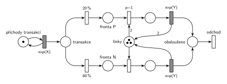

# MM3 – prioritní zabírají 2 linky

## Zadání

> Pro následující systém nakreslete jeho model v Petriho síti. Systém typu M/M/3. Příchozí transakce je s pravděpodobností 20% prioritní a navíc vyžaduje zabrat dvě linky současně.

Podobné úlohy:

- [Příklad s prioritou procesu](<../01 - Příklad s prioritou procesu/01 - Příklad s prioritou procesu.md>): stejné větvení 20 % / 80 % a přednost při obsazení, jen s jednou linkou
- [Priorita procesu a obsluhy](<../05 - Priorita procesu a obsluhy/05 - Priorita procesu a obsluhy.md>): proč tu jde o prioritu procesu

## Nápověda

<details>
<summary>Zobrazit nápovědu</summary>
<br>

- Čísla zadání nedává: příchody `exp(X)` (místo *příchody transakcí* ve smyčce), obsluha `exp(Y)` pro oba druhy jako ve studentském řešení.
- **Druh transakce** určí pravděpodobnostní větvení hned po příchodu (20 % / 80 %), každý druh pak čeká ve vlastní frontě.
- **M/M/3 = sklad se třemi linkami:** místo *linky* se 3 značkami. Prioritní transakce zabere dvě linky jedním přechodem s hranou váhy 2 („současně“) a časovaný přechod jí obě vrátí (hrana váhy 2 zpět). Normální bere a vrací jednu.
- **Jaká priorita:** zadání ji neupřesňuje. M/M/3 se modeluje skladem a sklad prioritu obsluhy nemá (slajd 188). Přerušovat by se navíc musely až dvě cizí obsluhy. Jde tedy o prioritu procesu: `p=1` na obsazení dvou linek. Čekají-li oba druhy a jsou-li volné aspoň dvě linky, jde dřív prioritní.
- **Předbíhání u jedné volné linky:** prioritní ji použít nemůže, takže ji dostane čekající normální transakce. Stejně se chová sklad v SIMLIBu: „První čekající s uspokojitelným požadavkem je obsloužen (nemusí být první ve frontě)“ (slajd 188). Kdyby prioritní měla normální zastavit, dokud se neuvolní dvě linky, musela by síť testovat prázdnou *frontu P* (inhibiční hranou). To zadání nežádá.
- Obsloužená transakce **opouští systém** přechodem *odchod*.

</details>

## Petriho síť

<details>
<summary>Zobrazit Petriho síť</summary>
<br>



</details>

## Časté chyby

<details>
<summary>Zobrazit časté chyby</summary>
<br>

- Prioritní obsluha vrací jen jednu linku (chybí váha 2 na zpětné hraně).
- *Linky* s jednou značkou místo tří.
- Dvě linky obsazené dvěma postupnými přechody. Prioritní pak drží jednu linku nevyužitou a čeká na druhou, zadání chce obě současně.
- Pravděpodobnost i priorita na jednom přechodu (`20 %, p=1`). Přechod má jen jeden parametr.
- V SIMLIBu `Facility` místo `Store`, nebo `Enter(Linky, 2)` a `Leave(Linky, 1)`.

</details>

## SIMLIB

<details>
<summary>Zobrazit SIMLIB kód</summary>
<br>

Model je izomorfní k Petriho síti výše: každé místo, přechod a značka mají svůj protějšek v kódu. Obě fronty sítě jsou v SIMLIBu jedna fronta skladu seřazená podle atributu `Priority`; `Leave` prochází frontu od začátku a pustí každého, komu stačí volná kapacita, takže normální transakce může předběhnout prioritní stejně jako v síti.

```cpp
// M/M/3, prioritní transakce zabírají dvě linky – model v SIMLIB/C++
#include "simlib.h"

const double X = 10, Y = 15;               // hodnoty symbolů X a Y

Store Linky("Linky", 3);                   // místo „linky“ se 3 značkami
Histogram CekaniP("Čekání prioritních", 0, 2, 15);
Histogram CekaniN("Čekání normálních", 0, 2, 15);

class Transakce : public Process {         // transakce = značka, která prochází sítí
  void Behavior() {
    double prichod = Time;
    if (Random() < 0.2) {                  // okamžitý přechod 20 %
      Priority = 1;                        // priorita procesu = p=1 na obsazení z „fronty P“
      Enter(Linky, 2);                     // hrana s váhou 2: obě linky současně
      CekaniP(Time - prichod);
      Wait(Exponential(Y));                // časovaný přechod exp(Y) ...
      Leave(Linky, 2);                     // ... vrací obě linky (hrana s váhou 2)
    } else {                               // okamžitý přechod 80 %
      Enter(Linky, 1);
      CekaniN(Time - prichod);
      Wait(Exponential(Y));
      Leave(Linky, 1);
    }
  }                                        // konec Behavior = přechod „odchod“
};

class Prichody : public Event {            // místo „příchody transakcí“ ve smyčce s exp(X)
  void Behavior() {
    (new Transakce)->Activate();
    Activate(Time + Exponential(X));
  }
};

int main() {
  Init(0, 1000000);                        // časová jednotka podle X a Y (např. minuty)
  (new Prichody)->Activate();
  Run();
  Linky.Output();
  CekaniP.Output();
  CekaniN.Output();
}
```

| Petriho síť | SIMLIB |
|---|---|
| *příchody transakcí* ⇄ `exp(X)` | událost `Prichody`, která se znovu plánuje za `Exponential(X)` |
| značka (transakce) | proces `Transakce` |
| `20 %` / `80 %` | `if (Random() < 0.2)` |
| *fronta P*, obsazení s `p=1` a hranou váhy 2 | `Priority = 1; Enter(Linky, 2);` |
| *fronta N*, obsazení s `p=0` | `Enter(Linky, 1);` |
| místo *linky* (3 značky) | `Store Linky("Linky", 3)` |
| `exp(Y)` vrací 2 (1) značky | `Wait(Exponential(Y)); Leave(Linky, 2);` (`Leave(Linky, 1)`) |
| přechod *odchod* | konec metody `Behavior()` |

**Kontrola simulací.** Petriho síť: *linky* + 2 × obsluha P + obsluha N = 3, takže najednou se obsluhuje nejvýš jedna prioritní transakce. Prioritních je asi 20 %, obě fronty zůstávají omezené a všechny přechody se provádějí (`make check`). SIMLIB model (X = 10, Y = 15, 10⁶ časových jednotek): průměrně bylo obsazeno 1,81 linky, teoreticky 0,1 × (0,2 × 2 + 0,8 × 1) × 15 = 1,8. Prioritní transakce čekaly v průměru 16,5 časové jednotky, normální jen 6,2: priorita procesu nepomůže, když prioritní potřebuje dvě volné linky najednou a normální jí uvolněné linky po jedné berou (`make simlib`).

</details>

## Původ a zdroje

<details>
<summary>Zobrazit původ a zdroje</summary>
<br>

**Původ:** zkouška uvedená v přípravě jako „2019:“ (pravděpodobně 2018/19, termín ani skupina nejsou uvedeny), otázka 3, 10 bodů.

**Zdroje:**

- `Fitcheats/Příprava na zkoušku/FIT - Řešené výpočetní příklady 2017-21.pdf`, str. 10–11 (výstřižek zadání a studentské řešení)
- `Fitcheats/Příprava na zkoušku/xenix - Příprava.pdf`, str. 27 („M/M/3 20%priorita, 2 linky“, fotka studentského řešení bez zadání)

**Existující řešení:**

- **Řešené výpočetní příklady, str. 11:** stejná síť. Místo linek má 3 značky, prioritní obsazení `p=1` bere 2 a `exp(y)` vrací 2, normální bere a vrací 1, za společným místem je výstupní přechod. Správně.
- **xenix, str. 27:** místo *L* má jen jednu značku a hrana z prioritní obsluhy zpět do *L* nemá váhu 2. S jednou značkou se obsazení s váhou 2 nikdy neprovede, takže by prioritní transakce čekaly navždy. Se 3 značkami by zase každá prioritní obsluha jednu linku ztratila. U prioritní obsluhy navíc chybí doba.

</details>

## Reference

- [Jak síť funguje](<../../../basics/Jak síť funguje.md>)
- [Notace a vzory](<../../../basics/Notace a vzory.md>)
- [Seznam úloh](<../../Seznam úloh.md>)
