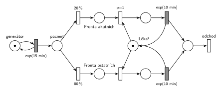

# 07–01 – Příklad s prioritou procesu

**Původ:** zkouška 2019/20, 3. termín, skupina A (7. 2. 2020), otázka 2, 20 bodů.

**Zdroje:**

- `Fitcheats/Zkoušky z minulých let/2019-20 - 3. termín A.pdf`, str. 2 (fotka zadání, rámeček na odpověď je prázdný)

## Zadání

> Vymyslete příklad systému hromadné obsluhy typu M/M/1, který bude demonstrovat použití priority procesu. Sestavte jeho model v Petriho síti a SIMLIBu.

Podobné úlohy:

- [07–02 – Každá N-tá s prioritou procesu](<../07–02 - Každá N-tá s prioritou procesu/07–02 - Každá N-tá s prioritou procesu.md>): prioritní je každá N-tá transakce
- [07–05 – Priorita procesu a obsluhy](<../07–05 - Priorita procesu a obsluhy/07–05 - Priorita procesu a obsluhy.md>): rozdíl proti prioritě obsluhy
- [02–03 – Příklad s netrpělivou transakcí](<../02–03 - Příklad s netrpělivou transakcí/02–03 - Příklad s netrpělivou transakcí.md>): stejný typ zadání „vymyslete příklad“

## Interpretace

Zobrazit interpretaci (nápověda)

- **Vymyšlený příklad:** ambulance s jedním lékařem. Pacienti přicházejí v intervalech `exp(15 min)`, 20 % z nich je akutních, vyšetření trvá `exp(10 min)`. Akutní pacienti mají vyšší prioritu procesu: když se lékař uvolní, jde na řadu akutní pacient před dříve příchozími ostatními. Probíhající vyšetření ale nepřeruší (to by byla priorita obsluhy, viz 07–05).
- **Priorita procesu = pořadí ve frontě** (slajd 182, v SIMLIBu atribut `Priority`). Místo v Petriho síti neuchovává pořadí ani rozdíl mezi značkami. Proto má každý druh pacientů vlastní frontu a přednost se zapíše prioritou `p=1` na obsazení lékaře z *Fronty akutních*. Projeví se jen tehdy, když se lékař uvolní a čekají pacienti z obou front.
- **Druh pacienta** určí pravděpodobnostní větvení hned po příchodu (20 % / 80 %). Větvicí přechody mají jen pravděpodobnost, priorita patří až na obsazení (jeden parametr na přechod, slajd 135).
- Obě obsazení by mohla vést do jednoho společného místa vyšetření, protože po začátku vyšetření už na druhu pacienta nezáleží. Dvě oddělená místa jsou tu kvůli přehlednosti a kvůli srovnání se sítí s prioritou obsluhy, kde nutná jsou.
- SIMLIB část otázky tu není řešená.

## Řešení

Zobrazit řešení

| Požadavek | Prvek sítě |
|---|---|
| M/M/1: příchody, jeden lékař, vyšetření | *generátor* ⇄ `exp(15 min)`; *Lékař* (1 značka); `exp(10 min)` vrací *Lékaře* |
| 20 % akutních pacientů | větvení *pacient* → `20 %` *Fronta akutních* / `80 %` *Fronta ostatních* |
| priorita procesu: akutní jde na řadu dřív | obsazení *Lékaře* z *Fronty akutních* s `p=1`, z *Fronty ostatních* s `p=0` |
| vyšetření se nepřerušuje | žádný přechod nebere značku z místa vyšetření |
| pacient opouští systém | *odchod* |

Kontrola simulací: *Lékař* + vyšetřovaní pacienti = 1. Akutních je asi 20 % a jejich fronta zůstává krátká, fronta ostatních je delší.

## Existující řešení

Zobrazit srovnání s existujícími řešeními

- K tomuto zadání žádné řešení není. Stejnou konstrukci (dvě fronty, obsazení s různou prioritou) kreslí **Studentská skripta 2015-16, str. 39** jako „slabou prioritu“.

## Časté chyby

Zobrazit časté chyby

- Akutní pacient přeruší probíhající vyšetření. To je priorita obsluhy, ne priorita procesu.
- Jedna společná fronta a v ní „prioritní“ přechod. Místo nerozliší, která značka je akutní pacient.
- Pravděpodobnost i priorita na jednom přechodu (např. `20 %, p=1`). Přechod má jen jeden parametr.
- Priorita napsaná na hranu místo na přechod.

