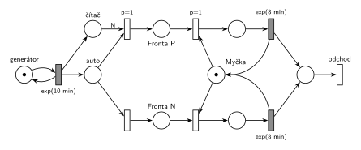

# 07–02 – Každá N-tá s prioritou procesu

## Zadání

> Vymyslete příklad systému hromadné obsluhy typu M/M/1, který bude demonstrovat použití priority procesu u každé N-té transakce. Sestavte jeho model v Petriho síti a SIMLIBu (bez main() a generátoru).

Podobné úlohy:

- [07–03 – Každá 10. s prioritou obsluhy](<../07–03 - Každá 10. s prioritou obsluhy/07–03 - Každá 10. s prioritou obsluhy.md>): stejný čítač, ale priorita obsluhy (přerušení)
- [07–01 – Příklad s prioritou procesu](<../07–01 - Příklad s prioritou procesu/07–01 - Příklad s prioritou procesu.md>): prioritní je náhodně 20 % transakcí
- [03–07 – Každá 10. transakce vyvolá poruchu](<../03–07 - Každá 10. transakce vyvolá poruchu/03–07 - Každá 10. transakce vyvolá poruchu.md>): čítač s hranou váhy 10

## Interpretace

Zobrazit interpretaci (nápověda)

 

- **Vymyšlený příklad:** myčka aut. Auta přijíždějí v intervalech `exp(10 min)`, mytí trvá `exp(8 min)`. Každé N-té auto dostane v rámci věrnostní akce přednost: předjede všechna čekající auta, rozjeté mytí ale nepřeruší.
- **Priorita procesu = pořadí ve frontě** (slajd 182). N-té auto proto jde do vlastní *Fronty P* a obsazení *Myčky* z ní má `p=1`. Přednost se projeví, když se myčka uvolní a čekají auta v obou frontách.
- **Čítač:** každý příchod přidá značku do místa *čítač*. Když jich je N, přechod s hranou váhy N (a `p=1`) pošle právě přijíždějící auto do *Fronty P* a čítač vynuluje. Jinak se provede přechod s `p=0` do *Fronty N*. Váha N počítá i právě přijíždějící auto: první až (N−1). auto jde do *Fronty N*, N-té do *Fronty P*.
- Rozhoduje se hned při příchodu: priorita procesu je vlastnost transakce a platí po celou dobu jejího čekání ve frontě.
- N zůstává symbolem jako v zadání, simulace počítá s N = 5.
- SIMLIB část otázky tu není řešená.

## Petriho síť

Zobrazit Petriho síť

 

| Požadavek | Prvek sítě |
|---|---|
| M/M/1: příchody, jedna myčka, mytí | *generátor* ⇄ `exp(10 min)`; *Myčka* (1 značka); `exp(8 min)` vrací *Myčku* |
| každá N-tá transakce | `exp(10 min)` → *čítač*; *auto* + N × *čítač* → *Fronta P* (`p=1`), jinak *auto* → *Fronta N* |
| priorita procesu: N-tá předbíhá ve frontě | obsazení *Myčky* z *Fronty P* s `p=1` |
| mytí se nepřerušuje | žádný přechod nebere značku z místa mytí |
| auto opouští systém | *odchod* |

Kontrola simulací: *Myčka* + mytá auta = 1, *čítač* nikdy nepřesáhne N. Do *Fronty P* jde přesně každé páté auto (N = 5).

## Časté chyby

Zobrazit časté chyby

 

- N-tá transakce přeruší probíhající obsluhu. To je priorita obsluhy (úloha ze skupiny H).
- Čítač, který se nevynuluje (hrana váhy N jen testuje a vrací značky), nebo hrana váhy N−1 při čítači, do kterého přispívá i právě příchozí transakce.
- „Prioritní“ přechod, který bere libovolnou značku ze společné fronty. Priorita patří N-té transakci, takže ta musí mít vlastní místo.
- Čítač bez priority na přechodu váhy N: N-tá transakce pak může projít i obyčejnou větví.

## Původ a zdroje

Zobrazit původ a zdroje

 

**Původ:** zkouška 2022/23, 3. termín, skupina G, otázka 2, 10 bodů. Ve skupině H stejného termínu byla sesterská úloha s prioritou obsluhy ([07–03](<../07–03 - Každá 10. s prioritou obsluhy/07–03 - Každá 10. s prioritou obsluhy.md>)).

**Zdroje:**

- `Fitcheats/Zkoušky z minulých let/2022-23 - 3. termín G.pdf`, str. 2 (fotka zadání, rámeček na odpověď je prázdný)

**Existující řešení:**

- K tomuto zadání žádné řešení není. K sesterské úloze s prioritou obsluhy existuje chybné řešení cranycrane, rozbor je v [07–03](<../07–03 - Každá 10. s prioritou obsluhy/07–03 - Každá 10. s prioritou obsluhy.md>).

