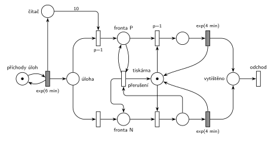

# 07–03 – Každá 10. s prioritou obsluhy

## Zadání

> Vymyslete příklad systému hromadné obsluhy typu M/M/1, který bude demonstrovat použití priority obsluhy každé 10. transakce. Sestavte jeho model v Petriho síti a SIMLIBu (bez main() a generátoru).

Podobné úlohy:

- [07–02 – Každá N-tá s prioritou procesu](<../07–02 - Každá N-tá s prioritou procesu/07–02 - Každá N-tá s prioritou procesu.md>): stejný čítač, ale bez přerušení
- [07–04 – Dva proudy příchodů](<../07–04 - Dva proudy příchodů/07–04 - Dva proudy příchodů.md>): stejné přerušení, prioritní mají vlastní proud příchodů
- [03–07 – Každá 10. transakce vyvolá poruchu](<../03–07 - Každá 10. transakce vyvolá poruchu/03–07 - Každá 10. transakce vyvolá poruchu.md>): čítač s hranou váhy 10

## Interpretace

Zobrazit interpretaci (nápověda)

- **Vymyšlený příklad:** tiskárna. Úlohy přicházejí v intervalech `exp(6 min)`, tisk trvá `exp(4 min)`. Každá 10. úloha je od vedení a má vyšší prioritu obsluhy (v SIMLIBu `Seize(tiskarna, 1)`). Když přijde a tiskárna tiskne běžnou úlohu, tisk se přeruší a vytiskne se úloha vedení. Přerušená úloha se pak dotiskne.
- **Priorita obsluhy = přerušení** (slajd 187), ne jen předbíhání ve frontě. Desátá úloha proto potřebuje vlastní frontu a vlastní místo tisku. Jen tak může síť poznat, kterou značku upřednostnit a kterou přerušit.
- **Čítač** jako v 07–02: každý příchod přidá značku do místa *čítač*. Když jich je 10, přechod s hranou váhy 10 (a `p=1`) pošle právě příchozí úlohu do *Fronty P* a čítač vynuluje.
- **Přerušení ve dvou krocích** jako u poruchy v 03–03. Přechod *přerušení* vezme běžnou úlohu z tisku, vrátí ji do *Fronty N* a značku vrátí *Tiskárně*. Úloha vedení zůstává ve *Frontě P* (hrana tam a zpět). Hned potom ji obsazení s `p=1` spojí s volnou tiskárnou. Bez `p=1` by si tiskárnu mohla vzít čekající běžná úloha.
- **Přerušená úloha** v SIMLIBu čeká ve vnitřní frontě zařízení a dokončí se přednostně. V síti se vrací do *Fronty N*. Pro značení je to totéž, protože síť nerozlišuje běžné úlohy a zbytek exponenciální obsluhy má stejné rozložení jako celá obsluha (podrobněji v 07–04).
- SIMLIB část otázky tu není řešená.

## Řešení

Zobrazit řešení

| Požadavek | Prvek sítě |
|---|---|
| M/M/1: příchody, jedna tiskárna, tisk | *generátor* ⇄ `exp(6 min)`; *Tiskárna* (1 značka); `exp(4 min)` vrací *Tiskárnu* |
| každá 10. transakce | `exp(6 min)` → *čítač*; *úloha* + 10 × *čítač* → *Fronta P* (`p=1`), jinak *úloha* → *Fronta N* |
| priorita obsluhy: 10. přeruší probíhající tisk | *přerušení*: *Fronta P* (zůstává) + tisk N → *Fronta N* + *Tiskárna* |
| 10. hned zabere tiskárnu | obsazení z *Fronty P* s `p=1` |
| úloha opouští systém | *odchod* |

Kontrola simulací: *Tiskárna* + tištěné úlohy = 1, *čítač* nepřesáhne 10. Prioritní je přesně každá desátá úloha a asi 70 % z nich přeruší probíhající tisk.

## Časté chyby

Zobrazit časté chyby

- Jen `p=1` na obsazení bez přerušení. To je priorita procesu (úloha ze skupiny G).
- Společná fronta a společné místo obsluhy pro desátou i ostatní transakce (cranycrane): síť pak nepozná, kterou značku přerušit.
- Čítač, který se nevynuluje.
- Přerušená transakce, která zmizí, nebo přerušení, které nevrátí značku *Tiskárně*.
- Přerušení i tisku jiné prioritní úlohy: prioritní by se navzájem vyhazovaly.

## Původ a zdroje

**Původ:** zkouška 2022/23, 3. termín, skupina H, otázka 2 (body v přepisu nejsou, stejná otázka ve skupině G má 10 bodů). Ve skupině G byla sesterská úloha s prioritou procesu ([07–02](<../07–02 - Každá N-tá s prioritou procesu/07–02 - Každá N-tá s prioritou procesu.md>)).

**Zdroje:**

- `Fitcheats/Zkoušky z minulých let/2022-23 - 3. termín H.pdf`, str. 1 (přepsané zadání bez čísel otázek a bodů)
- `Fitcheats/Příprava na zkoušku/cranycrane - Kódy (generátory, Monte Carlo, Euler, RK, Petri + SIMLIB)/petri/7.png` a `7.cpp` (studentské řešení)

**Existující řešení:**

Zobrazit existující řešení

- **cranycrane, 7.png:** `exp(A)` plní frontu i *Counter*. Přechod `p=1` bere 10 značek z *Counter*, jednu z fronty a jednu z obsluhy a vrací je do fronty a do obsluhy. Chyby:
  - Desátá transakce nemá vlastní místo. Přechod vrací značky do stejných míst, odkud je vzal, takže se značení fronty ani obsluhy nezmění. Jen se znovu spustí odpočet `exp(B)`, což u exponenciálního rozložení nic nemění. Síť se chová jako obyčejné M/M/1 a žádnou prioritu nemá.
  - Přechod je proveditelný jen při obsazené lince a neprázdné frontě. Přijde-li 10. transakce k volné lince, čítač zůstane plný a přechod se provede později s úplně jinými transakcemi (např. 11. transakce „vyhodí“ z obsluhy tu desátou).
- **cranycrane, 7.cpp:** `if (counter == 10) Seize(linka, 1)`, ale čítač se nikdy nenuluje. Prioritu tak dostane jen úplně první desátá transakce.

