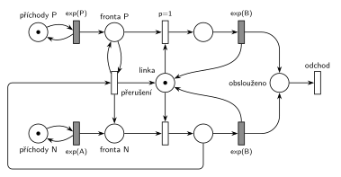

# 07–04 – Dva proudy příchodů

**Původ:** zkouška 2025/26, 1. termín, skupina B, otázka 1, 10 bodů.

**Zdroje:**

- `Fitcheats/Zkoušky z minulých let/2025-26 - 1. termín B.pdf`, str. 1 (fotka zadání, 13. 1. 2026; rámeček na odpověď je prázdný)

## Zadání

> Zadaný systém modelujte prostředky Petriho sítě s vyznačením atributů na přechodech a místech. Vyznačte přechodem, kde transakce opouští systém.
>
> Uvažujme systém typu M/M/1, kde však jsou dva zcela nezávislé procesy příchodů (Normální, Prioritní). Transakce pocházející z Prioritního procesu příchodů mají na lince vyšší *prioritu obsluhy* (!) než transakce z Normálního procesu příchodů.

Podobné úlohy:

- [07–05 – Priorita procesu a obsluhy](<../07–05 - Priorita procesu a obsluhy/07–05 - Priorita procesu a obsluhy.md>): tatáž síť jako ukázka b), vedle ní priorita procesu
- [07–03 – Každá 10. s prioritou obsluhy](<../07–03 - Každá 10. s prioritou obsluhy/07–03 - Každá 10. s prioritou obsluhy.md>): stejné přerušení, prioritní je každá 10. transakce
- [03–03 – Porucha s opravou, návrat do fronty](<../03–03 - Porucha s opravou, návrat do fronty/03–03 - Porucha s opravou, návrat do fronty.md>): porucha zabírá linku stejnými dvěma kroky

## Interpretace

Zobrazit interpretaci (nápověda)

- **Priorita obsluhy, ne priorita procesu.** Vykřičník míří právě na tento rozdíl (slajdy 182, 184 a 187). Priorita procesu jen mění pořadí ve frontě. Priorita obsluhy (SIMLIB `Seize(linka, 1)`) navíc znamená, že prioritní transakce, která přijde k lince obsazené normální transakcí, její obsluhu **přeruší** a linku zabere. Síť bez přerušení (jen `p=1` na obsazení) by byla priorita procesu, viz ukázka a) v [07–05](<../07–05 - Priorita procesu a obsluhy/07–05 - Priorita procesu a obsluhy.md>).
- **Přerušení ve dvou krocích**, stejně jako porucha v 03–03. Přechod *přerušení* vezme normální transakci z obsluhy, vrátí ji do *Fronty N* a značku vrátí *Lince*. Prioritní transakce přitom zůstává ve *Frontě P* (hrana tam a zpět). Hned potom ji obsazení s `p=1` spojí s uvolněnou linkou.
- **`p=1` na obsazení prioritní** je nutná: po přerušení je linka volná a ve *Frontě N* čeká (přinejmenším) přerušená transakce. Stejná priorita zároveň řeší i obyčejné uvolnění linky: čekají-li oba druhy, jde dřív prioritní.
- **Přerušení parametr nepotřebuje.** Je proveditelné jen při obsazené lince, kdy žádné obsazení proveditelné není. Před časovaným `exp(B)` má okamžitý přechod přednost vždy, takže odpočet obsluhy zanikne (slajd 139). Bere jen z obsluhy N, takže prioritní transakce jinou prioritní nepřeruší a čeká ve *Frontě P*.
- **Co s přerušenou transakcí.** SIMLIB ji odloží do vnitřní fronty zařízení a po uvolnění linky ji obslouží přednostně až do konce (slajd 187). V síti se vrací do *Fronty N*. Pro značení je to totéž: síť nerozlišuje, která z čekajících normálních transakcí jde na linku, a díky exponenciálnímu rozložení má zbytek obsluhy stejné rozložení jako celá `exp(B)`. Kdo chce vnitřní frontu nakreslit, přidá místo *přerušené* a jeho obsazení linky s prioritou mezi oběma obsazeními (pak prioritní `p=2`, přerušená `p=1`).
- Přerušení jde zapsat i jedním přechodem (*Fronta P* + obsluha N → obsluha P + *Fronta N*). Je to také správně, jen se to v tomto rozložení nenakreslí bez křížení dalších hran.
- Čísla zadání nedává: příchody `exp(A)` a `exp(P)`, obsluha `exp(B)` pro oba druhy (M/M/1 má jednu linku a jeden typ obsluhy).

## Řešení

Zobrazit řešení

| Požadavek | Prvek sítě |
|---|---|
| dva nezávislé proudy příchodů | *generátor P* ⇄ `exp(P)` → *Fronta P*; *generátor N* ⇄ `exp(A)` → *Fronta N* |
| jedna linka | *Linka* (1 značka); obě obsazení ji berou, obě `exp(B)` ji vrací |
| prioritní přeruší obsluhu normální | *přerušení*: *Fronta P* (zůstává) + obsluha N → *Fronta N* + *Linka* |
| prioritní zabere linku přednostně | obsazení z *Fronty P* s `p=1` |
| transakce opouští systém | *odchod* |

Kontrola simulací: *Linka* + obsluha P + obsluha N = 1. Asi 60 % prioritních transakcí přeruší obsluhu (tak velkou část času linku drží normální transakce), *Fronta P* zůstává krátká.

## Existující řešení

Zobrazit srovnání s existujícími řešeními

- K tomuto zadání žádné řešení není. Variantu s přerušením kreslí **Studentská skripta 2015-16, str. 40** a je chybná, rozbor je v [07–05](<../07–05 - Priorita procesu a obsluhy/07–05 - Priorita procesu a obsluhy.md>).

## Časté chyby

Zobrazit časté chyby

- Jen `p=1` na obsazení bez přerušení. To je priorita procesu, ne priorita obsluhy, kterou zadání zdůrazňuje vykřičníkem.
- Jedna společná fronta pro oba proudy. Z místa nejde poznat, která značka je prioritní, takže přerušení ani přednost nejde vyjádřit.
- Přerušení, které nevrátí značku *Lince* (nebo ji vrátí a prioritní ji pak nezabere): linka se ztratí, nebo ji znovu dostane normální transakce.
- Přerušená transakce zahozená nebo poslaná na *odchod*. Při prioritě obsluhy se její obsluha jen odkládá.
- Přerušení i z obsluhy prioritní transakce: prioritní by se navzájem vyhazovaly.

