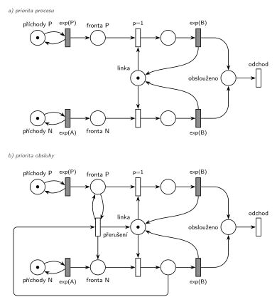

# 07–05 – Priorita procesu a obsluhy

**Původ:** zkouška 2025/26, 1. termín, skupina C, otázka 3, 10 bodů. Stejnou dvojici pojmů obsahovala teoretická otázka zkoušky „2019 - 2. opravný“ (bod d) „Priorita procesu, priorita obsluhy“).

**Zdroje:**

- `Fitcheats/Zkoušky z minulých let/2025-26 - 1. termín C.pdf`, str. 3 (fotka zadání, rámeček na odpověď je prázdný)
- `Přednášky - Prezentace 2025/IMS - Prezentace.pdf`, slajdy 143–144 (prioritní fronty a čtyři varianty prioritní obsluhy), 182 (priorita procesu), 184 (dvě fronty zařízení, dva typy priority), 187 (priorita obsluhy), 188 (sklad)
- `Fitcheats/Skripta/FIT - Studentská skripta 2015-16.pdf`, str. 39–40 (otázka 7: varianty priorit nakreslené Petriho sítí)
- `Fitcheats/Příprava na zkoušku/FIT - Řešené výpočetní příklady 2017-21.pdf`, str. 23 (zadání teorie „2019 - 2. opravný“) a str. 47 (studentská odpověď)
- `Fitcheats/Příprava na zkoušku/xenix - Příprava.pdf`, str. 6 (studentské definice)

## Zadání

> Uvažujme Systémy hromadné obsluhy (SHO). Definujte sémantiku pojmů 1) priorita procesu a 2) priorita obsluhy. Na co tyto priority mají vliv v kontextu transakcí? Demonstrujte na ukázkách modelů v Petriho sítí.

Podobné úlohy:

- [07–01 – Příklad s prioritou procesu](<../07–01 - Příklad s prioritou procesu/07–01 - Příklad s prioritou procesu.md>) a [07–02 – Každá N-tá s prioritou procesu](<../07–02 - Každá N-tá s prioritou procesu/07–02 - Každá N-tá s prioritou procesu.md>): ukázka a) jako celá úloha
- [07–04 – Dva proudy příchodů](<../07–04 - Dva proudy příchodů/07–04 - Dva proudy příchodů.md>) a [07–03 – Každá 10. s prioritou obsluhy](<../07–03 - Každá 10. s prioritou obsluhy/07–03 - Každá 10. s prioritou obsluhy.md>): ukázka b) jako celá úloha
- Bez Petriho sítě: zkouška 2016/17, 1. termín („v simlibe napisat prioritu obsluhy a kedy sa v praxi pouziva“) a 2021/22, 1. termín, skupina D (implementace `Facility` a `Seize` s prioritou obsluhy).

## Interpretace

Zobrazit interpretaci (nápověda)

- Otázka má tři části: definice, vliv na transakce a ukázky v Petriho síti. Na ukázky stačí dvě malé sítě, které se liší jediným prvkem. Tak je rozdíl nejlépe vidět.
- **Nepoplést se třetím významem slova.** Priorita přechodu `p=` v Petriho síti (slajd 132) není ani jedna z obou priorit. Je to jen prostředek, kterým se obě modelují.
- Dva druhy transakcí v ukázkách přicházejí ze dvou nezávislých generátorů (P = prioritní, N = normální). Stejně dobře by šlo větvení jednoho proudu (07–01) nebo čítač (07–02).

## Řešení

Zobrazit řešení

**1) Priorita procesu** (v SIMLIBu atribut `Priority`, slajd 182) je vlastnost transakce, podle které se řadí do front. Když se zařízení nebo sklad uvolní, dostane ho z čekajících transakce s vyšší prioritou procesu, i když přišla později. Probíhající obsluhu neovlivní. Kromě toho rozhoduje o pořadí aktivačních záznamů se stejným časem v kalendáři (záznam obsahuje prioritu, slajd 177).

**2) Priorita obsluhy** (v SIMLIBu druhý parametr `Seize(F, p)`, slajdy 184 a 187) je vlastnost požadavku na zařízení (Facility; sklad ji nemá, slajd 188). Žádá-li transakce s vyšší prioritou obsluhy o zařízení, které právě obsluhuje transakci s nižší, obsluhu přeruší a zařízení zabere. Přerušená transakce čeká ve vnitřní frontě zařízení a po uvolnění svou obsluhu přednostně dokončí. Používá se hlavně pro poruchy (slajd 187). V obecné řeči SHO jde o „slabou“ a „silnou“ prioritu (slajd 144).

**Vliv na transakce:** priorita procesu mění jen čekání, tedy kdo začne dřív. Priorita obsluhy mění i samotnou obsluhu: transakce s nižší prioritou může být uprostřed obsluhy přerušena a její pobyt v systému se prodlouží. Prioritní transakce nečeká ani na dokončení cizí obsluhy.

**V Petriho síti** místo nerozliší jednotlivé značky, proto má každý druh transakcí vlastní frontu a vlastní místo obsluhy:

- a) priorita procesu = `p=1` na obsazení linky z *Fronty P*. Projeví se jen ve chvíli, kdy je linka volná a čekají oba druhy.
- b) priorita obsluhy = navíc přechod *přerušení*. Vezme normální transakci z obsluhy (odpočet `exp(B)` zanikne, slajd 139), vrátí ji do *Fronty N* a značku vrátí *Lince*. Prioritní transakce zůstane ve *Frontě P* a hned nato linku zabere díky `p=1`.

| Pojem | SIMLIB | Petriho síť |
|---|---|---|
| priorita procesu | `Priority` procesu, řazení ve frontě | `p=1` na obsazení z *Fronty P* |
| priorita obsluhy | `Seize(linka, 1)`, vnitřní fronta přerušených | *přerušení*: *Fronta P* (zůstává) + obsluha N → *Fronta N* + *Linka*; pak obsazení s `p=1` |
| transakce opouští systém | – | *odchod* v obou sítích |

V síti b) se přerušená transakce vrací do *Fronty N*, ne do zvláštní vnitřní fronty. Pro značení je to totéž, protože síť nerozlišuje, která normální transakce jde na linku, a exponenciální zbytek obsluhy má stejné rozložení jako celá obsluha (podrobněji v 07–04).

Kontrola simulací: v obou sítích *Linka* + obsluha P + obsluha N = 1. V síti b) asi 60 % prioritních transakcí přeruší obsluhu, v síti a) prioritní transakce jen předbíhají ve frontě.

## Existující řešení

Zobrazit srovnání s existujícími řešeními

- **Studentská skripta 2015-16, str. 39** (slabá priorita): dvě fronty, obsazení s `p=1` a `p=2` bere společnou linku, jedna obsluha, uvolnění vrací linku. Správně, odpovídá ukázce a). Chybí jen doba obsluhy.
- **Skripta, str. 40** (silná priorita) je chybná:
  - Obsazení s `p=2` vůbec nebere značku linky. Prioritní transakce proto u volné linky nezačne, čeká, až linku zabere normální transakce a ona ji vyhodí.
  - Přechod *Obsluha* má dvě vstupní hrany (modrou od normální, zelenou od prioritní). Proveditelný je tedy jen se značkami v obou místech zároveň. Zamýšlené „buď, nebo“ se kreslí dvěma přechody.
  - U obsluhy chybí doba, je u ní jen `p=0`.
- **Řešené výpočetní příklady, str. 47:** textová odpověď je správná, včetně pořadí v kalendáři a „vyhození“ obsluhované transakce. Chybí, co se s vyhozenou transakcí stane dál.
- **xenix, str. 6:** u priority obsluhy píše, že přerušená transakce „odchází neobsloužen, nebo se určité době vrátí“. To jsou obecné varianty ze slajdu 144. V SIMLIBu přerušená transakce čeká ve vnitřní frontě zařízení a obsluhu dokončí.

## Časté chyby

Zobrazit časté chyby

- Priorita obsluhy vysvětlená jako předbíhání ve frontě. To je priorita procesu. Rozdíl je právě v přerušení.
- Záměna s prioritou přechodu `p=` v Petriho síti.
- Priorita obsluhy u skladu (Store ji nemá, slajd 188).
- Jedna fronta nebo jedno místo obsluhy pro oba druhy transakcí: síť pak nepozná, kterou značku upřednostnit nebo přerušit.
- Přerušená transakce, která zmizí, nebo přerušení, které nevrátí značku *Lince*.

