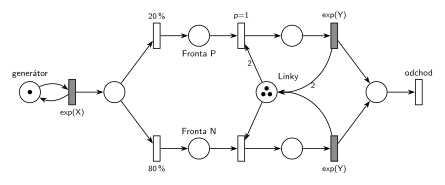

# 07–06 – MM3 – prioritní zabírají 2 linky

## Zadání

> Pro následující systém nakreslete jeho model v Petriho síti. Systém typu M/M/3. Příchozí transakce je s pravděpodobností 20% prioritní a navíc vyžaduje zabrat dvě linky současně.

Podobné úlohy:

- [07–01 – Příklad s prioritou procesu](<../07–01 - Příklad s prioritou procesu/07–01 - Příklad s prioritou procesu.md>): stejné větvení 20 % / 80 % a přednost při obsazení, jen s jednou linkou
- [07–05 – Priorita procesu a obsluhy](<../07–05 - Priorita procesu a obsluhy/07–05 - Priorita procesu a obsluhy.md>): proč tu jde o prioritu procesu

## Interpretace

Zobrazit interpretaci (nápověda)

- **M/M/3 = sklad se třemi linkami:** místo *Linky* se 3 značkami. Prioritní transakce zabere dvě linky jedním přechodem s hranou váhy 2 („současně“) a časovaný přechod jí obě vrátí (hrana váhy 2 zpět). Normální bere a vrací jednu.
- **Jaká priorita:** zadání ji neupřesňuje. M/M/3 se modeluje skladem a sklad prioritu obsluhy nemá (slajd 188). Přerušovat by se navíc musely až dvě cizí obsluhy. Jde tedy o prioritu procesu: `p=1` na obsazení dvou linek. Čekají-li oba druhy a jsou-li volné aspoň dvě linky, jde dřív prioritní.
- **Předbíhání u jedné volné linky:** prioritní ji použít nemůže, takže ji dostane čekající normální transakce. Stejně se chová sklad v SIMLIBu: „První čekající s uspokojitelným požadavkem je obsloužen (nemusí být první ve frontě)“ (slajd 188). Kdyby prioritní měla normální zastavit, dokud se neuvolní dvě linky, musela by síť testovat prázdnou *Frontu P* (inhibiční hranou). To zadání nežádá.
- **Druh transakce** určí pravděpodobnostní větvení hned po příchodu (20 % / 80 %), každý druh pak čeká ve vlastní frontě.
- Čísla zadání nedává: příchody `exp(X)`, obsluha `exp(Y)` pro oba druhy jako ve studentském řešení.

## Petriho síť

Zobrazit Petriho síť

| Požadavek | Prvek sítě |
|---|---|
| M/M/3 | *generátor* ⇄ `exp(X)`; *Linky* (3 značky); obsluha `exp(Y)` |
| 20 % transakcí je prioritních | větvení `20 %` → *Fronta P*, `80 %` → *Fronta N* |
| prioritní zabírá dvě linky současně | obsazení s hranou váhy 2 z *Linek*, `exp(Y)` vrací 2 |
| prioritní má přednost | obsazení z *Fronty P* s `p=1` |
| transakce opouští systém | *odchod* |

Kontrola simulací: *Linky* + 2 × obsluha P + obsluha N = 3, takže najednou se obsluhuje nejvýš jedna prioritní transakce. Prioritních je asi 20 % a obě fronty zůstávají omezené.

## Časté chyby

Zobrazit časté chyby

- Prioritní obsluha vrací jen jednu linku (chybí váha 2 na zpětné hraně).
- *Linky* s jednou značkou místo tří.
- Dvě linky obsazené dvěma postupnými přechody. Prioritní pak drží jednu linku nevyužitou a čeká na druhou, zadání chce obě současně.
- Pravděpodobnost i priorita na jednom přechodu (`20 %, p=1`). Přechod má jen jeden parametr.

## Původ a zdroje

**Původ:** zkouška uvedená v přípravě jako „2019:“ (pravděpodobně 2018/19, termín ani skupina nejsou uvedeny), otázka 3, 10 bodů.

**Zdroje:**

- `Fitcheats/Příprava na zkoušku/FIT - Řešené výpočetní příklady 2017-21.pdf`, str. 10–11 (výstřižek zadání a studentské řešení)
- `Fitcheats/Příprava na zkoušku/xenix - Příprava.pdf`, str. 27 („M/M/3 20%priorita, 2 linky“, fotka studentského řešení bez zadání)

**Existující řešení:**

Zobrazit existující řešení

- **Řešené výpočetní příklady, str. 11:** stejná síť. Místo linek má 3 značky, prioritní obsazení `p=1` bere 2 a `exp(y)` vrací 2, normální bere a vrací 1, za společným místem je výstupní přechod. Správně.
- **xenix, str. 27:** místo *L* má jen jednu značku a hrana z prioritní obsluhy zpět do *L* nemá váhu 2. S jednou značkou se obsazení s váhou 2 nikdy neprovede, takže by prioritní transakce čekaly navždy. Se 3 značkami by zase každá prioritní obsluha jednu linku ztratila. U prioritní obsluhy navíc chybí doba.

