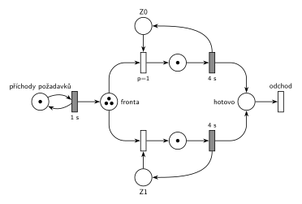

# DD2 FIFO, čas 6,5

## Zadání

> Napište pseudokód algoritmu řízení diskrétní simulace typu next-event (nesmíte použít speciální ukončovací událost). POZOR: bude-li chybět, -5 bodů.
>
> Mějme model systému typu D/D/2 se společnou FIFO frontou. Příchody požadavků začínají v čase 0 s intervalem přesně 1 sekundy a doba obsluhy trvá přesně 4 sekundy. Simulace bude provedena pro čas od 0 do 99 sekund. Požadavky číslujte od 0 podle pořadí příchodu. Neuvažujte priority transakcí (všechny jsou stejné). Zařízení (číslovaná od 0) jsou obsazována prioritně (nižší číslo = vyšší priorita). Události vhodně pojmenujte. Nakreslete si časový diagram činnosti simulátoru a pro čas t = 6,5 sekundy:
>
> - Seznam událostí, provedených od začátku simulace (v pořadí jejich provedení)
> - Obsah kalendáře (bude-li chybět, -5 bodů)
> - Obsah fronty (v pořadí od 1. Prvku)
> - Nakreslete Petriho síť se značením odpovídající zadanému času t

Podobné úlohy: [DD3 LIFO, čas 10,5](<../02 - DD3 LIFO, čas 10,5/02 - DD3 LIFO, čas 10,5.md>), [DD3 FIFO, čas 9,5](<../07 - DD3 FIFO, čas 9,5/07 - DD3 FIFO, čas 9,5.md>), [DD2 LIFO obsluha 4, čas 9,5](<../05 - DD2 LIFO obsluha 4, čas 9,5/05 - DD2 LIFO obsluha 4, čas 9,5.md>), [DD2 LIFO obsluha 5, čas 9,5](<../04 - DD2 LIFO obsluha 5, čas 9,5/04 - DD2 LIFO obsluha 5, čas 9,5.md>).

## Nápověda

<details>
<summary>Zobrazit nápovědu</summary>
<br>

- **Příchody:** místo *příchody požadavků* s jednou značkou ve smyčce s časovaným přechodem `1 s`. První příchod P0 je v čase 0, každý příchod naplánuje další za 1 s.
- **Společná fronta:** jedno místo *fronta*, ze kterého vedou hrany k přechodům obsazení obou zařízení.
- **Petriho síť zachycuje jen počty**, ne pořadí ve frontě. FIFO se v síti neprojeví, projeví se jen v seznamu událostí (kdo jde z fronty na zařízení).
- **Zařízení obsazovaná prioritně:** každé zařízení je místo s jednou značkou (*Z0*, *Z1*) a má svůj okamžitý přechod obsazení. Přechod k *Z0* má prioritu `p=1`, přechod k *Z1* implicitní `p=0`. Když jsou volná obě zařízení, vezme se Z0.
- **Obsluha a uvolnění:** časovaný přechod `4 s` po skončení obsluhy vrací značku zařízení; uvolnění je s ním sloučené.
- **Odchod:** obsloužený požadavek přejde do místa *hotovo* a opouští systém přechodem *odchod* bez výstupních hran.
- **Pořadí událostí ve stejném čase:** priority transakcí se neuvažují, takže se dřív provede událost, která byla **dřív naplánována**. V čase 4 tedy nejdřív končí obsluha P0 (naplánovaná v čase 0), až pak přichází P4 (naplánovaný v čase 3). U FIFO fronty to výsledný stav nezmění (z fronty jde stejně první P2), ale seznam událostí musí mít správné pořadí.
- Systém není stabilní: přichází 1 požadavek za sekundu, obsloužit se dají 2 za 4 s. Fronta roste.

### Časový diagram (obsazení zařízení)

| zařízení | obsluhy |
|---|---|
| Z0 | P0 0–4, P2 4–8 |
| Z1 | P1 1–5, P3 5–9 |

Fronta: P2 čeká 2–4, P3 3–5, P4 od 4, P5 od 5, P6 od 6.

### Události provedené od začátku do času 6,5

| čas | událost |
|---|---|
| 0 | příchod P0; plánuje příchod P1 v čase 1 |
| 0 | P0 obsazuje Z0; plánuje konec obsluhy P0 na Z0 v čase 4 |
| 1 | příchod P1; plánuje příchod P2 v čase 2 |
| 1 | P1 obsazuje Z1; plánuje konec obsluhy P1 na Z1 v čase 5 |
| 2 | příchod P2; plánuje příchod P3 v čase 3 |
| 2 | P2 jde do fronty |
| 3 | příchod P3; plánuje příchod P4 v čase 4 |
| 3 | P3 jde do fronty |
| 4 | P0 uvolňuje Z0 a odchází |
| 4 | P2 vystupuje z fronty (FIFO – první) a obsazuje Z0; plánuje konec obsluhy P2 na Z0 v čase 8 |
| 4 | příchod P4; plánuje příchod P5 v čase 5 |
| 4 | P4 jde do fronty |
| 5 | P1 uvolňuje Z1 a odchází |
| 5 | P3 vystupuje z fronty (FIFO – první) a obsazuje Z1; plánuje konec obsluhy P3 na Z1 v čase 9 |
| 5 | příchod P5; plánuje příchod P6 v čase 6 |
| 5 | P5 jde do fronty |
| 6 | příchod P6; plánuje příchod P7 v čase 7 |
| 6 | P6 jde do fronty |

Proč toto pořadí v časech 4 a 5: konec obsluhy byl naplánován dřív (v čase 0, resp. 1) než příchod (v čase 3, resp. 4).

### Kalendář v čase 6,5

| čas | událost |
|---|---|
| 7 | příchod P7 |
| 8 | konec obsluhy P2 na Z0 |
| 9 | konec obsluhy P3 na Z1 |

Fronta v čase 6,5 (od 1. prvku): P4, P5, P6. Zařízení: Z0 – P2, Z1 – P3.

### Značení sítě v čase 6,5

- *příchody požadavků*: 1 značka (příchod P7 se právě odpočítává)
- *fronta*: 3 značky (P4, P5, P6)
- *Z0*, *Z1*: 0 značek (obě zařízení obsazená)
- místa obsluhy: po 1 značce (P2, P3)

</details>

## Petriho síť

<details>
<summary>Zobrazit Petriho síť</summary>
<br>



</details>

## Časté chyby

<details>
<summary>Zobrazit časté chyby</summary>
<br>

- Opačné pořadí v časech 4 a 5 (nejdřív příchod). Stav vyjde stejně, ale seznam událostí je špatně.
- V kalendáři chybí příchod P7: generátor ho naplánoval už v čase 6.
- Značky ve volných zařízeních *Z0*, *Z1*: v čase 6,5 jsou obě zařízení obsazená.
- Pořadí P4, P5, P6 nakreslené v síti. Místo *fronta* nese jen počet (3).

</details>

## SIMLIB

<details>
<summary>Zobrazit SIMLIB kód</summary>
<br>

Model je izomorfní k Petriho síti výše: každé místo, přechod a značka mají svůj protějšek v kódu. Simulace běží do času 6,5 a vypíše frontu, obsazení zařízení a obsah kalendáře.

```cpp
// D/D/2 se společnou FIFO frontou – model v SIMLIB/C++
#include "simlib.h"

const int N = 2;                         // počet zařízení Z0, Z1
Facility Z[N];                           // místa Z0, Z1 (značka = volné zařízení)
Queue Fronta("fronta");                  // místo „fronta“ (společná FIFO fronta)

class Pozadavek : public Process {       // transakce = značka, která prochází sítí
 public:
  const int id;                          // číslo požadavku P0, P1, ...
  explicit Pozadavek(int n) : id(n) {}
  void Behavior() override {
    int k;                               // obsazení s prioritami p=1, 0:
    for (;;) {                           // volné zařízení s nejnižším číslem
      for (k = 0; k < N && Z[k].Busy(); k++) {}
      if (k < N) break;
      Into(Fronta);                      // vše obsazeno: čeká v místě „fronta“
      Passivate();                       // (FIFO: na konec)
    }
    Seize(Z[k]);                         // obsazení: značka ze Zk do místa obsluhy
    Wait(4);                             // časovaný přechod 4 s ...
    Release(Z[k]);                       // ... který vrací značku do Zk
    if (!Fronta.Empty())                 // další z fronty (FIFO: nejdéle čekající)
      Fronta.GetFirst()->Activate();
  }                                      // místo „hotovo“ a přechod „odchod“
};

class Prichody : public Event {          // „příchody požadavků“ ⇄ přechod 1 s
 public:
  int n = 0;                             // číslo dalšího požadavku
  void Behavior() override {
    (new Pozadavek(n++))->Activate();    // příchod Pn: nová značka v místě „fronta“
    Activate(Time + 1);                  // plánuje další příchod za 1 s
  }
};
Prichody *Gen;

class Stav : public Event {              // výpis stavu v čase t po událostech
 public:
  Stav() : Event(-1) {}                  // nižší priorita než události modelu
  void Behavior() override {
    Print("Stav v čase %g\nfronta (od začátku, odkud se bere):", Time);
    for (Link *l : Fronta)
      Print(" P%d", static_cast<Pozadavek *>(l)->id);
    Print("\n");
    for (int k = 0; k < N; k++) {        // zařízení a v kalendáři konce obsluh
      auto *p = static_cast<Pozadavek *>(Z[k].In());
      if (p)
        Print("Z%d: P%d, konec obsluhy v %g\n", k, p->id, p->ActivationTime());
      else
        Print("Z%d: volné\n", k);
    }
    Print("v kalendáři příchod P%d v čase %g\n", Gen->n, Gen->ActivationTime());
  }
};

int main() {
  Init(0, 6.5);                          // čas v sekundách, běh do t = 6,5 s
  Gen = new Prichody;
  Gen->Activate();                       // příchod P0 v čase 0
  (new Stav)->Activate(6.5);
  Run();
}
```

| Petriho síť | SIMLIB |
|---|---|
| *příchody požadavků* ⇄ `1 s` | událost `Prichody`, která se znovu plánuje za 1 s; `n` čísluje požadavky P0, P1, … |
| značka (požadavek) | proces `Pozadavek` s číslem `id` |
| *fronta* | `Queue Fronta`: `Into(Fronta)` + `Passivate()` (FIFO, na konec), výběr `Fronta.GetFirst()->Activate()` |
| *Z0*, *Z1* (1 značka) | `Facility Z[N]` |
| obsazení s prioritami `p=1`, `p=0` | cyklus přes `Z[k].Busy()`: první volné zařízení od Z0 |
| místo obsluhy + časovaný přechod `4 s` se sloučeným uvolněním | `Seize(Z[k]); Wait(4); Release(Z[k]);` |
| *hotovo* + přechod *odchod* | konec metody `Behavior()` |
| značení v čase t | událost `Stav` s nižší prioritou, která proběhne po všech událostech v čase 6,5 |

**Kontrola simulací.** Petriho síť: síť se odsimuluje od času 0 (P0 ve *frontě*, zařízení volná) do času 6,5 a výsledné značení se musí shodovat s nakresleným; zařízení se vždy vrátí a *fronta* smí růst, protože systém není stabilní (`make check`). Seznam událostí a kalendář počítá `python3 -m pn.dd 2 fifo 1 4 6 6.5`. SIMLIB model vypíše v čase 6,5 frontu P4 P5 P6, Z0 – P2 s koncem obsluhy v 8, Z1 – P3 s koncem v 9 a příchod P7 v 7, tedy stejný stav a kalendář jako výše (`make simlib`). Kalendář SIMLIB obsluhuje události se stejným časem a prioritou v pořadí naplánování, stejně jako odpověď výše. Jediný rozdíl je v jemnějším dělení: požadavek probuzený z fronty (v čase 4 P2) obsadí zařízení až ve své vlastní aktivaci, tedy po příchodu P4. Ten ale volné zařízení hledá až po něm, takže výsledek je stejný.

</details>

## Původ a zdroje

<details>
<summary>Zobrazit původ a zdroje</summary>
<br>

**Původ:** zkouška 2012/13, 2. termín (1. opravný), skupina C, otázka 4, 15 bodů.

**Původní znění:**

> Napište pseudokód algoritmu řízení diskrétní simulace typu next-event (nesmíte použít speciální ukončovací událost). POZOR: bude-li chybět, -5 bodů.
>
> Mějme model systému typu D/D/2 se společnou FIFO frontou. Příchody požadavků začínají v čase 0 s intervalem 1s a doba obsluhy trvá 4s. Simulace bude provedena pro čas od 0 do 99s. Požadavky číslujte od 0 podle pořadí příchodu. Neuvažujte priority transakcí (všechny jsou stejné). Zařízení (číslovaná od 0) jsou obsazována prioritně (nižší číslo = vyšší priorita). Události vhodně pojmenujte. Nakreslete si časový diagram činnosti simulátoru a pro čas t=6.5s:
>
> - Seznam událostí, provedených od začátku simulace (v pořadí jejich provedení)
> - Obsah kalendáře (bude-li chybět, -5 bodů)
> - Obsah fronty (v pořadí od 1. Prvku)
> - Nakreslete Petriho síť se značením odpovídající zadanému času t

**Zdroje:**

- `Fitcheats/Zkoušky z minulých let/2012-13 - 2. termín C.pdf`, str. 1–2 (zadání)
- `Fitcheats/Příprava na zkoušku/Fituška - Řešené příklady 2016.pdf`, str. 7, a `Fitcheats/Příprava na zkoušku/xenix - Příprava.pdf`, str. 18 (řešený příklad se stejnou šablonou, ale s obsluhou 3 s a bez sítě)

**Existující řešení:**

- K této úloze řešení v podkladech není.
- **Fituška 2016, str. 7 (= xenix, str. 18):** řešený příklad D/D/2, čas 6,5, ale s obsluhou 3 s a bez Petriho sítě. Používá stejné pořadí událostí (v čase 3 nejdřív „konec obsluhy P0“, až pak „vygenerování P3“) a kalendář zapisuje se sloupcem priorita (např. „7 | 0 | P3→Release“). Dobrá předloha pro formu odpovědi; čísla se ale liší.

</details>
