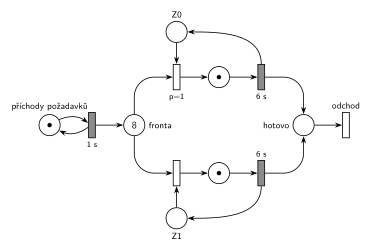

# DD2 LIFO obsluha 6, čas 13,5

## Zadání

> ⚠️ Text je z přepisu. Na fotce se dá přečíst, že v první odrážce stojí „provedených“, ne „plánovaných“ (stejně jako ve skupině 5-A), a zřejmě také „doba obsluhy“ a „nižší číslo zařízení = vyšší priorita“.

> Napište pseudokód algoritmu řízení diskrétní simulace typu “next-event” (nesmíte použít speciální ukončovací událost). POZOR: bude-li chybět, -5b. Mějme model systému typu D/D/2 se společnou LIFO frontou. Příchody požadavků začínají v čase 0 s intervalem přesně 1 sekundy a délka obsluhy trvá přesně 6 sekund. Simulace bude provedena pro čas od 0 do 99 sekund. Požadavky číslujte od 0 podle pořadí příchodů. Priorita všech událostí je 2 (Priority == 2). Zařízení (číslovaná od 0) jsou obsazována prioritně (nižší číslo zařízení s vyšší prioritou). Události vhodně pojmenujte (např. “P0 obsazuje Z0”, “P2 jde do fronty”). Nakreslete časový diagram činnosti simulátoru a napište:
>
> - Seznam všech událostí plánovaných v čase t1 = 12. Podmínky: každá událost na zvláštní řádek, události musí být ve správném pořadí (napište PROČ toto pořadí, jinak -3b) a včetně všech provedených operací plánování do kalendáře (jinak -5b). Nepište žádné jiné události, (jinak -1b).
> - Obsah kalendáře v čase t2 = 13,5 (POZOR: bude-li chybět, -5b).
> - Nakreslete Petriho síť systému se značením odpovídajícím času t2 = 13,5.

Podobné úlohy: [DD3 LIFO, čas 10,5](<../02 - DD3 LIFO, čas 10,5/02 - DD3 LIFO, čas 10,5.md>), [DD2 LIFO obsluha 5, čas 9,5](<../04 - DD2 LIFO obsluha 5, čas 9,5/04 - DD2 LIFO obsluha 5, čas 9,5.md>), [DD2 LIFO obsluha 4, čas 9,5](<../05 - DD2 LIFO obsluha 4, čas 9,5/05 - DD2 LIFO obsluha 4, čas 9,5.md>), [DD2 FIFO, čas 6,5](<../01 - DD2 FIFO, čas 6,5/01 - DD2 FIFO, čas 6,5.md>).

## Nápověda

<details>
<summary>Zobrazit nápovědu</summary>
<br>

- **Příchody:** místo *příchody požadavků* s jednou značkou ve smyčce s časovaným přechodem `1 s`. První příchod P0 je v čase 0, každý příchod naplánuje další za 1 s.
- **Společná fronta:** jedno místo *fronta*, ze kterého vedou hrany k přechodům obsazení obou zařízení.
- **Petriho síť zachycuje jen počty**, ne pořadí ve frontě. LIFO se v síti neprojeví, projeví se jen v seznamu událostí.
- **Zařízení obsazovaná prioritně:** každé zařízení je místo s jednou značkou (*Z0*, *Z1*) a má svůj okamžitý přechod obsazení s prioritou `p=1` (Z0) a `p=0` (Z1, implicitní). Když jsou volná obě, vezme se Z0.
- **Obsluha a uvolnění:** časovaný přechod `6 s` po skončení obsluhy vrací značku zařízení; uvolnění je s ním sloučené.
- **Odchod:** obsloužený požadavek přejde do místa *hotovo* a opouští systém přechodem *odchod* bez výstupních hran.
- **Pořadí událostí ve stejném čase:** všechny mají prioritu 2, takže se dřív provede událost, která byla **dřív naplánována**. V čase 12 nejdřív končí obsluha P5 (naplánovaná v čase 6), až pak přichází P12 (naplánovaný v čase 11). Proto Z0 dostane P11 a P12 jde do fronty. Totéž v čase 13: konec obsluhy P6 (z času 7) před příchodem P13 (z času 12), takže Z1 dostane P12.
- **„Provedených“, nebo „plánovaných“:** podle fotky jde o události **provedené** v čase 12, a to včetně operací plánování, které při nich proběhnou. Při čtení „plánovaných“ by se psaly jen ty dvě operace plánování (konec obsluhy P11 v 18, příchod P13 v 13). V seznamu níže jsou obsažené tak jako tak.

### Časový diagram (obsazení zařízení)

| zařízení | obsluhy |
|---|---|
| Z0 | P0 0–6, P5 6–12, P11 12–18 |
| Z1 | P1 1–7, P6 7–13, P12 13–19 |

Fronta: P2, P3, P4 čekají od 2, 3, 4 (pod nimi se střídají novější). P5 jde v 6 na Z0, P6 v 7 na Z1, P11 ve 12 na Z0, P12 ve 13 na Z1.

### Události provedené v čase t1 = 12

1. P5 uvolňuje Z0 a odchází
2. P11 vystupuje z fronty (LIFO – poslední) a obsazuje Z0; plánuje konec obsluhy P11 na Z0 v čase 18
3. příchod P12; plánuje příchod P13 v čase 13
4. P12 jde do fronty

Proč toto pořadí: konec obsluhy P5 byl naplánován v čase 6, příchod P12 až v čase 11. Při stejné prioritě rozhoduje pořadí naplánování.

### Kalendář v čase t2 = 13,5

| čas | událost |
|---|---|
| 14 | příchod P14 |
| 18 | konec obsluhy P11 na Z0 |
| 19 | konec obsluhy P12 na Z1 |

Fronta v čase 13,5 (od nejstaršího): P2, P3, P4, P7, P8, P9, P10, P13. Zařízení: Z0 – P11, Z1 – P12.

### Značení sítě v čase 13,5

- *příchody požadavků*: 1 značka (příchod P14 se právě odpočítává)
- *fronta*: 8 značek (v síti zapsáno číslem)
- *Z0*, *Z1*: 0 značek (obě zařízení obsazená)
- místa obsluhy: po 1 značce (P11, P12)

</details>

## Petriho síť

<details>
<summary>Zobrazit Petriho síť</summary>
<br>



</details>

## Časté chyby

<details>
<summary>Zobrazit časté chyby</summary>
<br>

- Opačné pořadí v čase 12 (nejdřív příchod P12). Pak by P12 obsadil Z0 a ve frontě by zůstal P11.
- Kalendář s událostí v čase 13 (konec obsluhy P6, příchod P13): ty už jsou v čase 13,5 provedené.
- Brát z LIFO fronty nejstarší požadavek (jako u FIFO). P2, P3 a P4 čekají od začátku a v čase 13,5 jsou ve frontě pořád.
- Zapomenuté plánování do kalendáře u událostí v čase 12.

</details>

## SIMLIB

<details>
<summary>Zobrazit SIMLIB kód</summary>
<br>

Model je izomorfní k Petriho síti výše: každé místo, přechod a značka mají svůj protějšek v kódu. Simulace běží do času t2 = 13,5 a vypíše frontu, obsazení zařízení a obsah kalendáře.

```cpp
// D/D/2 se společnou LIFO frontou – model v SIMLIB/C++
#include "simlib.h"

const int N = 2;                         // počet zařízení Z0, Z1
Facility Z[N];                           // místa Z0, Z1 (značka = volné zařízení)
Queue Fronta("fronta");                  // místo „fronta“ (společná LIFO fronta)

class Pozadavek : public Process {       // transakce = značka, která prochází sítí
 public:
  const int id;                          // číslo požadavku P0, P1, ...
  explicit Pozadavek(int n) : id(n) {}
  void Behavior() override {
    int k;                               // obsazení s prioritami p=1, 0:
    for (;;) {                           // volné zařízení s nejnižším číslem
      for (k = 0; k < N && Z[k].Busy(); k++) {}
      if (k < N) break;
      Fronta.InsFirst(this);             // vše obsazeno: čeká v místě „fronta“
      Passivate();                       // (LIFO: na začátek, odkud se bere)
    }
    Seize(Z[k]);                         // obsazení: značka ze Zk do místa obsluhy
    Wait(6);                             // časovaný přechod 6 s ...
    Release(Z[k]);                       // ... který vrací značku do Zk
    if (!Fronta.Empty())                 // další z fronty (LIFO: naposledy vložený)
      Fronta.GetFirst()->Activate();
  }                                      // místo „hotovo“ a přechod „odchod“
};

class Prichody : public Event {          // „příchody požadavků“ ⇄ přechod 1 s
 public:
  int n = 0;                             // číslo dalšího požadavku
  void Behavior() override {
    (new Pozadavek(n++))->Activate();    // příchod Pn: nová značka v místě „fronta“
    Activate(Time + 1);                  // plánuje další příchod za 1 s
  }
};
Prichody *Gen;

class Stav : public Event {              // výpis stavu v čase t2 po událostech
 public:
  Stav() : Event(-1) {}                  // nižší priorita než události modelu
  void Behavior() override {
    Print("Stav v čase %g\nfronta (od začátku, odkud se bere):", Time);
    for (Link *l : Fronta)
      Print(" P%d", static_cast<Pozadavek *>(l)->id);
    Print("\n");
    for (int k = 0; k < N; k++) {        // zařízení a v kalendáři konce obsluh
      auto *p = static_cast<Pozadavek *>(Z[k].In());
      if (p)
        Print("Z%d: P%d, konec obsluhy v %g\n", k, p->id, p->ActivationTime());
      else
        Print("Z%d: volné\n", k);
    }
    Print("v kalendáři příchod P%d v čase %g\n", Gen->n, Gen->ActivationTime());
  }
};

int main() {
  Init(0, 13.5);                         // čas v sekundách, běh do t2 = 13,5 s
  Gen = new Prichody;
  Gen->Activate();                       // příchod P0 v čase 0
  (new Stav)->Activate(13.5);
  Run();
}
```

| Petriho síť | SIMLIB |
|---|---|
| *příchody požadavků* ⇄ `1 s` | událost `Prichody`, která se znovu plánuje za 1 s; `n` čísluje požadavky P0, P1, … |
| značka (požadavek) | proces `Pozadavek` s číslem `id` |
| *fronta* | `Queue Fronta`: `Fronta.InsFirst(this)` + `Passivate()` (LIFO, na začátek), výběr `Fronta.GetFirst()->Activate()` |
| *Z0*, *Z1* (1 značka) | `Facility Z[N]` |
| obsazení s prioritami `p=1`, `p=0` | cyklus přes `Z[k].Busy()`: první volné zařízení od Z0 |
| místo obsluhy + časovaný přechod `6 s` se sloučeným uvolněním | `Seize(Z[k]); Wait(6); Release(Z[k]);` |
| *hotovo* + přechod *odchod* | konec metody `Behavior()` |
| značení v čase t2 | událost `Stav` s nižší prioritou, která proběhne po všech událostech v čase 13,5 |

**Kontrola simulací.** Petriho síť: síť se odsimuluje od času 0 (P0 ve *frontě*, zařízení volná) do času 13,5 a výsledné značení se musí shodovat s nakresleným; zařízení se vždy vrátí a *fronta* smí růst, protože systém není stabilní (`make check`). Seznam událostí a kalendář počítá `python3 -m pn.dd 2 lifo 1 6 12 13.5`. Priorita 2 ze zadání jen říká, že všechny události mají stejnou prioritu; v SIMLIB na to stačí výchozí priorita 0. SIMLIB model vypíše v čase 13,5 frontu P13 P10 P9 P8 P7 P4 P3 P2 (od začátku, odkud se bere, tedy obráceně než výše), Z0 – P11 s koncem obsluhy v 18, Z1 – P12 v 19 a příchod P14 ve 14, tedy stejný stav a kalendář jako výše (`make simlib`). Kalendář SIMLIB obsluhuje události se stejným časem a prioritou v pořadí naplánování, stejně jako odpověď výše. Jediný rozdíl je v jemnějším dělení: P11 probuzený z fronty obsadí Z0 až ve své vlastní aktivaci, tedy po příchodu P12. P12 ale volné zařízení hledá až po něm, takže výsledek je stejný.

</details>

## Původ a zdroje

<details>
<summary>Zobrazit původ a zdroje</summary>
<br>

**Původ:** zkouška 2015/16, 3. termín (27. 1. 2016), skupina 5-D, otázka 1, 15 bodů. Sesterská skupina 5-A je [DD3 LIFO, čas 10,5](<../02 - DD3 LIFO, čas 10,5/02 - DD3 LIFO, čas 10,5.md>).

**Původní znění:**

> Napište pseudokód algoritmu řízení diskrétní simulace typu “next-event” (nesmíte použít speciální ukončovací událost). POZOR: bude-li chybět, -5b. Mějme model systému typu D/D/2 se společnou LIFO frontou. Příchody požadavků začínají v čase 0 s intervalem 1s a délka obsluhy trvá 6s. Simulace bude provedena pro čas od 0 do 99s. Požadavky číslujte od 0 podle pořadí příchodů. Priorita všech událostí je 2 (Priority == 2). Zařízení (číslovaná od 0) jsou obsazována prioritně (nižší číslo zařízení s vyšší prioritou). Události vhodně pojmenujte (např. “P0 obsazuje Z0”, “P2 jde do fronty”). Nakreslete časový diagram činnosti simulátoru a napište:
>
> - Seznam všech událostí plánovaných v čase t1 = 12. Podmínky: každá událost na zvláštní řádek, události musí být ve správném pořadí (napište PROČ toto pořadí, jinak -3b) a včetně všech provedených operací plánování do kalendáře (jinak -5b). Nepište žádné jiné události, (jinak -1b).
> - Obsah kalendáře v čase t2 = 13,5 (POZOR: bude-li chybět, -5b).
> - Nakreslete Petriho síť systému se značením odpovídajícím času t2 = 13,5.

**Zdroje:**

- `Fitcheats/Zkoušky z minulých let/2016-17 - 3. termín D.pdf` (rozmazaná fotka zadání; podle hlavičky „skupina 5-D“, 27. 1. 2016, tedy rok 2015/16)
- `Fitcheats/Zkoušky z minulých let/2005-06 - Termín 27. 1. 2006 (5D).pdf`, str. 1 („přepis zadání zkoušky z hůře čitelné fotky“; stejná zkouška, rok 2006 v názvu je překlep)

**Existující řešení:**

- K této skupině řešení v podkladech není. Síť má stejný tvar jako studentská řešení sesterské skupiny 5-A ([DD3 LIFO, čas 10,5](<../02 - DD3 LIFO, čas 10,5/02 - DD3 LIFO, čas 10,5.md>)), jen se dvěma zařízeními.

</details>
