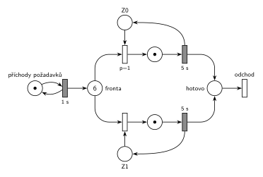

# DD2 LIFO obsluha 5, čas 9,5

## Zadání

> ⚠️ Zadání je opsané studentem (bez diakritiky), původní papír v podkladech není.

> Napiste pseudokod algoritmu razeni diskreni simulace typu "next-event" (nesmite pouzit specialni ukoncovaci udalost). POZOR: bude-li chybet, -5b.
>
> Mejme model systemu typu D/D/2 se spolecnou LIFO frontou. Prichody pozadavku zacinaji v case 0 s intervalem přesně 1 sekundy a doba obsluhy trva přesně 5 sekund. Simulace bude provedena po cas od 0 do 99 sekund. Pozadavky cislujte od 0 podle poradi prichodu. Neuvazujte priority transakcii (vsechny jsou stejne). Zarizeni (cislovana od 0) jsou obsazovana prioritne (nizsi cislo zarizeni = vyssi priorita). Udalosti vhodně pojmenujte (napr. "P0 obsazuje Z0", "P2 jde do fronty").
>
> Nakreslete casovy diagram cinnosti simulatoru a napiste:
>
> - Seznam vsech udalosti provedenych v case t1 = 6 Podminky: kazda na zvlastni radek, udalosti musi byt ve spravnem poradi (napiste PROC toto poradi, jinak -3b), a vcetne vsech provedenych operaci planovani do kalendare (jinak -4b). Nepiste zadne jine udalosti.
> - Obsah kalendare v case t2 = 9.5 (POZOR: bude-li chybet, -5b)
> - Nakreslete Petriho sit systemu se znacenim odpovidajicim casu t2 = 9.5

Zkouška 2014/15 (vzpomínka): „Next-event algoritmus. D/D/2 LIFO, prichod za 1 s, 5 s obsluha, od 0 do 99, prvni pozadavek v case 0. Nakreslit casovy diagram. t=9.5s Obsah fronty, Kalendare, zarizezni, nakreslit petri. Napsat udalosti v case 5“

Podobné úlohy: [DD2 LIFO obsluha 4, čas 9,5](<../05 - DD2 LIFO obsluha 4, čas 9,5/05 - DD2 LIFO obsluha 4, čas 9,5.md>) (sesterská skupina A), [DD2 LIFO obsluha 6, čas 13,5](<../03 - DD2 LIFO obsluha 6, čas 13,5/03 - DD2 LIFO obsluha 6, čas 13,5.md>), [DD3 LIFO, čas 10,5](<../02 - DD3 LIFO, čas 10,5/02 - DD3 LIFO, čas 10,5.md>), [DD2 FIFO, čas 6,5](<../01 - DD2 FIFO, čas 6,5/01 - DD2 FIFO, čas 6,5.md>).

## Nápověda

<details>
<summary>Zobrazit nápovědu</summary>
<br>

- **Příchody:** místo *příchody požadavků* s jednou značkou ve smyčce s časovaným přechodem `1 s`. První příchod P0 je v čase 0, každý příchod naplánuje další za 1 s.
- **Společná fronta:** jedno místo *fronta*, ze kterého vedou hrany k přechodům obsazení obou zařízení.
- **Petriho síť zachycuje jen počty**, ne pořadí ve frontě. LIFO se v síti neprojeví, projeví se jen v seznamu událostí.
- **Zařízení obsazovaná prioritně:** každé zařízení je místo s jednou značkou (*Z0*, *Z1*) a má svůj okamžitý přechod obsazení s prioritou `p=1` (Z0) a `p=0` (Z1, implicitní). Když jsou volná obě, vezme se Z0.
- **Obsluha a uvolnění:** časovaný přechod `5 s` po skončení obsluhy vrací značku zařízení; uvolnění je s ním sloučené.
- **Odchod:** obsloužený požadavek přejde do místa *hotovo* a opouští systém přechodem *odchod* bez výstupních hran.
- **Pořadí událostí ve stejném čase:** priority transakcí se neuvažují, takže se dřív provede událost, která byla **dřív naplánována**. V čase 6 nejdřív končí obsluha P1 (naplánovaná v čase 1), až pak přichází P6 (naplánovaný v čase 5). Proto Z1 dostane P5 a P6 jde do fronty.

### Časový diagram (obsazení zařízení)

| zařízení | obsluhy |
|---|---|
| Z0 | P0 0–5, P4 5–10 |
| Z1 | P1 1–6, P5 6–11 |

Fronta: P2 a P3 čekají od 2 a 3 (pod nimi se střídají novější). P4 jde v 5 na Z0, P5 v 6 na Z1, P6 až P9 přicházejí v 6 až 9 a čekají.

### Události provedené v čase t1 = 6

1. P1 uvolňuje Z1 a odchází
2. P5 vystupuje z fronty (LIFO – poslední) a obsazuje Z1; plánuje konec obsluhy P5 na Z1 v čase 11
3. příchod P6; plánuje příchod P7 v čase 7
4. P6 jde do fronty

Proč toto pořadí: konec obsluhy P1 byl naplánován v čase 1, příchod P6 až v čase 5. Při stejné prioritě rozhoduje pořadí naplánování.

### Kalendář v čase t2 = 9,5

| čas | událost |
|---|---|
| 10 | konec obsluhy P4 na Z0 (naplánováno v čase 5) |
| 10 | příchod P10 (naplánováno v čase 9) |
| 11 | konec obsluhy P5 na Z1 |

Fronta v čase 9,5 (od nejstaršího): P2, P3, P6, P7, P8, P9. Zařízení: Z0 – P4, Z1 – P5.

### Značení sítě v čase 9,5

- *příchody požadavků*: 1 značka (příchod P10 se právě odpočítává)
- *fronta*: 6 značek (v síti zapsáno číslem)
- *Z0*, *Z1*: 0 značek (obě zařízení obsazená)
- místa obsluhy: po 1 značce (P4, P5)

### Varianta 2014/15 (události v čase 5)

1. P0 uvolňuje Z0 a odchází
2. P4 vystupuje z fronty (LIFO – poslední) a obsazuje Z0; plánuje konec obsluhy P4 na Z0 v čase 10
3. příchod P5; plánuje příchod P6 v čase 6
4. P5 jde do fronty

Proč: konec obsluhy P0 byl naplánován v čase 0, příchod P5 v čase 4. Stav v čase 9,5 (fronta, kalendář, zařízení, síť) je stejný jako výše.

</details>

## Petriho síť

<details>
<summary>Zobrazit Petriho síť</summary>
<br>



</details>

## Časté chyby

<details>
<summary>Zobrazit časté chyby</summary>
<br>

- Opačné pořadí v čase 6 (nejdřív příchod P6). Pak by P6 obsadil Z1 a ve frontě by zůstal P5.
- V kalendáři jen jedna událost v čase 10, nebo obě v opačném pořadí. Konec obsluhy P4 byl naplánován dřív (v čase 5) než příchod P10 (v čase 9).
- Brát z LIFO fronty nejstarší požadavek. P2 a P3 čekají od začátku a v čase 9,5 jsou ve frontě pořád.
- Zapomenuté plánování do kalendáře u událostí v čase 6.

</details>

## SIMLIB

<details>
<summary>Zobrazit SIMLIB kód</summary>
<br>

Model je izomorfní k Petriho síti výše: každé místo, přechod a značka mají svůj protějšek v kódu. Simulace běží do času t2 = 9,5 a vypíše frontu, obsazení zařízení a obsah kalendáře.

```cpp
// D/D/2 se společnou LIFO frontou – model v SIMLIB/C++
#include "simlib.h"

const int N = 2;                         // počet zařízení Z0, Z1
Facility Z[N];                           // místa Z0, Z1 (značka = volné zařízení)
Queue Fronta("fronta");                  // místo „fronta“ (společná LIFO fronta)

class Pozadavek : public Process {       // transakce = značka, která prochází sítí
 public:
  const int id;                          // číslo požadavku P0, P1, ...
  explicit Pozadavek(int n) : id(n) {}
  void Behavior() override {
    int k;                               // obsazení s prioritami p=1, 0:
    for (;;) {                           // volné zařízení s nejnižším číslem
      for (k = 0; k < N && Z[k].Busy(); k++) {}
      if (k < N) break;
      Fronta.InsFirst(this);             // vše obsazeno: čeká v místě „fronta“
      Passivate();                       // (LIFO: na začátek, odkud se bere)
    }
    Seize(Z[k]);                         // obsazení: značka ze Zk do místa obsluhy
    Wait(5);                             // časovaný přechod 5 s ...
    Release(Z[k]);                       // ... který vrací značku do Zk
    if (!Fronta.Empty())                 // další z fronty (LIFO: naposledy vložený)
      Fronta.GetFirst()->Activate();
  }                                      // místo „hotovo“ a přechod „odchod“
};

class Prichody : public Event {          // „příchody požadavků“ ⇄ přechod 1 s
 public:
  int n = 0;                             // číslo dalšího požadavku
  void Behavior() override {
    (new Pozadavek(n++))->Activate();    // příchod Pn: nová značka v místě „fronta“
    Activate(Time + 1);                  // plánuje další příchod za 1 s
  }
};
Prichody *Gen;

class Stav : public Event {              // výpis stavu v čase t2 po událostech
 public:
  Stav() : Event(-1) {}                  // nižší priorita než události modelu
  void Behavior() override {
    Print("Stav v čase %g\nfronta (od začátku, odkud se bere):", Time);
    for (Link *l : Fronta)
      Print(" P%d", static_cast<Pozadavek *>(l)->id);
    Print("\n");
    for (int k = 0; k < N; k++) {        // zařízení a v kalendáři konce obsluh
      auto *p = static_cast<Pozadavek *>(Z[k].In());
      if (p)
        Print("Z%d: P%d, konec obsluhy v %g\n", k, p->id, p->ActivationTime());
      else
        Print("Z%d: volné\n", k);
    }
    Print("v kalendáři příchod P%d v čase %g\n", Gen->n, Gen->ActivationTime());
  }
};

int main() {
  Init(0, 9.5);                          // čas v sekundách, běh do t2 = 9,5 s
  Gen = new Prichody;
  Gen->Activate();                       // příchod P0 v čase 0
  (new Stav)->Activate(9.5);
  Run();
}
```

| Petriho síť | SIMLIB |
|---|---|
| *příchody požadavků* ⇄ `1 s` | událost `Prichody`, která se znovu plánuje za 1 s; `n` čísluje požadavky P0, P1, … |
| značka (požadavek) | proces `Pozadavek` s číslem `id` |
| *fronta* | `Queue Fronta`: `Fronta.InsFirst(this)` + `Passivate()` (LIFO, na začátek), výběr `Fronta.GetFirst()->Activate()` |
| *Z0*, *Z1* (1 značka) | `Facility Z[N]` |
| obsazení s prioritami `p=1`, `p=0` | cyklus přes `Z[k].Busy()`: první volné zařízení od Z0 |
| místo obsluhy + časovaný přechod `5 s` se sloučeným uvolněním | `Seize(Z[k]); Wait(5); Release(Z[k]);` |
| *hotovo* + přechod *odchod* | konec metody `Behavior()` |
| značení v čase t2 | událost `Stav` s nižší prioritou, která proběhne po všech událostech v čase 9,5 |

**Kontrola simulací.** Petriho síť: síť se odsimuluje od času 0 (P0 ve *frontě*, zařízení volná) do času 9,5 a výsledné značení se musí shodovat s nakresleným; zařízení se vždy vrátí a *fronta* smí růst, protože systém není stabilní (`make check`). Seznam událostí a kalendář počítá `python3 -m pn.dd 2 lifo 1 5 6 9.5` (a `… 5 9.5` pro variantu 2014/15). SIMLIB model vypíše v čase 9,5 frontu P9 P8 P7 P6 P3 P2 (od začátku, odkud se bere, tedy obráceně než výše), Z0 – P4 s koncem obsluhy v 10, Z1 – P5 v 11 a příchod P10 v 10, tedy stejný stav a kalendář jako výše (`make simlib`). Kalendář SIMLIB obsluhuje události se stejným časem a prioritou v pořadí naplánování, stejně jako odpověď výše. Jediný rozdíl je v jemnějším dělení: P5 probuzený z fronty obsadí Z1 až ve své vlastní aktivaci, tedy po příchodu P6. P6 ale volné zařízení hledá až po něm, takže výsledek je stejný.

</details>

## Původ a zdroje

<details>
<summary>Zobrazit původ a zdroje</summary>
<br>

**Původ:** zkouška 2015/16, 2. termín, skupina B (v souboru nadepsaná „Skupina A“, druhá skupina ze stejného souboru o sobě píše „to co B“), otázka 1, 15 bodů. Stejná úloha (jiný čas t1): zkouška 2014/15, 1. termín, skupina B (události v čase 5).

**Původní znění:**

> Napiste pseudokod algoritmu razeni diskreni simulace typu "next-event" (nesmite pouzit specialni ukoncovaci udalost). POZOR: bude-li chybet, -5b.
>
> Mejme model systemu typu D/D/2 se spolecnou LIFO frontou. Prichody pozadavku zacinaji v case 0 s intervalem 1s a doba obsluhy trva 5s. Simulace bude provedena po cas od 0 do 99s. Pozadavky cislujte od 0 podle poradi prichodu. Neuvazujte priority transakcii (vsechny jsou stejne). Zarizeni (cislovana od 0) jsou obsazovana prioritne (nizsi cislo zarizeni = vyssi priorita). Udalosti vhodně pojmenujte (napr. "P0 obsazuje Z0", "P2 jde do fronty").
>
> Nakreslete casovy diagram cinnosti simulatoru a napiste:
>
> - Seznam vsech udalosti provedenych v case t1 = 6 Podminky: kazda na zvlastni radek, udalosti musi byt ve spravnem poradi (napiste PROC toto poradi, jinak -3b), a vcetne vsech provedenych operaci planovani do kalendare (jinak -4b). Nepiste zadne jine udalosti.
> - Obsah kalendare v case t2 = 9.5 (POZOR: bude-li chybet, -5b)
> - Nakreslete Petriho sit systemu se znacenim odpovidajicim casu t2 = 9.5

**Zdroje:**

- `Fitcheats/Zkoušky z minulých let/2015-16 - 2. termín.txt`, první skupina, otázka 1 (opsané zadání bez diakritiky)
- `Fitcheats/Zkoušky z minulých let/2014-15 - 1. termín.txt`, skupina B, otázka 1 (studentská vzpomínka)

**Existující řešení:**

- K této úloze řešení v podkladech není. Síť má stejný tvar jako studentská řešení úlohy [DD3 LIFO, čas 10,5](<../02 - DD3 LIFO, čas 10,5/02 - DD3 LIFO, čas 10,5.md>), jen se dvěma zařízeními.

</details>

## Reference

- [Jak síť funguje](<../../../basics/Jak síť funguje.md>)
- [Notace a vzory](<../../../basics/Notace a vzory.md>)
- [Seznam úloh](<../../Seznam úloh.md>)
