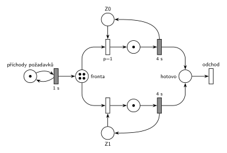

# DD2 LIFO obsluha 4, čas 9,5

## Zadání

> ⚠️ Jen studentská vzpomínka, která uvádí pouze rozdíly proti skupině B. Zbytek zadání (LIFO fronta, příchody od času 0 po 1 s, priority, pojmenování událostí, pseudokód next-event) je převzatý ze skupiny B.

> 1\) D/D/2. Doba obsluhy přesně 4 sekundy.
>
> Nakreslete casovy diagram ....:
>
> - Seznam udalosti pri cas t1 = 5
> - Obsah kalendare v t2 = 9.5
> - Nakreslete PS v t2 = 9.5

Plné znění skupiny B (s obsluhou 5 s a t1 = 6) je v úloze [DD2 LIFO obsluha 5, čas 9,5](<../04 - DD2 LIFO obsluha 5, čas 9,5/04 - DD2 LIFO obsluha 5, čas 9,5.md>).

Podobné úlohy: [DD2 LIFO obsluha 5, čas 9,5](<../04 - DD2 LIFO obsluha 5, čas 9,5/04 - DD2 LIFO obsluha 5, čas 9,5.md>), [DD2 LIFO obsluha 6, čas 13,5](<../03 - DD2 LIFO obsluha 6, čas 13,5/03 - DD2 LIFO obsluha 6, čas 13,5.md>), [DD2 FIFO, čas 6,5](<../01 - DD2 FIFO, čas 6,5/01 - DD2 FIFO, čas 6,5.md>), [DD3 LIFO, čas 10,5](<../02 - DD3 LIFO, čas 10,5/02 - DD3 LIFO, čas 10,5.md>).

## Interpretace

<details>
<summary>Zobrazit interpretaci (nápověda)</summary>
<br>

- **LIFO je předpoklad.** Vzpomínka frontu neuvádí. Protože jde o „to co B“ a skupina B má LIFO, počítá se tu s LIFO. Při FIFO by bylo **značení sítě stejné** (síť pořadí ve frontě nevidí). Lišilo by se, kdo je kde: v čase 5 by z fronty šel P3 místo P4 a v čase 9,5 by byla fronta P6, P7, P8, P9, na Z0 P4 a na Z1 P5.
- **Příchody:** místo *příchody požadavků* s jednou značkou ve smyčce s časovaným přechodem `1 s`. První příchod P0 je v čase 0, každý příchod naplánuje další za 1 s.
- **Společná fronta:** jedno místo *fronta*, ze kterého vedou hrany k přechodům obsazení obou zařízení.
- **Petriho síť zachycuje jen počty**, ne pořadí ve frontě.
- **Zařízení obsazovaná prioritně:** každé zařízení je místo s jednou značkou (*Z0*, *Z1*) a má svůj okamžitý přechod obsazení s prioritou `p=1` (Z0) a `p=0` (Z1, implicitní). Když jsou volná obě, vezme se Z0.
- **Obsluha a uvolnění:** časovaný přechod `4 s` po skončení obsluhy vrací značku zařízení; uvolnění je s ním sloučené.
- **Odchod:** obsloužený požadavek přejde do místa *hotovo* a opouští systém přechodem *odchod* bez výstupních hran.
- **Pořadí událostí ve stejném čase:** všechny události mají stejnou prioritu, takže se dřív provede ta, která byla **dřív naplánována**. V čase 5 nejdřív končí obsluha P1 (naplánovaná v čase 1), až pak přichází P5 (naplánovaný v čase 4). Proto Z1 dostane P4 a P5 jde do fronty.

### Časový diagram (obsazení zařízení)

| zařízení | obsluhy |
|---|---|
| Z0 | P0 0–4, P3 4–8, P7 8–12 |
| Z1 | P1 1–5, P4 5–9, P8 9–13 |

Fronta: P2 čeká od 2 (pod ním se střídají novější). P3 jde ve 4 na Z0, P4 v 5 na Z1, P5 a P6 přicházejí v 5 a 6 a čekají, P7 jde v 8 na Z0, P8 v 9 na Z1, P9 čeká od 9.

### Události provedené v čase t1 = 5

1. P1 uvolňuje Z1 a odchází
2. P4 vystupuje z fronty (LIFO – poslední) a obsazuje Z1; plánuje konec obsluhy P4 na Z1 v čase 9
3. příchod P5; plánuje příchod P6 v čase 6
4. P5 jde do fronty

Proč toto pořadí: konec obsluhy P1 byl naplánován v čase 1, příchod P5 až v čase 4. Při stejné prioritě rozhoduje pořadí naplánování.

### Kalendář v čase t2 = 9,5

| čas | událost |
|---|---|
| 10 | příchod P10 |
| 12 | konec obsluhy P7 na Z0 |
| 13 | konec obsluhy P8 na Z1 |

Fronta v čase 9,5 (od nejstaršího): P2, P5, P6, P9. Zařízení: Z0 – P7, Z1 – P8.

### Značení sítě v čase 9,5

- *příchody požadavků*: 1 značka (příchod P10 se právě odpočítává)
- *fronta*: 4 značky (P2, P5, P6, P9)
- *Z0*, *Z1*: 0 značek (obě zařízení obsazená)
- místa obsluhy: po 1 značce (P7, P8)

</details>

## Petriho síť

<details>
<summary>Zobrazit Petriho síť</summary>
<br>



</details>

## Časté chyby

<details>
<summary>Zobrazit časté chyby</summary>
<br>

- Opačné pořadí v čase 5 (nejdřív příchod P5). Pak by P5 obsadil Z1 a ve frontě by zůstal P4.
- Kalendář s událostmi v čase 9 (konec obsluhy P4, příchod P9): ty už jsou v čase 9,5 provedené. Na zařízeních jsou v čase 9,5 už P7 a P8, ne P3 a P4.
- Brát z LIFO fronty nejstarší požadavek. P2 čeká od času 2 a v čase 9,5 je ve frontě pořád.
- Zapomenuté plánování do kalendáře u událostí v čase 5.

</details>

## SIMLIB

<details>
<summary>Zobrazit SIMLIB kód</summary>
<br>

Model je izomorfní k Petriho síti výše: každé místo, přechod a značka mají svůj protějšek v kódu. Simulace běží do času t2 = 9,5 a vypíše frontu, obsazení zařízení a obsah kalendáře.

```cpp
// D/D/2 se společnou LIFO frontou – model v SIMLIB/C++
#include "simlib.h"

const int N = 2;                         // počet zařízení Z0, Z1
Facility Z[N];                           // místa Z0, Z1 (značka = volné zařízení)
Queue Fronta("fronta");                  // místo „fronta“ (společná LIFO fronta)

class Pozadavek : public Process {       // transakce = značka, která prochází sítí
 public:
  const int id;                          // číslo požadavku P0, P1, ...
  explicit Pozadavek(int n) : id(n) {}
  void Behavior() override {
    int k;                               // obsazení s prioritami p=1, 0:
    for (;;) {                           // volné zařízení s nejnižším číslem
      for (k = 0; k < N && Z[k].Busy(); k++) {}
      if (k < N) break;
      Fronta.InsFirst(this);             // vše obsazeno: čeká v místě „fronta“
      Passivate();                       // (LIFO: na začátek, odkud se bere)
    }
    Seize(Z[k]);                         // obsazení: značka ze Zk do místa obsluhy
    Wait(4);                             // časovaný přechod 4 s ...
    Release(Z[k]);                       // ... který vrací značku do Zk
    if (!Fronta.Empty())                 // další z fronty (LIFO: naposledy vložený)
      Fronta.GetFirst()->Activate();
  }                                      // místo „hotovo“ a přechod „odchod“
};

class Prichody : public Event {          // „příchody požadavků“ ⇄ přechod 1 s
 public:
  int n = 0;                             // číslo dalšího požadavku
  void Behavior() override {
    (new Pozadavek(n++))->Activate();    // příchod Pn: nová značka v místě „fronta“
    Activate(Time + 1);                  // plánuje další příchod za 1 s
  }
};
Prichody *Gen;

class Stav : public Event {              // výpis stavu v čase t2 po událostech
 public:
  Stav() : Event(-1) {}                  // nižší priorita než události modelu
  void Behavior() override {
    Print("Stav v čase %g\nfronta (od začátku, odkud se bere):", Time);
    for (Link *l : Fronta)
      Print(" P%d", static_cast<Pozadavek *>(l)->id);
    Print("\n");
    for (int k = 0; k < N; k++) {        // zařízení a v kalendáři konce obsluh
      auto *p = static_cast<Pozadavek *>(Z[k].In());
      if (p)
        Print("Z%d: P%d, konec obsluhy v %g\n", k, p->id, p->ActivationTime());
      else
        Print("Z%d: volné\n", k);
    }
    Print("v kalendáři příchod P%d v čase %g\n", Gen->n, Gen->ActivationTime());
  }
};

int main() {
  Init(0, 9.5);                          // čas v sekundách, běh do t2 = 9,5 s
  Gen = new Prichody;
  Gen->Activate();                       // příchod P0 v čase 0
  (new Stav)->Activate(9.5);
  Run();
}
```

| Petriho síť | SIMLIB |
|---|---|
| *příchody požadavků* ⇄ `1 s` | událost `Prichody`, která se znovu plánuje za 1 s; `n` čísluje požadavky P0, P1, … |
| značka (požadavek) | proces `Pozadavek` s číslem `id` |
| *fronta* | `Queue Fronta`: `Fronta.InsFirst(this)` + `Passivate()` (LIFO, na začátek), výběr `Fronta.GetFirst()->Activate()` |
| *Z0*, *Z1* (1 značka) | `Facility Z[N]` |
| obsazení s prioritami `p=1`, `p=0` | cyklus přes `Z[k].Busy()`: první volné zařízení od Z0 |
| místo obsluhy + časovaný přechod `4 s` se sloučeným uvolněním | `Seize(Z[k]); Wait(4); Release(Z[k]);` |
| *hotovo* + přechod *odchod* | konec metody `Behavior()` |
| značení v čase t2 | událost `Stav` s nižší prioritou, která proběhne po všech událostech v čase 9,5 |

**Kontrola simulací.** Petriho síť: síť se odsimuluje od času 0 (P0 ve *frontě*, zařízení volná) do času 9,5 a výsledné značení se musí shodovat s nakresleným; zařízení se vždy vrátí a *fronta* smí růst, protože systém není stabilní (`make check`). Seznam událostí a kalendář počítá `python3 -m pn.dd 2 lifo 1 4 5 9.5`. SIMLIB model vypíše v čase 9,5 frontu P9 P6 P5 P2 (od začátku, odkud se bere, tedy obráceně než výše), Z0 – P7 s koncem obsluhy ve 12, Z1 – P8 ve 13 a příchod P10 v 10, tedy stejný stav a kalendář jako výše (`make simlib`). Kalendář SIMLIB obsluhuje události se stejným časem a prioritou v pořadí naplánování, stejně jako odpověď výše. Jediný rozdíl je v jemnějším dělení: P4 probuzený z fronty obsadí Z1 až ve své vlastní aktivaci, tedy po příchodu P5. P5 ale volné zařízení hledá až po něm, takže výsledek je stejný.

</details>

## Původ a zdroje

<details>
<summary>Zobrazit původ a zdroje</summary>
<br>

**Původ:** zkouška 2015/16, 2. termín, skupina A, otázka 1, 15 bodů. Sesterská skupina B je [DD2 LIFO obsluha 5, čas 9,5](<../04 - DD2 LIFO obsluha 5, čas 9,5/04 - DD2 LIFO obsluha 5, čas 9,5.md>).

**Původní znění:**

> 1\) D/D/2. Doba obsluhy 4s.
>
> Nakreslete casovy diagram ....:
>
> - Seznam udalosti pri cas t1 = 5
> - Obsah kalendare v t2 = 9.5
> - Nakreslete PS v t2 = 9.5

**Zdroje:**

- `Fitcheats/Zkoušky z minulých let/2015-16 - 2. termín.txt`, druhá skupina („Skupina A … Prakticky to co B, tu sa nachadzaju iba rozdielne ulohy“), otázka 1

**Existující řešení:**

- K této úloze řešení v podkladech není. Síť má stejný tvar jako studentská řešení úlohy [DD3 LIFO, čas 10,5](<../02 - DD3 LIFO, čas 10,5/02 - DD3 LIFO, čas 10,5.md>), jen se dvěma zařízeními.

</details>
