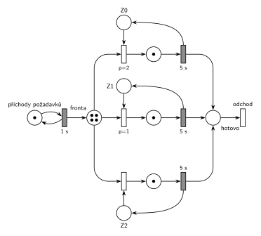

# DD3 FIFO, čas 9,5

## Zadání

> napsat next-event
>
> D/D/3 s FIFO frontou\
> v čase t=9,5: vypsat kalendář, fronty, petriho síť\
> vypsat události v čase 5

Podobné úlohy: [DD3 LIFO, čas 10,5](<../02 - DD3 LIFO, čas 10,5/02 - DD3 LIFO, čas 10,5.md>), [DD2 FIFO, čas 6,5](<../01 - DD2 FIFO, čas 6,5/01 - DD2 FIFO, čas 6,5.md>), [DD4 LIFO, čas 9,5](<../06 - DD4 LIFO, čas 9,5/06 - DD4 LIFO, čas 9,5.md>).

## Nápověda

<details>
<summary>Zobrazit nápovědu</summary>
<br>

- **Časy ve vzpomínce chybí.** Předpokládají se příchody od času 0 po **1 s** a obsluha **5 s**, jako u druhé skupiny téhož termínu („prichody 1s, obsluha 5s“) a u stejného zadání z roku 2016/17. Zbytek podle šablony: požadavky od P0, zařízení Z0–Z2 obsazovaná prioritně (nižší číslo dřív), všechny události se stejnou prioritou.
- **Příchody:** místo *příchody požadavků* s jednou značkou ve smyčce s časovaným přechodem `1 s`. První příchod P0 je v čase 0, každý příchod naplánuje další za 1 s.
- **Společná fronta:** jedno místo *fronta*, ze kterého vedou hrany k přechodům obsazení všech tří zařízení.
- **Petriho síť zachycuje jen počty**, ne pořadí ve frontě. Značení vyjde stejně jako v LIFO úloze [DD3 LIFO, čas 10,5](<../02 - DD3 LIFO, čas 10,5/02 - DD3 LIFO, čas 10,5.md>) v čase 10,5 (4 značky ve frontě, všechna zařízení obsazená). Liší se jen to, kdo je kde.
- **Zařízení obsazovaná prioritně:** každé zařízení je místo s jednou značkou (*Z0*, *Z1*, *Z2*) a má svůj okamžitý přechod obsazení s prioritou `p=2` (Z0), `p=1` (Z1) a `p=0` (Z2, implicitní).
- **Obsluha a uvolnění:** časovaný přechod `5 s` po skončení obsluhy vrací značku zařízení; uvolnění je s ním sloučené.
- **Odchod:** obsloužený požadavek přejde do místa *hotovo* a opouští systém přechodem *odchod* bez výstupních hran.
- **Pořadí událostí ve stejném čase:** dřív se provede událost, která byla **dřív naplánována**. V čase 5 nejdřív končí obsluha P0 (naplánovaná v čase 0), až pak přichází P5 (naplánovaný v čase 4). U FIFO to výsledný stav nezmění (z fronty jde stejně první P3), ale seznam událostí musí mít správné pořadí.

### Časový diagram (obsazení zařízení)

| zařízení | obsluhy |
|---|---|
| Z0 | P0 0–5, P3 5–10 |
| Z1 | P1 1–6, P4 6–11 |
| Z2 | P2 2–7, P5 7–12 |

Fronta: P3 čeká 3–5, P4 4–6, P5 5–7, P6 až P9 čekají od 6 až 9.

### Události provedené v čase 5

1. P0 uvolňuje Z0 a odchází
2. P3 vystupuje z fronty (FIFO – první) a obsazuje Z0; plánuje konec obsluhy P3 na Z0 v čase 10
3. příchod P5; plánuje příchod P6 v čase 6
4. P5 jde do fronty

Proč toto pořadí: konec obsluhy P0 byl naplánován v čase 0, příchod P5 až v čase 4. Při stejné prioritě rozhoduje pořadí naplánování.

### Kalendář v čase 9,5

| čas | událost |
|---|---|
| 10 | konec obsluhy P3 na Z0 (naplánováno v čase 5) |
| 10 | příchod P10 (naplánováno v čase 9) |
| 11 | konec obsluhy P4 na Z1 |
| 12 | konec obsluhy P5 na Z2 |

Fronta v čase 9,5 (od 1. prvku): P6, P7, P8, P9. Zařízení: Z0 – P3, Z1 – P4, Z2 – P5.

### Značení sítě v čase 9,5

- *příchody požadavků*: 1 značka (příchod P10 se právě odpočítává)
- *fronta*: 4 značky (P6, P7, P8, P9)
- *Z0*, *Z1*, *Z2*: 0 značek (všechna zařízení obsazená)
- místa obsluhy: po 1 značce (P3, P4, P5)

</details>

## Petriho síť

<details>
<summary>Zobrazit Petriho síť</summary>
<br>



</details>

## Časté chyby

<details>
<summary>Zobrazit časté chyby</summary>
<br>

- V kalendáři chybí příchod P10 nebo jsou dvě události v čase 10 obráceně. Konec obsluhy P3 byl naplánován v čase 5, příchod P10 v čase 9.
- Opačné pořadí v čase 5 (nejdřív příchod P5). Stav vyjde stejně, ale seznam událostí je špatně.
- Fronta vypsaná v obráceném pořadí. U FIFO je první P6, který půjde na zařízení jako další.
- Pořadí požadavků nakreslené v síti. Místo *fronta* nese jen počet (4).

</details>

## SIMLIB

<details>
<summary>Zobrazit SIMLIB kód</summary>
<br>

Model je izomorfní k Petriho síti výše: každé místo, přechod a značka mají svůj protějšek v kódu. Simulace běží do času 9,5 a vypíše frontu, obsazení zařízení a obsah kalendáře.

```cpp
// D/D/3 se společnou FIFO frontou – model v SIMLIB/C++
#include "simlib.h"

const int N = 3;                         // počet zařízení Z0, Z1, Z2
Facility Z[N];                           // místa Z0–Z2 (značka = volné zařízení)
Queue Fronta("fronta");                  // místo „fronta“ (společná FIFO fronta)

class Pozadavek : public Process {       // transakce = značka, která prochází sítí
 public:
  const int id;                          // číslo požadavku P0, P1, ...
  explicit Pozadavek(int n) : id(n) {}
  void Behavior() override {
    int k;                               // obsazení s prioritami p=2, 1, 0:
    for (;;) {                           // volné zařízení s nejnižším číslem
      for (k = 0; k < N && Z[k].Busy(); k++) {}
      if (k < N) break;
      Into(Fronta);                      // vše obsazeno: čeká v místě „fronta“
      Passivate();                       // (FIFO: na konec)
    }
    Seize(Z[k]);                         // obsazení: značka ze Zk do místa obsluhy
    Wait(5);                             // časovaný přechod 5 s ...
    Release(Z[k]);                       // ... který vrací značku do Zk
    if (!Fronta.Empty())                 // další z fronty (FIFO: nejdéle čekající)
      Fronta.GetFirst()->Activate();
  }                                      // místo „hotovo“ a přechod „odchod“
};

class Prichody : public Event {          // „příchody požadavků“ ⇄ přechod 1 s
 public:
  int n = 0;                             // číslo dalšího požadavku
  void Behavior() override {
    (new Pozadavek(n++))->Activate();    // příchod Pn: nová značka v místě „fronta“
    Activate(Time + 1);                  // plánuje další příchod za 1 s
  }
};
Prichody *Gen;

class Stav : public Event {              // výpis stavu v čase t po událostech
 public:
  Stav() : Event(-1) {}                  // nižší priorita než události modelu
  void Behavior() override {
    Print("Stav v čase %g\nfronta (od začátku, odkud se bere):", Time);
    for (Link *l : Fronta)
      Print(" P%d", static_cast<Pozadavek *>(l)->id);
    Print("\n");
    for (int k = 0; k < N; k++) {        // zařízení a v kalendáři konce obsluh
      auto *p = static_cast<Pozadavek *>(Z[k].In());
      if (p)
        Print("Z%d: P%d, konec obsluhy v %g\n", k, p->id, p->ActivationTime());
      else
        Print("Z%d: volné\n", k);
    }
    Print("v kalendáři příchod P%d v čase %g\n", Gen->n, Gen->ActivationTime());
  }
};

int main() {
  Init(0, 9.5);                          // čas v sekundách, běh do t = 9,5 s
  Gen = new Prichody;
  Gen->Activate();                       // příchod P0 v čase 0
  (new Stav)->Activate(9.5);
  Run();
}
```

| Petriho síť | SIMLIB |
|---|---|
| *příchody požadavků* ⇄ `1 s` | událost `Prichody`, která se znovu plánuje za 1 s; `n` čísluje požadavky P0, P1, … |
| značka (požadavek) | proces `Pozadavek` s číslem `id` |
| *fronta* | `Queue Fronta`: `Into(Fronta)` + `Passivate()` (FIFO, na konec), výběr `Fronta.GetFirst()->Activate()` |
| *Z0*, *Z1*, *Z2* (1 značka) | `Facility Z[N]` |
| obsazení s prioritami `p=2`, `p=1`, `p=0` | cyklus přes `Z[k].Busy()`: první volné zařízení od Z0 |
| místo obsluhy + časovaný přechod `5 s` se sloučeným uvolněním | `Seize(Z[k]); Wait(5); Release(Z[k]);` |
| *hotovo* + přechod *odchod* | konec metody `Behavior()` |
| značení v čase t | událost `Stav` s nižší prioritou, která proběhne po všech událostech v čase 9,5 |

**Kontrola simulací.** Petriho síť: síť se odsimuluje od času 0 (P0 ve *frontě*, zařízení volná) do času 9,5 a výsledné značení se musí shodovat s nakresleným; zařízení se vždy vrátí a *fronta* smí růst, protože systém není stabilní (`make check`). Seznam událostí a kalendář počítá `python3 -m pn.dd 3 fifo 1 5 5 9.5`. SIMLIB model vypíše v čase 9,5 frontu P6 P7 P8 P9, Z0 – P3 s koncem obsluhy v 10, Z1 – P4 v 11, Z2 – P5 ve 12 a příchod P10 v 10, tedy stejný stav a kalendář jako výše (`make simlib`). Kalendář SIMLIB obsluhuje události se stejným časem a prioritou v pořadí naplánování, stejně jako odpověď výše. Jediný rozdíl je v jemnějším dělení: P3 probuzený z fronty obsadí Z0 až ve své vlastní aktivaci, tedy po příchodu P5. P5 ale volné zařízení hledá až po něm, takže výsledek je stejný.

</details>

## Původ a zdroje

<details>
<summary>Zobrazit původ a zdroje</summary>
<br>

**Původ:** zkouška 2015/16, 1. termín, skupina 5H, otázka 1, 15 bodů. Stejné zadání bez zmínky o síti: zkouška 2016/17, 1. termín (jedna ze skupin: „D/D/3, FIFO, 1s, 5s, t=9,5s“). Zadání je známé jen ze studentské vzpomínky, původní zadání v podkladech není.

**Zdroje:**

- `Fitcheats/Zkoušky z minulých let/2015-16 - 1. termín.txt`, skupina 5H, otázka 1 (studentská vzpomínka); druhá skupina téhož souboru: „D/D/3, T=10.5, prichody 1s, obsluha 5s“
- `Fitcheats/Zkoušky z minulých let/2016-17 - 1. termín.txt`, druhá skupina, otázka 1 (stejné parametry, síť nezmíněna)

**Existující řešení:**

- K této úloze řešení v podkladech není. Síť je stejná jako v úloze [DD3 LIFO, čas 10,5](<../02 - DD3 LIFO, čas 10,5/02 - DD3 LIFO, čas 10,5.md>), kde jsou rozebraná studentská řešení.

</details>

## Reference

- [Jak síť funguje](<../../../basics/Jak síť funguje.md>)
- [Notace a vzory](<../../../basics/Notace a vzory.md>)

<!-- -->

- [Studijní plán](<../../Studijní plán.md>)
- [Seznam úloh](<../../Seznam úloh.md>)
