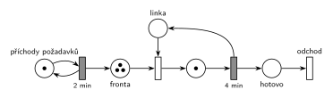

# DD1 – příchody 2, obsluha 4 (08/08)

## Zadání

> Mějme systém D/D/1 s intervaly mezi příchody přesně 2 minuty a délkou obsluhy přesně 4 minuty. Systém modelujte Petriho sítí. Zjistěte, zda je tento systém stabilní. Určete, ve kterých časových okamžicích dochází ke změně stavu systému až po čas TMAX=10 včetně. Do tabulky napište hodnoty stavových veličin systému ve zjištěných okamžicích změny stavu systému (po provedení všech událostí v daném čase). Tabulka nechť obsahuje: 1) čas, 2) délku fronty, 3) počet transakcí v obsluze.

Podobné úlohy: [DD1 – příchody 3, obsluha 2](<../09 - DD1 – příchody 3, obsluha 2/09 - DD1 – příchody 3, obsluha 2.md>) (skupina H, stabilní varianta), [DD2 FIFO, čas 6,5](<../01 - DD2 FIFO, čas 6,5/01 - DD2 FIFO, čas 6,5.md>).

## Nápověda

<details>
<summary>Zobrazit nápovědu</summary>
<br>

- **První příchod v čase 0.** Zadání ho neuvádí. Bere se konvence starších D/D/x zadání („Příchody požadavků začínají v čase 0“). Při jiném prvním příchodu se celá tabulka posune.
- **Příchody:** místo *příchody požadavků* s jednou značkou ve smyčce s časovaným přechodem `2 min`.
- **Linka:** jedna linka = místo *linka* s 1 značkou, obsazení okamžitým přechodem z místa *fronta*, obsluha časovaným přechodem `4 min`, který linku vrací. Obsloužený požadavek přejde do místa *hotovo* a opouští systém přechodem *odchod*.
- **Současné události:** v časech 4 a 8 končí obsluha a zároveň přichází další požadavek. Dřív se provede událost, která byla dřív naplánována: konec obsluhy (naplánovaný v čase 0, resp. 4) před příchodem (naplánovaným v čase 2, resp. 6). Tabulka ukazuje stav **po provedení všech událostí** v daném čase, takže na pořadí výsledek nezávisí a mezistavy (např. chvíle, kdy P0 odešel a P2 ještě nepřišel) se do ní nepíšou.
- **Časy 4 a 8:** počty (1 a 1, resp. 2 a 1) zůstanou stejné jako předtím, ale stav systému se změní: jeden požadavek odejde, další začne obsluhu a další přijde. Proto jsou tyto okamžiky v tabulce. Kdo chápe „stav“ jen jako dvojici (délka fronty, počet v obsluze), může je vynechat; je dobré to k tabulce napsat.
- **Stabilita:** λ = 1/2 za minutu, μ = 1/4 za minutu, ρ = λ/μ = 2 > 1. Systém **není stabilní**: přicházejí dva požadavky za dobu jedné obsluhy, fronta roste zhruba o 1 každé 4 minuty a nikdy se neustálí.
- **Značení:** zadání značení v žádném čase nežádá. Nakreslené je značení v čase TMAX = 10, aby šlo porovnat s posledním řádkem tabulky: značky ve *frontě* = délka fronty, značka v místě obsluhy = počet transakcí v obsluze, *linka* = 1 − počet v obsluze. Počáteční značení pro start v čase 0 je: *příchody požadavků* 1, *fronta* 1 (P0, který přichází v čase 0), *linka* 1.

### Časový diagram

| zařízení | obsluhy |
|---|---|
| linka | P0 0–4, P1 4–8, P2 8–12 |

Příchody: P0 v 0, P1 ve 2, P2 ve 4, P3 v 6, P4 v 8, P5 v 10.

### Stav po provedení všech událostí v daném čase

| čas [min] | délka fronty | v obsluze | události |
|---|---|---|---|
| 0 | 0 | 1 | příchod P0, P0 obsazuje linku |
| 2 | 1 | 1 | příchod P1, jde do fronty |
| 4 | 1 | 1 | P0 končí a odchází, P1 z fronty obsazuje linku, příchod P2 do fronty |
| 6 | 2 | 1 | příchod P3 do fronty |
| 8 | 2 | 1 | P1 končí a odchází, P2 obsazuje linku, příchod P4 do fronty |
| 10 | 3 | 1 | příchod P5 do fronty |

Stabilita: ρ = 4/2 = 2 > 1, systém **není stabilní** (fronta roste nade všechny meze).

### Značení sítě v čase TMAX = 10

- *příchody požadavků*: 1 značka (příchod P6 v čase 12 se odpočítává)
- *fronta*: 3 značky (P3, P4, P5)
- *linka*: 0 značek (obsazená)
- místo obsluhy: 1 značka (P2, obsluha 8–12)

</details>

## Petriho síť

<details>
<summary>Zobrazit Petriho síť</summary>
<br>



</details>

## Časté chyby

<details>
<summary>Zobrazit časté chyby</summary>
<br>

- Obrácené kritérium stability („interval 2 je menší než obsluha 4, tedy stabilní“). Rozhoduje ρ = λ/μ = obsluha / interval = 2 > 1.
- Chybějící řádek pro čas 0: P0 přichází hned na začátku a hned obsazuje linku.
- V čase 4 zapsaný mezistav (fronta 0 po odchodu P0) místo stavu po všech událostech.
- Požadavek, který právě skončil, započtený do „v obsluze“. V jednom okamžiku je v obsluze nejvýš 1 transakce.
- Síť bez vrácení značky *lince* po obsluze nebo bez výstupního přechodu.

</details>

## SIMLIB

<details>
<summary>Zobrazit SIMLIB kód</summary>
<br>

Model je izomorfní k Petriho síti výše: každé místo, přechod a značka mají svůj protějšek v kódu. Simulace běží do času TMAX = 10 včetně a po každém čase, ve kterém nastala událost, vypíše řádek tabulky.

```cpp
// D/D/1 (příchody po 2 min, obsluha 4 min) – model v SIMLIB/C++
#include "simlib.h"

Facility Linka("linka");                 // místo „linka“ (značka = volná linka);
                                         // vnitřní fronta zařízení = místo „fronta“
double Udalost = -1;                     // čas poslední události (změny stavu)

class Pozadavek : public Process {       // transakce = značka, která prochází sítí
  void Behavior() override {
    Udalost = Time;                      // příchod
    Seize(Linka);                        // fronta + obsazení linky
    Wait(4);                             // časovaný přechod 4 min ...
    Udalost = Time;                      // konec obsluhy
    Release(Linka);                      // ... který vrací značku lince
  }                                      // místo „hotovo“ a přechod „odchod“
};

class Prichody : public Event {          // „příchody požadavků“ ⇄ přechod 2 min
  void Behavior() override {
    (new Pozadavek)->Activate();         // příchod: nová značka v místě „fronta“
    Activate(Time + 2);                  // plánuje další příchod za 2 min
  }
};

class Tabulka : public Event {           // řádek tabulky po všech událostech v čase
 public:
  Tabulka() : Event(-1) {}               // nižší priorita než události modelu
  void Behavior() override {
    if (Udalost == Time)                 // v tomto čase se stav změnil
      Print("%4g | %12u | %9d\n", Time, Linka.QueueLen(), Linka.Busy() ? 1 : 0);
    Activate(Time + 1);                  // všechny události jsou v celých minutách
  }
};

int main() {
  Init(0, 10);                           // modelový čas v minutách, TMAX = 10 včetně
  Print(" čas | délka fronty | v obsluze\n");
  (new Prichody)->Activate();            // první příchod v čase 0
  (new Tabulka)->Activate();
  Run();
  Linka.Output();
}
```

| Petriho síť | SIMLIB |
|---|---|
| *příchody požadavků* ⇄ `2 min` | událost `Prichody`, která se znovu plánuje za 2 min |
| značka (požadavek) | proces `Pozadavek` |
| *fronta* + obsazení linky | `Seize(Linka)` (fronta je vnitřní FIFO fronta zařízení, `Linka.QueueLen()` je její délka) |
| *linka* (1 značka) | `Facility Linka` |
| místo obsluhy + časovaný přechod `4 min` se sloučeným uvolněním | `Wait(4); Release(Linka);` (`Linka.Busy()` = počet v obsluze) |
| *hotovo* + přechod *odchod* | konec metody `Behavior()` |
| stav po všech událostech v daném čase | událost `Tabulka` s nižší prioritou, která proběhne po všech událostech v každé celé minutě |

**Kontrola simulací.** Petriho síť: síť se odsimuluje od času 0 (P0 ve *frontě*, linka volná) do času 10 včetně událostí v čase 10 a výsledné značení se musí shodovat s nakresleným; *fronta* smí růst (`make check`). Simulace bez omezení času potvrzuje nestabilitu: na 2 000 příchodů připadá 1 000 obsluh. Tabulku počítá `python3 -m pn.dd table 1 fifo 2 4 10`. SIMLIB model vypíše stejné řádky jako tabulka výše (časy 0, 2, 4, 6, 8, 10 s délkou fronty 0, 1, 1, 2, 2, 3 a jednou transakcí v obsluze) a statistika linky ukazuje vytížení 1 a frontu délky 3 na konci: linka nemá ani chvilku volno a fronta roste, jak odpovídá ρ = 2 (`make simlib`).

</details>

## Původ a zdroje

<details>
<summary>Zobrazit původ a zdroje</summary>
<br>

**Původ:** zkouška 2022/23, 3. termín (3. 2. 2023), skupina G, otázka 1, 15 bodů.

**Původní znění:**

> Mějme systém D/D/1 s intervaly mezi příchody = 2 minuty a délkou obsluhy = 4 minuty. Systém modelujte Petriho sítí. Zjistěte, zda je tento systém stabilní. Určete, ve kterých časových okamžicích dochází ke změně stavu systému až po čas TMAX=10 včetně. Do tabulky napište hodnoty stavových veličin systému ve zjištěných okamžicích změny stavu systému (po provedení všech událostí v daném čase). Tabulka nechť obsahuje: 1) čas, 2) délku fronty, 3) počet transakcí v obsluze.

**Zdroje:**

- `Fitcheats/Zkoušky z minulých let/2022-23 - 3. termín G.pdf`, str. 1 (fotka zadání, rámeček na odpověď je prázdný)

**Existující řešení:**

- K této úloze řešení v podkladech není (rámeček na fotce je prázdný).

</details>

## Reference

- [Jak síť funguje](<../../../basics/Jak síť funguje.md>)
- [Notace a vzory](<../../../basics/Notace a vzory.md>)

<!-- -->

- [Studijní plán](<../../Studijní plán.md>)
- [Seznam úloh](<../../Seznam úloh.md>)
