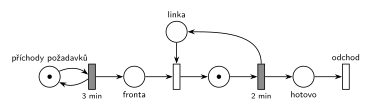

# DD1 – příchody 3, obsluha 2

Úloha 08/09

## Zadání

> Mějme systém D/D/1 s intervaly mezi příchody přesně 3 minuty a délkou obsluhy přesně 2 minuty. Systém modelujte Petriho sítí. Zjistěte, zda je tento systém stabilní. Určete, ve kterých časových okamžicích dochází ke změně stavu systému až po čas TMAX=10 včetně. Do tabulky napište hodnoty stavových veličin systému ve zjištěných okamžicích změny stavu systému (po provedení všech událostí v daném čase). Tabulka nechť obsahuje: 1) Čas 2) délku fronty 3) počet transakcí v obsluze.

Podobné úlohy: [DD1 – příchody 2, obsluha 4](<../08 - DD1 – příchody 2, obsluha 4/08 - DD1 – příchody 2, obsluha 4.md>) (skupina G, nestabilní varianta), [DD2 FIFO, čas 6,5](<../01 - DD2 FIFO, čas 6,5/01 - DD2 FIFO, čas 6,5.md>).

## Nápověda

<details>
<summary>Zobrazit nápovědu</summary>
<br>

- **První příchod v čase 0.** Zadání ho neuvádí. Bere se konvence starších D/D/x zadání („Příchody požadavků začínají v čase 0“). Při jiném prvním příchodu se celá tabulka posune.
- **Příchody:** místo *příchody požadavků* s jednou značkou ve smyčce s časovaným přechodem `3 min`.
- **Linka:** jedna linka = místo *linka* s 1 značkou, obsazení okamžitým přechodem z místa *fronta*, obsluha časovaným přechodem `2 min`, který linku vrací. Obsloužený požadavek přejde do místa *hotovo* a opouští systém přechodem *odchod*.
- **Současné události tu nenastávají:** obsluha (2 min) vždy skončí dřív, než přijde další požadavek (za 3 min). Každý požadavek tak hned obsadí volnou linku a fronta je pořád prázdná.
- **Čas 10:** v čase 10 žádná událost není (další jsou v 11 a 12), stav z času 9 trvá. Řádek pro čas 10 se dá připsat se stejnými hodnotami, změna stavu to ale není.
- **Stabilita:** λ = 1/3 za minutu, μ = 1/2 za minutu, ρ = λ/μ = 2/3 < 1. Systém **je stabilní**; linka je vytížená 2/3 času.
- **Značení:** zadání značení v žádném čase nežádá. Nakreslené je značení v čase TMAX = 10, aby šlo porovnat s posledním řádkem tabulky: značky ve *frontě* = délka fronty, značka v místě obsluhy = počet transakcí v obsluze, *linka* = 1 − počet v obsluze. Počáteční značení pro start v čase 0 je: *příchody požadavků* 1, *fronta* 1 (P0, který přichází v čase 0), *linka* 1.

### Časový diagram

| zařízení | obsluhy |
|---|---|
| linka | P0 0–2, P1 3–5, P2 6–8, P3 9–11 |

Příchody: P0 v 0, P1 ve 3, P2 v 6, P3 v 9 (další P4 až ve 12).

### Stav po provedení všech událostí v daném čase

| čas [min] | délka fronty | v obsluze | události |
|---|---|---|---|
| 0 | 0 | 1 | příchod P0, P0 obsazuje linku |
| 2 | 0 | 0 | P0 končí a odchází |
| 3 | 0 | 1 | příchod P1, P1 obsazuje linku |
| 5 | 0 | 0 | P1 končí a odchází |
| 6 | 0 | 1 | příchod P2, P2 obsazuje linku |
| 8 | 0 | 0 | P2 končí a odchází |
| 9 | 0 | 1 | příchod P3, P3 obsazuje linku |

Stabilita: ρ = 2/3 < 1, systém **je stabilní** (fronta zůstává prázdná).

### Značení sítě v čase TMAX = 10

- *příchody požadavků*: 1 značka (příchod P4 v čase 12 se odpočítává)
- *fronta*: 0 značek
- *linka*: 0 značek (obsazená)
- místo obsluhy: 1 značka (P3, obsluha 9–11)

</details>

## Petriho síť

<details>
<summary>Zobrazit Petriho síť</summary>
<br>



</details>

## Časté chyby

<details>
<summary>Zobrazit časté chyby</summary>
<br>

- Obrácené kritérium stability. Rozhoduje ρ = λ/μ = obsluha / interval = 2/3 < 1.
- Vynechané okamžiky konce obsluhy (2, 5, 8). I v nich se stav mění: počet v obsluze klesne na 0.
- Chybějící řádek pro čas 0: P0 přichází hned na začátku a hned obsazuje linku.
- Příchozí požadavek zapsaný do fronty, i když je linka volná. Délka fronty je pořád 0.
- Síť bez vrácení značky *lince* po obsluze nebo bez výstupního přechodu.

</details>

## SIMLIB

<details>
<summary>Zobrazit SIMLIB kód</summary>
<br>

Model je izomorfní k Petriho síti výše: každé místo, přechod a značka mají svůj protějšek v kódu. Simulace běží do času TMAX = 10 včetně a po každém čase, ve kterém nastala událost, vypíše řádek tabulky.

```cpp
// D/D/1 (příchody po 3 min, obsluha 2 min) – model v SIMLIB/C++
#include "simlib.h"

Facility Linka("linka");                 // místo „linka“ (značka = volná linka);
                                         // vnitřní fronta zařízení = místo „fronta“
double Udalost = -1;                     // čas poslední události (změny stavu)

class Pozadavek : public Process {       // transakce = značka, která prochází sítí
  void Behavior() override {
    Udalost = Time;                      // příchod
    Seize(Linka);                        // fronta + obsazení linky
    Wait(2);                             // časovaný přechod 2 min ...
    Udalost = Time;                      // konec obsluhy
    Release(Linka);                      // ... který vrací značku lince
  }                                      // místo „hotovo“ a přechod „odchod“
};

class Prichody : public Event {          // „příchody požadavků“ ⇄ přechod 3 min
  void Behavior() override {
    (new Pozadavek)->Activate();         // příchod: nová značka v místě „fronta“
    Activate(Time + 3);                  // plánuje další příchod za 3 min
  }
};

class Tabulka : public Event {           // řádek tabulky po všech událostech v čase
 public:
  Tabulka() : Event(-1) {}               // nižší priorita než události modelu
  void Behavior() override {
    if (Udalost == Time)                 // v tomto čase se stav změnil
      Print("%4g | %12u | %9d\n", Time, Linka.QueueLen(), Linka.Busy() ? 1 : 0);
    Activate(Time + 1);                  // všechny události jsou v celých minutách
  }
};

int main() {
  Init(0, 10);                           // modelový čas v minutách, TMAX = 10 včetně
  Print(" čas | délka fronty | v obsluze\n");
  (new Prichody)->Activate();            // první příchod v čase 0
  (new Tabulka)->Activate();
  Run();
  Linka.Output();
}
```

| Petriho síť | SIMLIB |
|---|---|
| *příchody požadavků* ⇄ `3 min` | událost `Prichody`, která se znovu plánuje za 3 min |
| značka (požadavek) | proces `Pozadavek` |
| *fronta* + obsazení linky | `Seize(Linka)` (fronta je vnitřní FIFO fronta zařízení, `Linka.QueueLen()` je její délka) |
| *linka* (1 značka) | `Facility Linka` |
| místo obsluhy + časovaný přechod `2 min` se sloučeným uvolněním | `Wait(2); Release(Linka);` (`Linka.Busy()` = počet v obsluze) |
| *hotovo* + přechod *odchod* | konec metody `Behavior()` |
| stav po všech událostech v daném čase | událost `Tabulka` s nižší prioritou, která proběhne po všech událostech v každé celé minutě |

**Kontrola simulací.** Petriho síť: síť se odsimuluje od času 0 (P0 ve *frontě*, linka volná) do času 10 a výsledné značení se musí shodovat s nakresleným. Navíc se kontroluje, že ve *frontě* po provedení okamžitých přechodů nikdy nic nezůstane (`make check`). Tabulku počítá `python3 -m pn.dd table 1 fifo 3 2 10`. SIMLIB model vypíše stejné řádky jako tabulka výše (časy 0, 2, 3, 5, 6, 8, 9; fronta vždy 0, v obsluze střídavě 1 a 0; čas 10 chybí, protože v něm žádná událost není). Vytížení linky za 0–10 je 0,7 (7 minut obsluhy z 10); dlouhodobě to je ρ = 2/3 (`make simlib`).

</details>

## Původ a zdroje

<details>
<summary>Zobrazit původ a zdroje</summary>
<br>

**Původ:** zkouška 2022/23, 3. termín, skupina H, otázka 1 (body v přepisu nejsou; ve skupině G má stejná otázka 15 bodů).

**Původní znění:**

> Mějme systém D/D/1 s intervaly mezi příchody = 3min a délkou obsluhy = 2min. Systém modelujte Petriho sítí. Zjistěte, zda je tento systém stabilní. Určete, ve kterých časových okamžicích dochází ke změně stavu systému až po čas TMAX=10 včetně. Do tabulky napište hodnoty stavových veličin systému ve zjištěných okamžicích změny stavu systému (po provedení všech událostí v daném čase). Tabulka nechť obsahuje: 1) Čas 2) délku fronty 3) počet transakcí v obsluze.

**Zdroje:**

- `Fitcheats/Zkoušky z minulých let/2022-23 - 3. termín H.pdf`, str. 1 (přepsané zadání bez hlavičky a číslování)

**Existující řešení:**

- K této úloze řešení v podkladech není.

</details>

## Reference

- [Jak síť funguje](<../../../basics/Jak síť funguje.md>)
- [Notace a vzory](<../../../basics/Notace a vzory.md>)

<!-- -->

- [Studijní plán](<../../Studijní plán.md>)
- [Seznam úloh](<../../Seznam úloh.md>)
