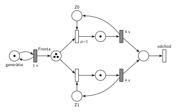

# 08–01 – D/D/2 s FIFO frontou, značení v čase 6,5

## Zadání

> Napište pseudokód algoritmu řízení diskrétní simulace typu next-event (nesmíte použít speciální ukončovací událost). POZOR: bude-li chybět, -5 bodů.
>
> Mějme model systému typu D/D/2 se společnou FIFO frontou. Příchody požadavků začínají v čase 0 s intervalem 1s a doba obsluhy trvá 4s. Simulace bude provedena pro čas od 0 do 99s. Požadavky číslujte od 0 podle pořadí příchodu. Neuvažujte priority transakcí (všechny jsou stejné). Zařízení (číslovaná od 0) jsou obsazována prioritně (nižší číslo = vyšší priorita). Události vhodně pojmenujte. Nakreslete si časový diagram činnosti simulátoru a pro čas t=6.5s:
>
> - Seznam událostí, provedených od začátku simulace (v pořadí jejich provedení)
> - Obsah kalendáře (bude-li chybět, -5 bodů)
> - Obsah fronty (v pořadí od 1. Prvku)
> - Nakreslete Petriho síť se značením odpovídající zadanému času t

Podobné úlohy: [08–02 – DD3 LIFO, čas 10,5](<../08–02 - DD3 LIFO, čas 10,5/08–02 - DD3 LIFO, čas 10,5.md>), [08–07 – DD3 FIFO, čas 9,5](<../08–07 - DD3 FIFO, čas 9,5/08–07 - DD3 FIFO, čas 9,5.md>), [08–05 – DD2 LIFO obsluha 4, čas 9,5](<../08–05 - DD2 LIFO obsluha 4, čas 9,5/08–05 - DD2 LIFO obsluha 4, čas 9,5.md>), [08–04 – DD2 LIFO obsluha 5, čas 9,5](<../08–04 - DD2 LIFO obsluha 5, čas 9,5/08–04 - DD2 LIFO obsluha 5, čas 9,5.md>).

## Interpretace

Zobrazit interpretaci (nápověda)

- **Petriho síť zachycuje jen počty**, ne pořadí ve frontě. FIFO se v síti neprojeví, projeví se jen v seznamu událostí (kdo jde z fronty na zařízení).
- **Zařízení obsazovaná prioritně:** dva okamžité přechody obsazení s prioritami `p=1` (Z0) a `p=0` (Z1, implicitní). Když jsou volná obě zařízení, vezme se Z0.
- **Pořadí událostí ve stejném čase:** priority transakcí se neuvažují, takže se dřív provede událost, která byla **dřív naplánována**. V čase 4 tedy nejdřív končí obsluha P0 (naplánovaná v čase 0), až pak přichází P4 (naplánovaný v čase 3). U FIFO fronty to výsledný stav nezmění (z fronty jde stejně první P2), ale seznam událostí musí mít správné pořadí.
- Generátor: první příchod P0 je v čase 0. Každý příchod naplánuje další za 1 s.
- Systém není stabilní: přichází 1 požadavek za sekundu, obsloužit se dají 2 za 4 s. Fronta roste.

## Petriho síť

Zobrazit Petriho síť

### Časový diagram (obsazení zařízení)

| zařízení | obsluhy |
|---|---|
| Z0 | P0 0–4, P2 4–8 |
| Z1 | P1 1–5, P3 5–9 |

Fronta: P2 čeká 2–4, P3 3–5, P4 od 4, P5 od 5, P6 od 6.

### Události provedené od začátku do času 6,5

| čas | událost |
|---|---|
| 0 | příchod P0; plánuje příchod P1 v čase 1 |
| 0 | P0 obsazuje Z0; plánuje konec obsluhy P0 na Z0 v čase 4 |
| 1 | příchod P1; plánuje příchod P2 v čase 2 |
| 1 | P1 obsazuje Z1; plánuje konec obsluhy P1 na Z1 v čase 5 |
| 2 | příchod P2; plánuje příchod P3 v čase 3 |
| 2 | P2 jde do fronty |
| 3 | příchod P3; plánuje příchod P4 v čase 4 |
| 3 | P3 jde do fronty |
| 4 | P0 uvolňuje Z0 a odchází |
| 4 | P2 vystupuje z fronty (FIFO – první) a obsazuje Z0; plánuje konec obsluhy P2 na Z0 v čase 8 |
| 4 | příchod P4; plánuje příchod P5 v čase 5 |
| 4 | P4 jde do fronty |
| 5 | P1 uvolňuje Z1 a odchází |
| 5 | P3 vystupuje z fronty (FIFO – první) a obsazuje Z1; plánuje konec obsluhy P3 na Z1 v čase 9 |
| 5 | příchod P5; plánuje příchod P6 v čase 6 |
| 5 | P5 jde do fronty |
| 6 | příchod P6; plánuje příchod P7 v čase 7 |
| 6 | P6 jde do fronty |

Proč toto pořadí v časech 4 a 5: konec obsluhy byl naplánován dřív (v čase 0, resp. 1) než příchod (v čase 3, resp. 4).

### Kalendář v čase 6,5

| čas | událost |
|---|---|
| 7 | příchod P7 |
| 8 | konec obsluhy P2 na Z0 |
| 9 | konec obsluhy P3 na Z1 |

Fronta v čase 6,5 (od 1. prvku): P4, P5, P6. Zařízení: Z0 – P2, Z1 – P3.

### Petriho síť se značením v čase 6,5

- *generátor*: 1 značka (příchod P7 se právě odpočítává)
- *Fronta*: 3 značky (P4, P5, P6)
- *Z0*, *Z1*: 0 značek (obě zařízení obsazená)
- místa obsluhy: po 1 značce (P2, P3)

Kontrola (`make check`): síť se odsimuluje od času 0 (P0 ve frontě, zařízení volná) do času 6,5 a výsledné značení se musí shodovat s nakresleným. Výpočet kalendáře a stavu: `python3 -m pn.dd 2 fifo 1 4 6 6.5`.

## Časté chyby

Zobrazit časté chyby

- Opačné pořadí v časech 4 a 5 (nejdřív příchod). Stav vyjde stejně, ale seznam událostí je špatně.
- V kalendáři chybí příchod P7: generátor ho naplánoval už v čase 6.
- Značky ve volných zařízeních *Z0*, *Z1*: v čase 6,5 jsou obě zařízení obsazená.
- Pořadí P4, P5, P6 nakreslené v síti. Místo *Fronta* nese jen počet (3).

## Původ a zdroje

**Původ:** zkouška 2012/13, 2. termín (1. opravný), skupina C, otázka 4, 15 bodů.

**Zdroje:**

- `Fitcheats/Zkoušky z minulých let/2012-13 - 2. termín C.pdf`, str. 1–2 (zadání)
- `Fitcheats/Příprava na zkoušku/Fituška - Řešené příklady 2016.pdf`, str. 7, a `Fitcheats/Příprava na zkoušku/xenix - Příprava.pdf`, str. 18 (řešený příklad se stejnou šablonou, ale s obsluhou 3 s a bez sítě)

**Existující řešení:**

Zobrazit existující řešení

- K této úloze řešení v podkladech není.
- **Fituška 2016, str. 7 (= xenix, str. 18):** řešený příklad D/D/2, čas 6,5, ale s obsluhou 3 s a bez Petriho sítě. Používá stejné pořadí událostí (v čase 3 nejdřív „konec obsluhy P0“, až pak „vygenerování P3“) a kalendář zapisuje se sloupcem priorita (např. „7 | 0 | P3→Release“). Dobrá předloha pro formu odpovědi; čísla se ale liší.

