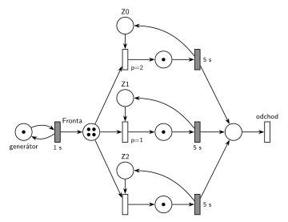

# 08–02 – D/D/3 s LIFO frontou, značení v čase 10,5

## Zadání

> Napište pseudokód algoritmu řízení diskrétní simulace typu "next-event" (nesmíte použít speciální ukončovací událost). POZOR: bude-li chybět, -5b. Mějme model systému typu D/D/3 se společnou LIFO frontou. Příchody požadavků začínají v čase 0 s intervalem přesně 1 sekundy a doba obsluhy trvá přesně 5 sekund. Simulace bude provedena pro čas od 0 do 99 sekund. Požadavky číslujte od 0 podle pořadí příchodu. Priorita všech událostí je 2 (Priority==2). Zařízení (číslovaná od 0) jsou obsazována prioritně (nižší číslo zařízení = vyšší priorita). Události vhodně pojmenujte (např. "P0 obsazuje Z0", "P2 jde do fronty"). Nakreslete časový diagram činnosti simulátoru a napište:
>
> - Seznam všech událostí provedených v čase t1 = 10. Podmínky: každá událost na zvláštní řádek, události musí být ve správném pořadí (napište PROČ toto pořadí, jinak -3b), a včetně všech provedených operací plánování do kalendáře (jinak -4b). Nepište žádné jiné události (jinak -1b).
> - Obsah kalendáře v čase t2 = 10.5 (POZOR: bude-li chybět, -5b).
> - Nakreslete Petriho síť systému se značením odpovídajícím času t2 = 10.5.

Podobné úlohy: [08–01 – DD2 FIFO, čas 6,5](<../08–01 - DD2 FIFO, čas 6,5/08–01 - DD2 FIFO, čas 6,5.md>), [08–03 – DD2 LIFO obsluha 6, čas 13,5](<../08–03 - DD2 LIFO obsluha 6, čas 13,5/08–03 - DD2 LIFO obsluha 6, čas 13,5.md>), [08–04 – DD2 LIFO obsluha 5, čas 9,5](<../08–04 - DD2 LIFO obsluha 5, čas 9,5/08–04 - DD2 LIFO obsluha 5, čas 9,5.md>), [08–05 – DD2 LIFO obsluha 4, čas 9,5](<../08–05 - DD2 LIFO obsluha 4, čas 9,5/08–05 - DD2 LIFO obsluha 4, čas 9,5.md>), [08–06 – DD4 LIFO, čas 9,5](<../08–06 - DD4 LIFO, čas 9,5/08–06 - DD4 LIFO, čas 9,5.md>), [08–07 – DD3 FIFO, čas 9,5](<../08–07 - DD3 FIFO, čas 9,5/08–07 - DD3 FIFO, čas 9,5.md>).

## Interpretace

<details>
<summary>Zobrazit interpretaci (nápověda)</summary>
<br>

- **Příchody:** místo *příchody požadavků* s jednou značkou ve smyčce s časovaným přechodem `1 s`. První příchod P0 je v čase 0, každý příchod naplánuje další za 1 s.
- **Společná fronta:** jedno místo *fronta*, ze kterého vedou hrany k přechodům obsazení všech tří zařízení.
- **Petriho síť zachycuje jen počty**, ne pořadí ve frontě. LIFO/FIFO se v síti neprojeví, projeví se jen v seznamu událostí (kdo jde z fronty na zařízení).
- **Zařízení obsazovaná prioritně:** každé zařízení je místo s jednou značkou (*Z0*, *Z1*, *Z2*) a má svůj okamžitý přechod obsazení s prioritou `p=2` (Z0), `p=1` (Z1) a `p=0` (Z2, implicitní). Vyšší číslo má přednost (slajd 132). Pokud je volných víc zařízení, vezme se Z0.
- **Obsluha a uvolnění:** časovaný přechod `5 s` po skončení obsluhy vrací značku zařízení; uvolnění je s ním sloučené.
- **Odchod:** obsloužený požadavek přejde do místa *hotovo* a opouští systém přechodem *odchod* bez výstupních hran.
- **Pořadí událostí ve stejném čase:** všechny mají stejnou prioritu (2), takže kalendář je pro stejný čas FIFO: dřív se provede událost, která byla **dřív naplánována**. V čase 10 tedy nejdřív končí obsluha P4 (naplánovaná v čase 5), až pak přichází P10 (naplánovaný v čase 9). Proto P9 jde na Z0 a P10 zůstává ve frontě.

### Časový diagram (obsazení zařízení)

| zařízení | obsluhy |
|---|---|
| Z0 | P0 0–5, P4 5–10, P9 10–15 |
| Z1 | P1 1–6, P5 6–11 |
| Z2 | P2 2–7, P6 7–12 |

Fronta: P3 čeká od 3 (pod ní se střídají novější), P4 jde v 5 na Z0, P5 v 6 na Z1, P6 v 7 na Z2, P9 v 10 na Z0.

### Události provedené v čase t1 = 10

1. P4 uvolňuje Z0 a odchází
2. P9 vystupuje z fronty (LIFO – poslední) a obsazuje Z0; plánuje konec obsluhy P9 na Z0 v čase 15
3. příchod P10; plánuje příchod P11 v čase 11
4. P10 jde do fronty

Proč toto pořadí: konec obsluhy P4 byl naplánován v čase 5, příchod P10 až v čase 9. Při stejné prioritě rozhoduje pořadí naplánování.

### Kalendář v čase t2 = 10,5

| čas | událost |
|---|---|
| 11 | konec obsluhy P5 na Z1 (naplánováno v čase 6) |
| 11 | příchod P11 (naplánováno v čase 10) |
| 12 | konec obsluhy P6 na Z2 |
| 15 | konec obsluhy P9 na Z0 |

Fronta v čase 10,5 (od nejstaršího): P3, P7, P8, P10. Zařízení: Z0 – P9, Z1 – P5, Z2 – P6.

### Značení sítě v čase 10,5

- *příchody požadavků*: 1 značka (příchod P11 se právě odpočítává)
- *fronta*: 4 značky (P3, P7, P8, P10)
- *Z0*, *Z1*, *Z2*: 0 značek (všechna zařízení obsazená)
- místa obsluhy: po 1 značce (P9, P5, P6)

### Varianty se stejnou sítí

- **xenix (t1 = 6):** P1 uvolňuje Z1 a odchází → P5 vystupuje z fronty a obsazuje Z1, plánuje konec v 11 → příchod P6, plánuje příchod P7 v 7 → P6 jde do fronty.
- **2014/15 skupina C (události v čase 5):** P0 uvolňuje Z0 a odchází → P4 vystupuje z fronty a obsazuje Z0, plánuje konec v 10 → příchod P5, plánuje příchod P6 v 6 → P5 jde do fronty.

Stav v čase 10,5 je v obou variantách stejný jako výše.

</details>

## Petriho síť

<details>
<summary>Zobrazit Petriho síť</summary>
<br>



</details>

## Časté chyby

<details>
<summary>Zobrazit časté chyby</summary>
<br>

- Značky ve frontě v pořadí nebo s čísly P3, P7, … přímo v síti. Síť zobrazuje jen počet.
- Prázdná místa obsluhy a značky ve volných zařízeních: v čase 10,5 jsou všechna tři zařízení obsazená.
- Opačné pořadí událostí v čase 10 (nejdřív příchod P10). Pak by P10 obsadil Z0 a ve frontě by zůstal P9.
- Zapomenuté plánování do kalendáře u každé události (-4 b).

</details>

## SIMLIB

<details>
<summary>Zobrazit SIMLIB kód</summary>
<br>

Model je izomorfní k Petriho síti výše: každé místo, přechod a značka mají svůj protějšek v kódu. Simulace běží do času t2 = 10,5 a vypíše frontu, obsazení zařízení a obsah kalendáře.

```cpp
// 08–02 D/D/3 se společnou LIFO frontou – model v SIMLIB/C++
#include "simlib.h"

const int N = 3;                         // počet zařízení Z0, Z1, Z2
Facility Z[N];                           // místa Z0–Z2 (značka = volné zařízení)
Queue Fronta("fronta");                  // místo „fronta“ (společná LIFO fronta)

class Pozadavek : public Process {       // transakce = značka, která prochází sítí
 public:
  const int id;                          // číslo požadavku P0, P1, ...
  explicit Pozadavek(int n) : id(n) {}
  void Behavior() override {
    int k;                               // obsazení s prioritami p=2, 1, 0:
    for (;;) {                           // volné zařízení s nejnižším číslem
      for (k = 0; k < N && Z[k].Busy(); k++) {}
      if (k < N) break;
      Fronta.InsFirst(this);             // vše obsazeno: čeká v místě „fronta“
      Passivate();                       // (LIFO: na začátek, odkud se bere)
    }
    Seize(Z[k]);                         // obsazení: značka ze Zk do místa obsluhy
    Wait(5);                             // časovaný přechod 5 s ...
    Release(Z[k]);                       // ... který vrací značku do Zk
    if (!Fronta.Empty())                 // další z fronty (LIFO: naposledy vložený)
      Fronta.GetFirst()->Activate();
  }                                      // místo „hotovo“ a přechod „odchod“
};

class Prichody : public Event {          // „příchody požadavků“ ⇄ přechod 1 s
 public:
  int n = 0;                             // číslo dalšího požadavku
  void Behavior() override {
    (new Pozadavek(n++))->Activate();    // příchod Pn: nová značka v místě „fronta“
    Activate(Time + 1);                  // plánuje další příchod za 1 s
  }
};
Prichody *Gen;

class Stav : public Event {              // výpis stavu v čase t2 po událostech
 public:
  Stav() : Event(-1) {}                  // nižší priorita než události modelu
  void Behavior() override {
    Print("Stav v čase %g\nfronta (od začátku, odkud se bere):", Time);
    for (Link *l : Fronta)
      Print(" P%d", static_cast<Pozadavek *>(l)->id);
    Print("\n");
    for (int k = 0; k < N; k++) {        // zařízení a v kalendáři konce obsluh
      auto *p = static_cast<Pozadavek *>(Z[k].In());
      if (p)
        Print("Z%d: P%d, konec obsluhy v %g\n", k, p->id, p->ActivationTime());
      else
        Print("Z%d: volné\n", k);
    }
    Print("v kalendáři příchod P%d v čase %g\n", Gen->n, Gen->ActivationTime());
  }
};

int main() {
  Init(0, 10.5);                         // čas v sekundách, běh do t2 = 10,5 s
  Gen = new Prichody;
  Gen->Activate();                       // příchod P0 v čase 0
  (new Stav)->Activate(10.5);
  Run();
}
```

| Petriho síť | SIMLIB |
|---|---|
| *příchody požadavků* ⇄ `1 s` | událost `Prichody`, která se znovu plánuje za 1 s; `n` čísluje požadavky P0, P1, … |
| značka (požadavek) | proces `Pozadavek` s číslem `id` |
| *fronta* | `Queue Fronta`: `Fronta.InsFirst(this)` + `Passivate()` (LIFO, na začátek), výběr `Fronta.GetFirst()->Activate()` |
| *Z0*, *Z1*, *Z2* (1 značka) | `Facility Z[N]` |
| obsazení s prioritami `p=2`, `p=1`, `p=0` | cyklus přes `Z[k].Busy()`: první volné zařízení od Z0 |
| místo obsluhy + časovaný přechod `5 s` se sloučeným uvolněním | `Seize(Z[k]); Wait(5); Release(Z[k]);` |
| *hotovo* + přechod *odchod* | konec metody `Behavior()` |
| značení v čase t2 | událost `Stav` s nižší prioritou, která proběhne po všech událostech v čase 10,5 |

**Kontrola simulací.** Petriho síť: síť se odsimuluje od času 0 (P0 ve *frontě*, zařízení volná) do času 10,5 a výsledné značení se musí shodovat s nakresleným; zařízení se vždy vrátí a *fronta* smí růst, protože systém není stabilní (`make check`). Seznam událostí a kalendář počítá `python3 -m pn.dd 3 lifo 1 5 10 10.5`. Priorita 2 ze zadání jen říká, že všechny události mají stejnou prioritu; v SIMLIB na to stačí výchozí priorita 0. SIMLIB model vypíše v čase 10,5 frontu P10 P8 P7 P3 (od začátku, odkud se bere, tedy obráceně než výše), Z0 – P9 s koncem obsluhy v 15, Z1 – P5 v 11, Z2 – P6 v 12 a příchod P11 v 11, tedy stejný stav a kalendář jako výše (`make simlib`). Kalendář SIMLIB obsluhuje události se stejným časem a prioritou v pořadí naplánování, stejně jako odpověď výše. Jediný rozdíl je v jemnějším dělení: P9 probuzený z fronty obsadí Z0 až ve své vlastní aktivaci, tedy po příchodu P10. P10 ale volné zařízení hledá až po něm, takže výsledek je stejný.

</details>

## Původ a zdroje

<details>
<summary>Zobrazit původ a zdroje</summary>
<br>

**Původ:** zkouška 2015/16, 3. termín (27. 1. 2016), skupina 5-A, otázka 1, 15 bodů. Stejné parametry má i zkouška 2014/15, 1. termín, skupina C.

**Původní znění:**

> Napište pseudokód algoritmu řízení diskrétní simulace typu "next-event" (nesmíte použít speciální ukončovací událost). POZOR: bude-li chybět, -5b. Mějme model systému typu D/D/3 se společnou LIFO frontou. Příchody požadavků začínají v čase 0 s intervalem 1s a doba obsluhy trvá 5s. Simulace bude provedena pro čas od 0 do 99s. Požadavky číslujte od 0 podle pořadí příchodu. Priorita všech událostí je 2 (Priority==2). Zařízení (číslovaná od 0) jsou obsazována prioritně (nižší číslo zařízení = vyšší priorita). Události vhodně pojmenujte (např. "P0 obsazuje Z0", "P2 jde do fronty"). Nakreslete časový diagram činnosti simulátoru a napište:
>
> - Seznam všech událostí provedených v čase t1 = 10. Podmínky: každá událost na zvláštní řádek, události musí být ve správném pořadí (napište PROČ toto pořadí, jinak -3b), a včetně všech provedených operací plánování do kalendáře (jinak -4b). Nepište žádné jiné události (jinak -1b).
> - Obsah kalendáře v čase t2 = 10.5 (POZOR: bude-li chybět, -5b).
> - Nakreslete Petriho síť systému se značením odpovídajícím času t2 = 10.5.

**Zdroje:**

- `Fitcheats/Zkoušky z minulých let/2016-17 - 3. termín A.pdf` (fotka zadání; podle hlavičky jde o 27. 1. 2016, tedy rok 2015/16)
- `Fitcheats/Zkoušky z minulých let/2014-15 - 1. termín.txt`, skupina C (stejné parametry, události v čase 5, stav v čase 10,5)
- `Fitcheats/Příprava na zkoušku/FIT - Příprava 2018-19.pdf`, str. 2–5 (studentské řešení včetně sítě)
- `Fitcheats/Příprava na zkoušku/xenix - Příprava.pdf`, str. 10–11 (varianta s t1 = 6, bez priorit událostí)

**Existující řešení:**

- **Příprava 2018-19, str. 2–5:** stejný kalendář (11 uvolnění Z1, 11 příchod P11, 12, 15) i fronta (P3, P7, P8, P10). V síti je generátor jen přechod `1s` bez místa a priority obsazení jsou `p=3, 2, 1`. To je ekvivalentní, záleží jen na pořadí priorit. Řešení má 20 souhlasů.
- **xenix, str. 10–11:** stejné značení, priority `p2, p1, (0)`. Chybí výstupní přechod, takže není vidět, kde transakce opouští systém. V seznamu událostí je omylem „FIFO poslední z fronty“, ačkoli fronta je LIFO.

</details>
