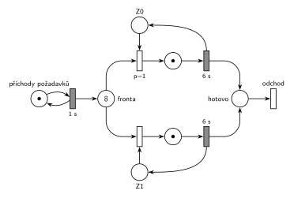

# 08–03 – D/D/2 s LIFO frontou, obsluha 6 s, značení v čase 13,5

## Zadání

> ⚠️ Text je z přepisu. Na fotce se dá přečíst, že v první odrážce stojí „provedených“, ne „plánovaných“ (stejně jako ve skupině 5-A), a zřejmě také „doba obsluhy“ a „nižší číslo zařízení = vyšší priorita“.

> Napište pseudokód algoritmu řízení diskrétní simulace typu “next-event” (nesmíte použít speciální ukončovací událost). POZOR: bude-li chybět, -5b. Mějme model systému typu D/D/2 se společnou LIFO frontou. Příchody požadavků začínají v čase 0 s intervalem 1s a délka obsluhy trvá 6s. Simulace bude provedena pro čas od 0 do 99s. Požadavky číslujte od 0 podle pořadí příchodů. Priorita všech událostí je 2 (Priority == 2). Zařízení (číslovaná od 0) jsou obsazována prioritně (nižší číslo zařízení s vyšší prioritou). Události vhodně pojmenujte (např. “P0 obsazuje Z0”, “P2 jde do fronty”). Nakreslete časový diagram činnosti simulátoru a napište:
>
> - Seznam všech událostí plánovaných v čase t1 = 12. Podmínky: každá událost na zvláštní řádek, události musí být ve správném pořadí (napište PROČ toto pořadí, jinak -3b) a včetně všech provedených operací plánování do kalendáře (jinak -5b). Nepište žádné jiné události, (jinak -1b).
> - Obsah kalendáře v čase t2 = 13,5 (POZOR: bude-li chybět, -5b).
> - Nakreslete Petriho síť systému se značením odpovídajícím času t2 = 13,5.

Podobné úlohy: [08–02 – DD3 LIFO, čas 10,5](<../08–02 - DD3 LIFO, čas 10,5/08–02 - DD3 LIFO, čas 10,5.md>), [08–04 – DD2 LIFO obsluha 5, čas 9,5](<../08–04 - DD2 LIFO obsluha 5, čas 9,5/08–04 - DD2 LIFO obsluha 5, čas 9,5.md>), [08–05 – DD2 LIFO obsluha 4, čas 9,5](<../08–05 - DD2 LIFO obsluha 4, čas 9,5/08–05 - DD2 LIFO obsluha 4, čas 9,5.md>), [08–01 – DD2 FIFO, čas 6,5](<../08–01 - DD2 FIFO, čas 6,5/08–01 - DD2 FIFO, čas 6,5.md>).

## Interpretace

Zobrazit interpretaci (nápověda)

- **„Provedených“, nebo „plánovaných“:** podle fotky jde o události **provedené** v čase 12, a to včetně operací plánování, které při nich proběhnou. Při čtení „plánovaných“ by se psaly jen ty dvě operace plánování (konec obsluhy P11 v 18, příchod P13 v 13). V seznamu níže jsou obsažené tak jako tak.
- **Petriho síť zachycuje jen počty**, ne pořadí ve frontě. LIFO se v síti neprojeví, projeví se jen v seznamu událostí.
- **Zařízení obsazovaná prioritně:** `p=1` (Z0) a `p=0` (Z1, implicitní). Když jsou volná obě, vezme se Z0.
- **Pořadí událostí ve stejném čase:** všechny mají prioritu 2, takže se dřív provede událost, která byla **dřív naplánována**. V čase 12 nejdřív končí obsluha P5 (naplánovaná v čase 6), až pak přichází P12 (naplánovaný v čase 11). Proto Z0 dostane P11 a P12 jde do fronty. Totéž v čase 13: konec obsluhy P6 (z času 7) před příchodem P13 (z času 12), takže Z1 dostane P12.
- Generátor: první příchod P0 je v čase 0. Každý příchod naplánuje další za 1 s.

## Petriho síť

Zobrazit Petriho síť

### Časový diagram (obsazení zařízení)

| zařízení | obsluhy |
|---|---|
| Z0 | P0 0–6, P5 6–12, P11 12–18 |
| Z1 | P1 1–7, P6 7–13, P12 13–19 |

Fronta: P2, P3, P4 čekají od 2, 3, 4 (pod nimi se střídají novější). P5 jde v 6 na Z0, P6 v 7 na Z1, P11 ve 12 na Z0, P12 ve 13 na Z1.

### Události provedené v čase t1 = 12

1. P5 uvolňuje Z0 a odchází
2. P11 vystupuje z fronty (LIFO – poslední) a obsazuje Z0; plánuje konec obsluhy P11 na Z0 v čase 18
3. příchod P12; plánuje příchod P13 v čase 13
4. P12 jde do fronty

Proč toto pořadí: konec obsluhy P5 byl naplánován v čase 6, příchod P12 až v čase 11. Při stejné prioritě rozhoduje pořadí naplánování.

### Kalendář v čase t2 = 13,5

| čas | událost |
|---|---|
| 14 | příchod P14 |
| 18 | konec obsluhy P11 na Z0 |
| 19 | konec obsluhy P12 na Z1 |

Fronta v čase 13,5 (od nejstaršího): P2, P3, P4, P7, P8, P9, P10, P13. Zařízení: Z0 – P11, Z1 – P12.

### Petriho síť se značením v čase 13,5

- *generátor*: 1 značka (příchod P14 se právě odpočítává)
- *Fronta*: 8 značek (v síti zapsáno číslem)
- *Z0*, *Z1*: 0 značek (obě zařízení obsazená)
- místa obsluhy: po 1 značce (P11, P12)

Kontrola (`make check`): síť se odsimuluje od času 0 (P0 ve frontě, zařízení volná) do času 13,5 a výsledné značení se musí shodovat s nakresleným. Výpočet událostí a kalendáře: `python3 -m pn.dd 2 lifo 1 6 12 13.5`.

## Časté chyby

Zobrazit časté chyby

- Opačné pořadí v čase 12 (nejdřív příchod P12). Pak by P12 obsadil Z0 a ve frontě by zůstal P11.
- Kalendář s událostí v čase 13 (konec obsluhy P6, příchod P13): ty už jsou v čase 13,5 provedené.
- Brát z LIFO fronty nejstarší požadavek (jako u FIFO). P2, P3 a P4 čekají od začátku a v čase 13,5 jsou ve frontě pořád.
- Zapomenuté plánování do kalendáře u událostí v čase 12.

## Původ a zdroje

Zobrazit původ a zdroje

**Původ:** zkouška 2015/16, 3. termín (27. 1. 2016), skupina 5-D, otázka 1, 15 bodů. Sesterská skupina 5-A je [08–02 – DD3 LIFO, čas 10,5](<../08–02 - DD3 LIFO, čas 10,5/08–02 - DD3 LIFO, čas 10,5.md>).

**Zdroje:**

- `Fitcheats/Zkoušky z minulých let/2016-17 - 3. termín D.pdf` (rozmazaná fotka zadání; podle hlavičky „skupina 5-D“, 27. 1. 2016, tedy rok 2015/16)
- `Fitcheats/Zkoušky z minulých let/2005-06 - Termín 27. 1. 2006 (5D).pdf`, str. 1 („přepis zadání zkoušky z hůře čitelné fotky“; stejná zkouška, rok 2006 v názvu je překlep)

**Existující řešení:**

- K této skupině řešení v podkladech není. Síť má stejný tvar jako studentská řešení sesterské skupiny 5-A ([08–02](<../08–02 - DD3 LIFO, čas 10,5/08–02 - DD3 LIFO, čas 10,5.md>)), jen se dvěma zařízeními.

