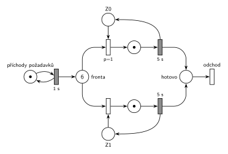

# 08–04 – D/D/2 s LIFO frontou, obsluha 5 s, značení v čase 9,5

## Zadání

> ⚠️ Zadání je opsané studentem (bez diakritiky), původní papír v podkladech není.

> Napiste pseudokod algoritmu razeni diskreni simulace typu "next-event" (nesmite pouzit specialni ukoncovaci udalost). POZOR: bude-li chybet, -5b.
>
> Mejme model systemu typu D/D/2 se spolecnou LIFO frontou. Prichody pozadavku zacinaji v case 0 s intervalem 1s a doba obsluhy trva 5s. Simulace bude provedena po cas od 0 do 99s. Pozadavky cislujte od 0 podle poradi prichodu. Neuvazujte priority transakcii (vsechny jsou stejne). Zarizeni (cislovana od 0) jsou obsazovana prioritne (nizsi cislo zarizeni = vyssi priorita). Udalosti vhodně pojmenujte (napr. "P0 obsazuje Z0", "P2 jde do fronty").
>
> Nakreslete casovy diagram cinnosti simulatoru a napiste:
>
> - Seznam vsech udalosti provedenych v case t1 = 6 Podminky: kazda na zvlastni radek, udalosti musi byt ve spravnem poradi (napiste PROC toto poradi, jinak -3b), a vcetne vsech provedenych operaci planovani do kalendare (jinak -4b). Nepiste zadne jine udalosti.
> - Obsah kalendare v case t2 = 9.5 (POZOR: bude-li chybet, -5b)
> - Nakreslete Petriho sit systemu se znacenim odpovidajicim casu t2 = 9.5

Zkouška 2014/15 (vzpomínka): „Next-event algoritmus. D/D/2 LIFO, prichod za 1 s, 5 s obsluha, od 0 do 99, prvni pozadavek v case 0. Nakreslit casovy diagram. t=9.5s Obsah fronty, Kalendare, zarizezni, nakreslit petri. Napsat udalosti v case 5“

Podobné úlohy: [08–05 – DD2 LIFO obsluha 4, čas 9,5](<../08–05 - DD2 LIFO obsluha 4, čas 9,5/08–05 - DD2 LIFO obsluha 4, čas 9,5.md>) (sesterská skupina A), [08–03 – DD2 LIFO obsluha 6, čas 13,5](<../08–03 - DD2 LIFO obsluha 6, čas 13,5/08–03 - DD2 LIFO obsluha 6, čas 13,5.md>), [08–02 – DD3 LIFO, čas 10,5](<../08–02 - DD3 LIFO, čas 10,5/08–02 - DD3 LIFO, čas 10,5.md>), [08–01 – DD2 FIFO, čas 6,5](<../08–01 - DD2 FIFO, čas 6,5/08–01 - DD2 FIFO, čas 6,5.md>).

## Interpretace

Zobrazit interpretaci (nápověda)

- **Petriho síť zachycuje jen počty**, ne pořadí ve frontě. LIFO se v síti neprojeví, projeví se jen v seznamu událostí.
- **Zařízení obsazovaná prioritně:** `p=1` (Z0) a `p=0` (Z1, implicitní). Když jsou volná obě, vezme se Z0.
- **Pořadí událostí ve stejném čase:** priority transakcí se neuvažují, takže se dřív provede událost, která byla **dřív naplánována**. V čase 6 nejdřív končí obsluha P1 (naplánovaná v čase 1), až pak přichází P6 (naplánovaný v čase 5). Proto Z1 dostane P5 a P6 jde do fronty.
- Generátor: první příchod P0 je v čase 0. Každý příchod naplánuje další za 1 s.

## Petriho síť

Zobrazit Petriho síť

### Časový diagram (obsazení zařízení)

| zařízení | obsluhy |
|---|---|
| Z0 | P0 0–5, P4 5–10 |
| Z1 | P1 1–6, P5 6–11 |

Fronta: P2 a P3 čekají od 2 a 3 (pod nimi se střídají novější). P4 jde v 5 na Z0, P5 v 6 na Z1, P6 až P9 přicházejí v 6 až 9 a čekají.

### Události provedené v čase t1 = 6

1. P1 uvolňuje Z1 a odchází
2. P5 vystupuje z fronty (LIFO – poslední) a obsazuje Z1; plánuje konec obsluhy P5 na Z1 v čase 11
3. příchod P6; plánuje příchod P7 v čase 7
4. P6 jde do fronty

Proč toto pořadí: konec obsluhy P1 byl naplánován v čase 1, příchod P6 až v čase 5. Při stejné prioritě rozhoduje pořadí naplánování.

### Kalendář v čase t2 = 9,5

| čas | událost |
|---|---|
| 10 | konec obsluhy P4 na Z0 (naplánováno v čase 5) |
| 10 | příchod P10 (naplánováno v čase 9) |
| 11 | konec obsluhy P5 na Z1 |

Fronta v čase 9,5 (od nejstaršího): P2, P3, P6, P7, P8, P9. Zařízení: Z0 – P4, Z1 – P5.

### Petriho síť se značením v čase 9,5

- *generátor*: 1 značka (příchod P10 se právě odpočítává)
- *Fronta*: 6 značek (v síti zapsáno číslem)
- *Z0*, *Z1*: 0 značek (obě zařízení obsazená)
- místa obsluhy: po 1 značce (P4, P5)

Kontrola (`make check`): síť se odsimuluje od času 0 (P0 ve frontě, zařízení volná) do času 9,5 a výsledné značení se musí shodovat s nakresleným. Výpočet událostí a kalendáře: `python3 -m pn.dd 2 lifo 1 5 6 9.5` (a `… 5 9.5` pro variantu 2014/15).

### Varianta 2014/15 (události v čase 5)

1. P0 uvolňuje Z0 a odchází
2. P4 vystupuje z fronty (LIFO – poslední) a obsazuje Z0; plánuje konec obsluhy P4 na Z0 v čase 10
3. příchod P5; plánuje příchod P6 v čase 6
4. P5 jde do fronty

Proč: konec obsluhy P0 byl naplánován v čase 0, příchod P5 v čase 4. Stav v čase 9,5 (fronta, kalendář, zařízení, síť) je stejný jako výše.

## Časté chyby

Zobrazit časté chyby

- Opačné pořadí v čase 6 (nejdřív příchod P6). Pak by P6 obsadil Z1 a ve frontě by zůstal P5.
- V kalendáři jen jedna událost v čase 10, nebo obě v opačném pořadí. Konec obsluhy P4 byl naplánován dřív (v čase 5) než příchod P10 (v čase 9).
- Brát z LIFO fronty nejstarší požadavek. P2 a P3 čekají od začátku a v čase 9,5 jsou ve frontě pořád.
- Zapomenuté plánování do kalendáře u událostí v čase 6.

## Původ a zdroje

Zobrazit původ a zdroje

**Původ:** zkouška 2015/16, 2. termín, skupina B (v souboru nadepsaná „Skupina A“, druhá skupina ze stejného souboru o sobě píše „to co B“), otázka 1, 15 bodů. Stejná úloha (jiný čas t1): zkouška 2014/15, 1. termín, skupina B (události v čase 5).

**Zdroje:**

- `Fitcheats/Zkoušky z minulých let/2015-16 - 2. termín.txt`, první skupina, otázka 1 (opsané zadání bez diakritiky)
- `Fitcheats/Zkoušky z minulých let/2014-15 - 1. termín.txt`, skupina B, otázka 1 (studentská vzpomínka)

**Existující řešení:**

- K této úloze řešení v podkladech není. Síť má stejný tvar jako studentská řešení úlohy [08–02](<../08–02 - DD3 LIFO, čas 10,5/08–02 - DD3 LIFO, čas 10,5.md>), jen se dvěma zařízeními.

